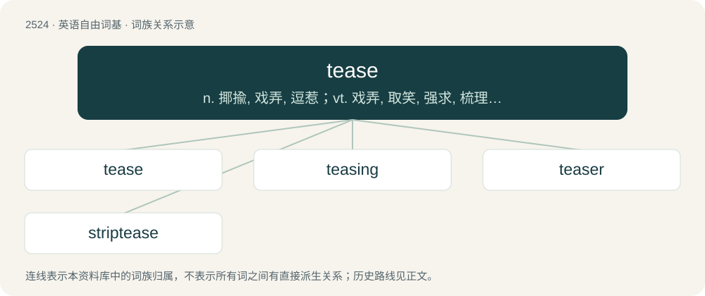

# 2628 · tease — n. 揶揄, 戏弄, 逗惹；vt. 戏弄, 取笑, 强求, 梳理, 使起毛

[总目录](../00_总目录_按常用程度.md)

**类型**：英语自由词基　｜　**来源语言**：见词源记录

## 核心含义与来源

- 核心含义：n. 揶揄, 戏弄, 逗惹；vt. 戏弄, 取笑, 强求, 梳理, 使起毛
- 英文含义：To separate the fibres of (a fibrous material).
- 词形：tease

**来源记录 1**（动词；To separate the fibres of (a fibrous material).）

From Middle English tesen, from Old English tǣsan (“to tease”), from Proto-West Germanic \*taisijan (“to separate, tug, shred”).

## 词族图

## 单词速览（常用到不常用）

| 单词 | 音标 | 释义 |
|---|---|---|
| [tease](#w-1) | /tiːz/ | n. 揶揄, 戏弄, 逗惹；vt. 戏弄, 取笑, 强求, 梳理, 使起毛 |
| [teasing](#w-2) | 英 /ˈtiːz.ɪŋ/；美 /ˈtiz.ɪŋ/ | \[医\] 针拨开法 |
| [teaser](#w-3) | 美 /ˈtiːzɚ/ | n. 戏弄者, 起绒机 |
| [striptease](#w-4) | 美 /ˈstɹɪpˌtiz/ | n. 脱衣舞；vi. 跳脱衣舞 |

## 逐词详解

### 1. tease

**词性**：动词　｜　**音标**：/tiːz/

**中文释义**：n. 揶揄, 戏弄, 逗惹；vt. 戏弄, 取笑, 强求, 梳理, 使起毛

**英文义项**：To separate the fibres of (a fibrous material). / To comb (originally with teasels) so that the fibres all lie in one direction.

**词源与演化**：

From Middle English tesen, from Old English tǣsan (“to tease”), from Proto-West Germanic \*taisijan (“to separate, tug, shred”).

**例句**：

> That grump is quick to blow his top when you tease him.

### 2. teasing

**词性**：名词　｜　**音标**：英 /ˈtiːz.ɪŋ/；美 /ˈtiz.ɪŋ/

**中文释义**：\[医\] 针拨开法

**英文义项**：The act of harassing someone playfully or maliciously, especially by ridicule; provoking someone with persistent annoyances; making fun of, making light of someone. / The act of removing tangles from one's hair with a comb.

**构词拆分**：tease + -ing

**词源与演化**：

From tease + -ing.

**例句**：

> The teasing of her curls took nearly an hour with the fine-tooth comb.

该用例对应义项：The act of removing tangles from one's hair with a comb.

### 3. teaser

**词性**：名词　｜　**音标**：美 /ˈtiːzɚ/

**中文释义**：n. 戏弄者, 起绒机

**英文义项**：One who teases or pokes fun. / A person or thing that teases.

**构词拆分**：tease + -er

**词源与演化**：

From tease + -er.

**例句**：

> The promo photos are pretty good, but the video teaser looks outdated.

### 4. striptease

**词性**：名词　｜　**音标**：美 /ˈstɹɪpˌtiz/

**中文释义**：n. 脱衣舞；vi. 跳脱衣舞

**英文义项**：The act of slowly taking off one's clothes to sexually arouse the viewer, often accompanied by music and in exchange for money.

**构词拆分**：From strip + tease.

**词源与演化**：

From strip + tease.

**例句**：

> I find striptease frustrating, as it doesn't often culminate in actual sex.
