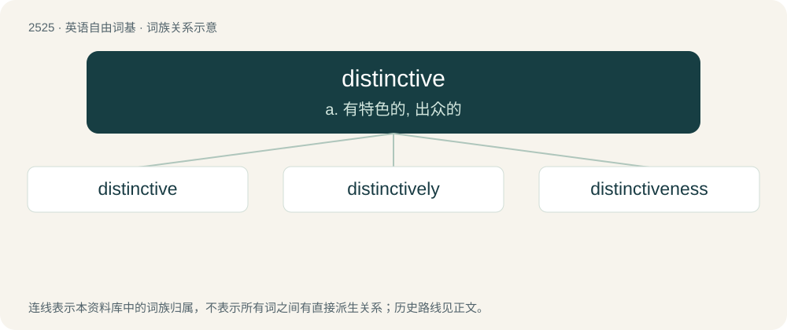

# 2629 · distinctive — a. 有特色的, 出众的

[总目录](../00_总目录_按常用程度.md)

**类型**：英语自由词基　｜　**来源语言**：见词源记录

## 核心含义与来源

- 核心含义：a. 有特色的, 出众的
- 英文含义：Distinguishing, used to or enabling the distinguishing of some thing.
- 词形：distinctive

**来源记录 1**（形容词；Distinguishing, used to or enabling the distinguishing of some thing.）

From Latin distinctus, perfect passive participle of distinguere (to push apart, to divide; see distinct) + -ive (forming adjectives signifying relation or tendency to). Cognate with French distinctif and Medieval Latin distinctivus.

## 词族图

## 单词速览（常用到不常用）

| 单词 | 音标 | 释义 |
|---|---|---|
| [distinctive](#w-1) | /dɪˈstɪŋktɪv/ | a. 有特色的, 出众的 |
| [distinctively](#w-2) | /dɪˈstɪŋktɪvlɪ/ | adv. 区别地, 特殊地 |
| [distinctiveness](#w-3) | 英 /dɪsˈtɪŋ(k)tɪvnɪs/ | 特殊\[独特\]性 |

## 逐词详解

### 1. distinctive

**词性**：形容词　｜　**音标**：/dɪˈstɪŋktɪv/

**中文释义**：a. 有特色的, 出众的

**英文义项**：Distinguishing, used to or enabling the distinguishing of some thing. / Discriminating, discerning, having the ability to distinguish between things.

**词源与演化**：

From Latin distinctus, perfect passive participle of distinguere (to push apart, to divide; see distinct) + -ive (forming adjectives signifying relation or tendency to). Cognate with French distinctif and Medieval Latin distinctivus.

**用法示例／搭配（非完整句）**：

> a product in distinctive packaging

该用例对应义项：Distinguishing, used to or enabling the distinguishing of some thing.

### 2. distinctively

**词性**：副词　｜　**音标**：/dɪˈstɪŋktɪvlɪ/

**中文释义**：adv. 区别地, 特殊地

**英文义项**：In a distinctive manner; in a way that is notable for its difference.

**构词拆分**：distinctive + -ly

**词源与演化**：

From distinctive + -ly.

**例句**：

> The distinctively conservative district of the county.

该用例对应义项：in an identifiably distinctive manner

### 3. distinctiveness

**词性**：名词　｜　**音标**：英 /dɪsˈtɪŋ(k)tɪvnɪs/

**中文释义**：特殊\[独特\]性

**英文义项**：The quality of being distinctive, individual or discrete. / Something which distinguishes something from anything else.

**构词拆分**：distinctive + -ness

**词源与演化**：

From distinctive + -ness.

**例句**：

> Furthermore, the frog’s external appearance and skeletal shape add to its distinctiveness.
