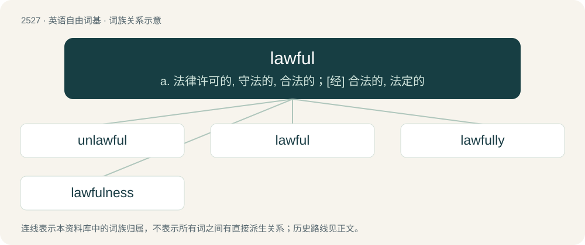

# 2632 · lawful — a. 法律许可的, 守法的, 合法的；\[经\] 合法的, 法定的

[总目录](../00_总目录_按常用程度.md)

**类型**：英语自由词基　｜　**来源语言**：见词源记录

## 核心含义与来源

- 核心含义：a. 法律许可的, 守法的, 合法的；\[经\] 合法的, 法定的
- 英文含义：Conforming to, or recognised by the laws of society.
- 词形：lawful

**来源记录 1**（形容词；Conforming to, or recognised by the laws of society.）

From Middle English laweful, equivalent to law + -ful, conflated with Middle English leful, leeful, leveful (“according to law, lawful, pertaining to law”). See also leveful.

## 词族图

## 单词速览（常用到不常用）

| 单词 | 音标 | 释义 |
|---|---|---|
| [unlawful](#w-1) | /.ʌnˈlɒːful/ | a. 非法的, 不正当的；\[法\] 不法, 不法的, 非法的 |
| [lawful](#w-2) | 英 /ˈlɔːfl̩/；美 /ˈlɔfl̩/ | a. 法律许可的, 守法的, 合法的；\[经\] 合法的, 法定的 |
| [lawfully](#w-3) |  | adv. 守法地；合法地 |
| [lawfulness](#w-4) | /ˈlɔːflnəs/ | 法制, 合法 |

## 逐词详解

### 1. unlawful

**词性**：形容词　｜　**音标**：/.ʌnˈlɒːful/

**中文释义**：a. 非法的, 不正当的；\[法\] 不法, 不法的, 非法的

**英文义项**：Prohibited; not permitted by law (either civil or criminal law; see illegal)

**构词拆分**：un- + lawful

**词源与演化**：

From Middle English unlawful; equivalent to un- + lawful.

**例句**：

> He was charged with unlawful use of a car.

该用例对应义项：Prohibited; not permitted by law (either civil or criminal law; see illegal)

### 2. lawful

**词性**：形容词　｜　**音标**：英 /ˈlɔːfl̩/；美 /ˈlɔfl̩/

**中文释义**：a. 法律许可的, 守法的, 合法的；\[经\] 合法的, 法定的

**英文义项**：Conforming to, or recognised by the laws of society. / Operating according to some law or fundamental principle.

**构词拆分**：law + -ful

**词源与演化**：

From Middle English laweful, equivalent to law + -ful, conflated with Middle English leful, leeful, leveful (“according to law, lawful, pertaining to law”). See also leveful.

**例句**：

> Lawful money is always a land asset and can only be issued by an actual land jurisdiction government — not a corporation.

该用例对应义项：Conforming to, or recognised by the laws of society.

### 3. lawfully

**词性**：副词

**中文释义**：adv. 守法地；合法地

**英文义项**：Conforming to the law; legally.

**构词拆分**：lawful + -ly

**词源与演化**：

From Middle English lawefully, lawfulliche, lawefulliche; equivalent to lawful + -ly.

**例句**：

> We are lawfully wedded now.

该用例对应义项：by law; conforming to the law

### 4. lawfulness

**词性**：名词　｜　**音标**：/ˈlɔːflnəs/

**中文释义**：法制, 合法

**英文义项**：Property of being lawful, of obeying the law. / Property of operating in a manner organized by certain laws, such as laws of nature.

**构词拆分**：lawful + -ness

**词源与演化**：

From Middle English laufulnes, lahfulnesse, equivalent to lawful + -ness.

**例句**：

> His extreme lawfulness made him righteous, but did it make him merciful?

该用例对应义项：Property of being lawful, of obeying the law.
