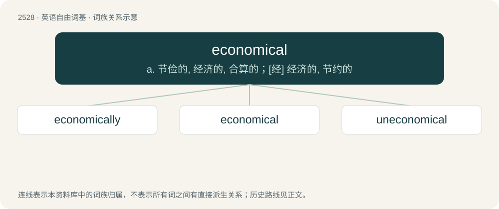

# 2633 · economical — a. 节俭的, 经济的, 合算的；\[经\] 经济的, 节约的

[总目录](../00_总目录_按常用程度.md)

**类型**：英语自由词基　｜　**来源语言**：见词源记录

## 核心含义与来源

- 核心含义：a. 节俭的, 经济的, 合算的；\[经\] 经济的, 节约的
- 英文含义：Careful with money so as not to spend too much; prudent; thrifty.
- 词形：economical

**来源记录 1**（形容词；Careful with money so as not to spend too much; prudent; thrifty.）

From economic + -al.

## 词族图

## 单词速览（常用到不常用）

| 单词 | 音标 | 释义 |
|---|---|---|
| [economically](#w-1) | 英 /ˌiː.kəˈnɒm.ɪ.kli/；美 /ˌɛk.əˈnɑ.mɪ.kli/ | adv. 节约地, 不浪费地, 节省地, 节俭地, 在经济上, 在经济学上 |
| [economical](#w-2) | 英 /ˌiː.kəˈnɒm.ɪ.kəl/；美 /ˌɛk.əˈnɑ.mɪ.kəl/ | a. 节俭的, 经济的, 合算的；\[经\] 经济的, 节约的 |
| [uneconomical](#w-3) | /ˈʌn,iːkəˈnɔmikəl/ | a. 不经济的, 浪费的 |

## 逐词详解

### 1. economically

**词性**：副词　｜　**音标**：英 /ˌiː.kəˈnɒm.ɪ.kli/；美 /ˌɛk.əˈnɑ.mɪ.kli/

**中文释义**：adv. 节约地, 不浪费地, 节省地, 节俭地, 在经济上, 在经济学上

**英文义项**：In an economical manner; not wastefully; not extravagantly. / From the perspective of economics or an economy.

**构词拆分**：economical + -ly

**词源与演化**：

From economical + -ly.

**例句**：

> The report highlights some of the main challenges facing Algeria economically?

### 2. economical

**词性**：形容词　｜　**音标**：英 /ˌiː.kəˈnɒm.ɪ.kəl/；美 /ˌɛk.əˈnɑ.mɪ.kəl/

**中文释义**：a. 节俭的, 经济的, 合算的；\[经\] 经济的, 节约的

**英文义项**：Careful with money so as not to spend too much; prudent; thrifty. / Saving money or resources.

**构词拆分**：economic + -al

**词源与演化**：

From economic + -al.

**例句**：

> The new, eco-friendly bicycle was an economical purchase.

该用例对应义项：Saving money or resources.

### 3. uneconomical

**词性**：形容词　｜　**音标**：/ˈʌn,iːkəˈnɔmikəl/

**中文释义**：a. 不经济的, 浪费的

**英文义项**：Not economical.

**构词拆分**：un- + economical

**词源与演化**：

From un- + economical.
