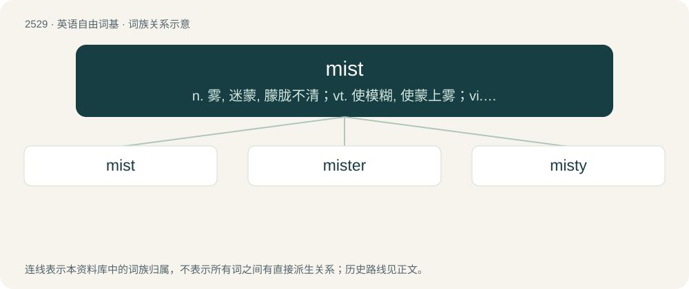

# 2634 · mist — n. 雾, 迷蒙, 朦胧不清；vt. 使模糊, 使蒙上雾；vi. 变模糊, 下雾

[总目录](../00_总目录_按常用程度.md)

**类型**：英语自由词基　｜　**来源语言**：见词源记录

## 核心含义与来源

- 核心含义：n. 雾, 迷蒙, 朦胧不清；vt. 使模糊, 使蒙上雾；vi. 变模糊, 下雾
- 英文含义：Water or other liquid finely suspended in air. (Compare fog, haze.)
- 词形：mist

**来源记录 1**（名词；Water or other liquid finely suspended in air. (Compare fog, haze.)）

The noun is from Middle English mist, from Old English mist (“mist; darkness; dimness (of eyesight)”), from Proto-Germanic \*mihstaz (“mist, fog”), from Proto-Indo-European \*h₃migʰstos, from the root \*h₃meygʰ- (“cloud, fog, drizzle”). Cognate with Scots mist (“mist, fog”), West Frisian mist (“mist”), Dutch mist (“mist”), Swedish mist (“mist, fog”), Icelandic mistur (“mist”), West Frisian miegelje (“to drizzle”), Dutch dialectal miggelen, miegelen (“to drizzle”), Lithuanian miglà (“fog”), Sanskrit मेघ (megha, “cloud”), Russian мгла (mgla, “fog, haze”). The verb is from Middle English misten, from Old English mistian.

## 词族图

## 单词速览（常用到不常用）

| 单词 | 音标 | 释义 |
|---|---|---|
| [mist](#w-1) | /mɪst/ | n. 雾, 迷蒙, 朦胧不清；vt. 使模糊, 使蒙上雾；vi. 变模糊, 下雾 |
| [mister](#w-2) | 英 /ˈmɪstə/；美 /ˈmɪstəɹ/ | 【英文】A device that makes or sprays mist. |
| [misty](#w-3) | /ˈmɪsti/ | a. 有雾的, 模糊的, 笼罩着雾的 |

## 逐词详解

### 1. mist

**词性**：名词　｜　**音标**：/mɪst/

**中文释义**：n. 雾, 迷蒙, 朦胧不清；vt. 使模糊, 使蒙上雾；vi. 变模糊, 下雾

**英文义项**：Water or other liquid finely suspended in air. (Compare fog, haze.) / A layer of fine droplets or particles.

**词源与演化**：

The noun is from Middle English mist, from Old English mist (“mist; darkness; dimness (of eyesight)”), from Proto-Germanic \*mihstaz (“mist, fog”), from Proto-Indo-European \*h₃migʰstos, from the root \*h₃meygʰ- (“cloud, fog, drizzle”). Cognate with Scots mist (“mist, fog”), West Frisian mist (“mist”), Dutch mist (“mist”), Swedish mist (“mist, fog”), Icelandic mistur (“mist”), West Frisian miegelje (“to drizzle”), Dutch dialectal miggelen, miegelen (“to drizzle”), Lithuanian miglà (“fog”), Sanskrit मेघ (megha, “cloud”), Russian мгла (mgla, “fog, haze”). The verb is from Middle English misten, from Old English mistian.

**例句**：

> It was difficult to see through the morning mist.

该用例对应义项：Water or other liquid finely suspended in air. (Compare fog, haze.)

### 2. mister

**词性**：名词　｜　**音标**：英 /ˈmɪstə/；美 /ˈmɪstəɹ/

**英文义项**：A device that makes or sprays mist.

**构词拆分**：mist + -er

**词源与演化**：

mist + -er

**例句**：

> Odessa D. uses a mister Sunday to fight the 106-degree heat at a NASCAR race in Fontana, California.

该用例对应义项：A device that makes or sprays mist.

### 3. misty

**词性**：形容词　｜　**音标**：/ˈmɪsti/

**中文释义**：a. 有雾的, 模糊的, 笼罩着雾的

**英文义项**：Covered in mist; foggy. / Dim; vague; obscure.

**构词拆分**：mist + -y

**词源与演化**：

From Middle English misty, mysty, misti, from Old English mistiġ (“misty, dark”), from Proto-West Germanic \*mistig (“misty”), equivalent to mist + -y. Cognate with Scots misty, mistie (“misty”), West Frisian mistich (“misty, foggy”), Dutch mistig (“misty, foggy”), German Low German mistig (“foggy”).

**例句**：

> Her eyes grew misty the night her long-time friend passed away.

该用例对应义项：With tears in the eyes; dewy-eyed.
