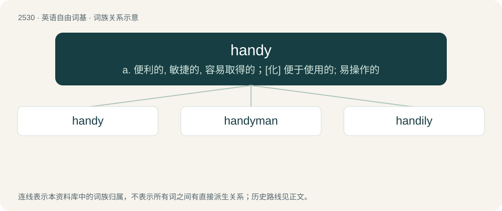

# 2635 · handy — a. 便利的, 敏捷的, 容易取得的；\[化\] 便于使用的; 易操作的

[总目录](../00_总目录_按常用程度.md)

**类型**：英语自由词基　｜　**来源语言**：见词源记录

## 核心含义与来源

- 核心含义：a. 便利的, 敏捷的, 容易取得的；\[化\] 便于使用的; 易操作的
- 英文含义：Easy to use, useful.
- 词形：handy

**多个词源／构词路径**：同一拼写可能有不同来源；以下按词性和含义分别列出。

**来源记录 1**（形容词；Easy to use, useful.）

From Middle English handy, hondi (attested in personal names), alteration of earlier hendi (“handy, skillful”), from Old English \*hendiġ (“skillful”) (attested in listhendiġ (“skilled in art”)), from Proto-West Germanic \*handīg, \*handag, \*handug, from Proto-Germanic \*handugaz (“handy, skillful, nimble”), from \*handuz (“hand”), equivalent to hand + -y. Cognate with Saterland Frisian jäntich (“handy”), Middle Low German handich (“skillful, apt”), Middle High German handec, hendec (“manual, hand-held”), Old Norse hǫndugr (“efficient”), Gothic 𐌷𐌰𐌽𐌳𐌿𐌲𐍃 (handugs, “wise, clever”). Akin to Dutch handig (“handy”), Norwegian hendig (“handy”), Swedish händig (“handy”).

**来源记录 2**（名词；The hand.）

From hand + -y (diminutive suffix).

**来源记录 3**（名词；A handgun.）

Clipping of handgun and hand job followed by -y (diminutive suffix).

**来源记录 4**（名词；(mostly used by Germans) Synonym of mobile phone.）

Disputed; see German Handy: according to some commentators, this meaning is originally from German (a condensed form of Handfunktelefon), whereas others claim there was an early, but now neglected, antetype of it in English (from etymology 1).

## 词族图

## 单词速览（常用到不常用）

| 单词 | 音标 | 释义 |
|---|---|---|
| [handy](#w-1) | /ˈhæn.di/ | a. 便利的, 敏捷的, 容易取得的；\[化\] 便于使用的; 易操作的 |
| [handyman](#w-2) | /ˈhændimæn/ | n. 杂务工, 手巧的人, 水手 |
| [handily](#w-3) | /ˈhændili/ | adv. 巧妙地, 敏捷地, 便利地 |

## 逐词详解

### 1. handy

**词性**：形容词　｜　**音标**：/ˈhæn.di/

**中文释义**：a. 便利的, 敏捷的, 容易取得的；\[化\] 便于使用的; 易操作的

**英文义项**：Easy to use, useful. / Nearby, within reach.

**构词拆分**：hand + -y

**词源与演化**：

From Middle English handy, hondi (attested in personal names), alteration of earlier hendi (“handy, skillful”), from Old English \*hendiġ (“skillful”) (attested in listhendiġ (“skilled in art”)), from Proto-West Germanic \*handīg, \*handag, \*handug, from Proto-Germanic \*handugaz (“handy, skillful, nimble”), from \*handuz (“hand”), equivalent to hand + -y. Cognate with Saterland Frisian jäntich (“handy”), Middle Low German handich (“skillful, apt”), Middle High German handec, hendec (“manual, hand-held”), Old Norse hǫndugr (“efficient”), Gothic 𐌷𐌰𐌽𐌳𐌿𐌲𐍃 (handugs, “wise, clever”). Akin to Dutch handig (“handy”), Norwegian hendig (“handy”), Swedish händig (“handy”).

**例句**：

> She's very handy: she made all her own kitchen cupboards.

该用例对应义项：Dexterous, skilful. (of a person)

### 2. handyman

**词性**：名词　｜　**音标**：/ˈhændimæn/

**中文释义**：n. 杂务工, 手巧的人, 水手

**英文义项**：A person who does small tasks and odd jobs, especially building repairs and the like.

**构词拆分**：handy + -man

**词源与演化**：

From handy + -man.

**例句**：

> I complained that the heat was not working, and the landlord sent the handyman to fix it.

该用例对应义项：A person who does small tasks and odd jobs, especially building repairs and the like.

### 3. handily

**词性**：副词　｜　**音标**：/ˈhændili/

**中文释义**：adv. 巧妙地, 敏捷地, 便利地

**英文义项**：In a handy manner; skillfully; conveniently. / Effortlessly; readily.

**构词拆分**：handy + -ly

**词源与演化**：

From handy + -ly. Compare Middle English hendily, hendiliche.

**例句**：

> He won the election handily.

该用例对应义项：Effortlessly; readily.
