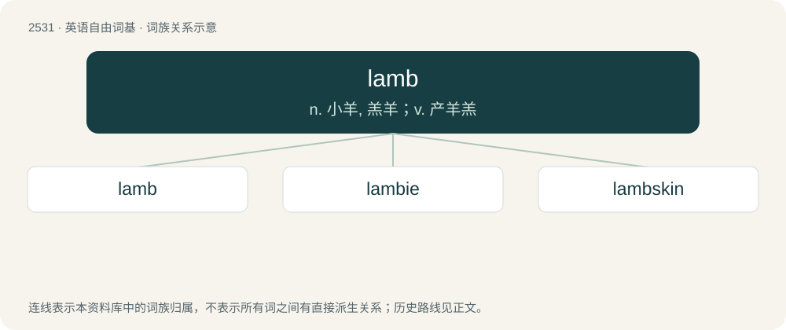

# 2636 · lamb — n. 小羊, 羔羊；v. 产羊羔

[总目录](../00_总目录_按常用程度.md)

**类型**：英语自由词基　｜　**来源语言**：见词源记录

## 核心含义与来源

- 核心含义：n. 小羊, 羔羊；v. 产羊羔
- 英文含义：A young sheep; especially, one younger than nine months.
- 词形：lamb

**来源记录 1**（名词；A young sheep; especially, one younger than nine months.）

From Middle English lamb, from Old English lamb, from Proto-West Germanic \*lamb, from Proto-Germanic \*lambaz, probably from Proto-Indo-European \*h₁l̥h₁onbʰos, enlargement of \*h₁elh₁én, ultimately from \*h₁el-. See also Dutch lam, German Lamm, Bavarian Lamperl, Danish lam, Swedish lamm, Finnish lammas, Scottish Gaelic lon (“elk”), Ancient Greek ἔλαφος (élaphos, “red deer”). More at elk.

## 词族图

## 单词速览（常用到不常用）

| 单词 | 音标 | 释义 |
|---|---|---|
| [lamb](#w-1) | 英 /ˈlæm/；美 /ˈlæm/ | n. 小羊, 羔羊；v. 产羊羔 |
| [lambie](#w-2) | /ˈlæmbik/ | n. &lt;昵&gt;乖乖,小宝贝儿 |
| [lambskin](#w-3) | /ˈlæmskin/ | n. 小羊皮, 羊皮纸 |

## 逐词详解

### 1. lamb

**词性**：名词　｜　**音标**：英 /ˈlæm/；美 /ˈlæm/

**中文释义**：n. 小羊, 羔羊；v. 产羊羔

**英文义项**：A young sheep; especially, one younger than nine months. / The flesh of a lamb used as food; (sometimes loosely) the flesh of a sheep of any age used as food.

**词源与演化**：

From Middle English lamb, from Old English lamb, from Proto-West Germanic \*lamb, from Proto-Germanic \*lambaz, probably from Proto-Indo-European \*h₁l̥h₁onbʰos, enlargement of \*h₁elh₁én, ultimately from \*h₁el-. See also Dutch lam, German Lamm, Bavarian Lamperl, Danish lam, Swedish lamm, Finnish lammas, Scottish Gaelic lon (“elk”), Ancient Greek ἔλαφος (élaphos, “red deer”). More at elk.

**例句**：

> Mark and Mark have raised some lambs for market, and they won a blue ribbon for quality at the fair.

该用例对应义项：A young sheep; especially, one younger than nine months.

### 2. lambie

**词性**：名词　｜　**音标**：/ˈlæmbik/

**中文释义**：n. &lt;昵&gt;乖乖,小宝贝儿

**英文义项**：A lamb.

**构词拆分**：lamb + -ie

**词源与演化**：

From lamb + -ie.

### 3. lambskin

**词性**：名词　｜　**音标**：/ˈlæmskin/

**中文释义**：n. 小羊皮, 羊皮纸

**英文义项**：The skin of a very young sheep, especially prepared with the fleece still attached. A very fine form of leather. / A kind of woollen cloth resembling this.

**构词拆分**：lamb + skin

**词源与演化**：

From lamb + skin.
