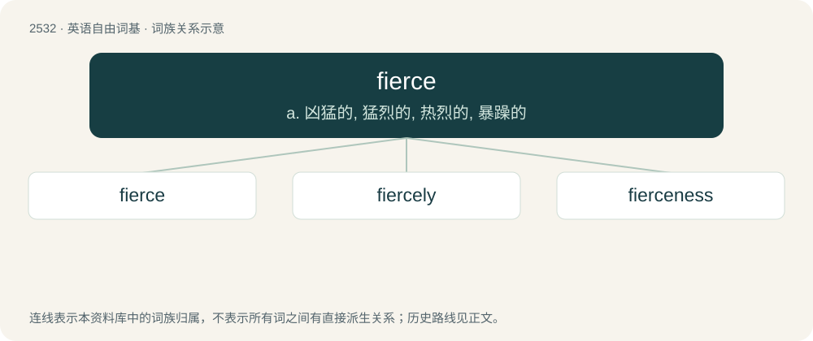

# 2637 · fierce — a. 凶猛的, 猛烈的, 热烈的, 暴躁的

[总目录](../00_总目录_按常用程度.md)

**类型**：英语自由词基　｜　**来源语言**：见词源记录

## 核心含义与来源

- 核心含义：a. 凶猛的, 猛烈的, 热烈的, 暴躁的
- 英文含义：Exceedingly violent, severe, ferocious, cruel or savage.
- 词形：fierce

**来源记录 1**（形容词；Exceedingly violent, severe, ferocious, cruel or savage.）

From Middle English fers, fiers, borrowed from Old French fers (“wild", "ferocious”), nominative of fer, from Latin ferus (“wild", "untamed”).

## 词族图

## 单词速览（常用到不常用）

| 单词 | 音标 | 释义 |
|---|---|---|
| [fierce](#w-1) | 英 /fɪəs/；美 /fɪɹs/ | a. 凶猛的, 猛烈的, 热烈的, 暴躁的 |
| [fiercely](#w-2) | 英 /ˈfɪəsli/；美 /ˈfɪɹsli/ | adv. 猛烈地, 厉害地 |
| [fierceness](#w-3) | /fɪəsnəs/ | n. 凶猛, 猛烈 |

## 逐词详解

### 1. fierce

**词性**：形容词　｜　**音标**：英 /fɪəs/；美 /fɪɹs/

**中文释义**：a. 凶猛的, 猛烈的, 热烈的, 暴躁的

**英文义项**：Exceedingly violent, severe, ferocious, cruel or savage. / Resolute or strenuously active.

**词源与演化**：

From Middle English fers, fiers, borrowed from Old French fers (“wild", "ferocious”), nominative of fer, from Latin ferus (“wild", "untamed”).

**例句**：

> Q: "How was the party last night?" A: "Fierce!"

该用例对应义项：Excellent, very good.

### 2. fiercely

**词性**：副词　｜　**音标**：英 /ˈfɪəsli/；美 /ˈfɪɹsli/

**中文释义**：adv. 猛烈地, 厉害地

**英文义项**：In a fierce manner. / Extremely; to a large degree.

**构词拆分**：fierce + -ly

**词源与演化**：

From Middle English fersly; equivalent to fierce + -ly.

**例句**：

> The wind blew fiercely and the rain fell heavily.

该用例对应义项：In a fierce manner.

### 3. fierceness

**词性**：名词　｜　**音标**：/fɪəsnəs/

**中文释义**：n. 凶猛, 猛烈

**英文义项**：The state of being fierce.

**构词拆分**：fierce + -ness

**词源与演化**：

From Middle English fersnesse; equivalent to fierce + -ness.
