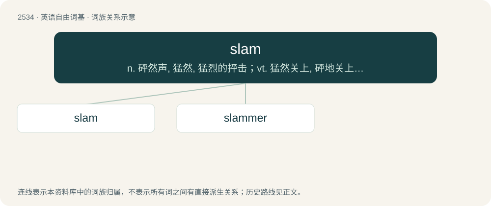

# 2638 · slam — n. 砰然声, 猛然, 猛烈的抨击；vt. 猛然关上, 砰地关上, 猛烈抨击；vi. 砰地关上, 猛攻

[总目录](../00_总目录_按常用程度.md)

**类型**：英语自由词基　｜　**来源语言**：见词源记录

## 核心含义与来源

- 核心含义：n. 砰然声, 猛然, 猛烈的抨击；vt. 猛然关上, 砰地关上, 猛烈抨击；vi. 砰地关上, 猛攻
- 英文含义：To shut with sudden force so as to produce a shock and noise.
- 词形：slam

**多个词源／构词路径**：同一拼写可能有不同来源；以下按词性和含义分别列出。

**来源记录 1**（动词；To shut with sudden force so as to produce a shock and noise.）

From Middle English \*slammen (not recorded), apparently from a Scandinavian source ultimately from Old Norse slæma, slœma (“to slam, swing a weapon, strike an object out of reach”), related to Old Norse slamra, slambra (“to slam”). Cognate with Norwegian Bokmål slamre (“to slam”), Swedish slamra (“to pound, beat, make a clatter, rattle”), Norwegian Nynorsk slamra (“to sway, dangle”).

**来源记录 2**（名词；A card game, played all at once without separate turns, in which players attempt to get rid of their cards as quickly as possible according to certain rules.）

Unknown and long-speculated, though perhaps at least reinforced by Etymology 1. Doublet of chelem.

## 词族图

## 单词速览（常用到不常用）

| 单词 | 音标 | 释义 |
|---|---|---|
| [slam](#w-1) | 英 /ˈslæm/；美 /ˈslæm/ | n. 砰然声, 猛然, 猛烈的抨击；vt. 猛然关上, 砰地关上, 猛烈抨击；vi. 砰地关上, 猛攻 |
| [slammer](#w-2) | 美 /ˈslæmɚ/ | \[法\] 监狱 |

## 逐词详解

### 1. slam

**词性**：动词　｜　**音标**：英 /ˈslæm/；美 /ˈslæm/

**中文释义**：n. 砰然声, 猛然, 猛烈的抨击；vt. 猛然关上, 砰地关上, 猛烈抨击；vi. 砰地关上, 猛攻

**英文义项**：To shut with sudden force so as to produce a shock and noise. / To put in or on a particular place with force and loud noise. (Often followed by a preposition such as down, against or into.)

**词源与演化**：

From Middle English \*slammen (not recorded), apparently from a Scandinavian source ultimately from Old Norse slæma, slœma (“to slam, swing a weapon, strike an object out of reach”), related to Old Norse slamra, slambra (“to slam”). Cognate with Norwegian Bokmål slamre (“to slam”), Swedish slamra (“to pound, beat, make a clatter, rattle”), Norwegian Nynorsk slamra (“to sway, dangle”).

**例句**：

> Don't ever slam me in front of the boss like that again!

该用例对应义项：To speak badly of; to criticize forcefully.

### 2. slammer

**词性**：名词　｜　**音标**：美 /ˈslæmɚ/

**中文释义**：\[法\] 监狱

**英文义项**：One who, or that which, slams. / Jail, prison.

**构词拆分**：From slam + -er.

**词源与演化**：

From slam + -er.

**例句**：

> She's a dramatic slammer of doors.

该用例对应义项：a person who closes things violently
