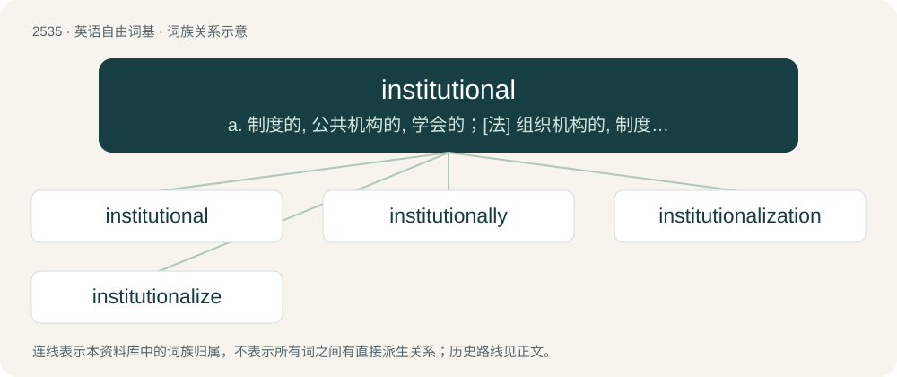

# 2640 · institutional — a. 制度的, 公共机构的, 学会的；\[法\] 组织机构的, 制度的, 公共机构的

[总目录](../00_总目录_按常用程度.md)

**类型**：英语自由词基　｜　**来源语言**：见词源记录

## 核心含义与来源

- 核心含义：a. 制度的, 公共机构的, 学会的；\[法\] 组织机构的, 制度的, 公共机构的
- 英文含义：Of, pertaining to, characteristic of, or organized along the lines of an institution.
- 词形：institutional

**来源记录 1**（形容词；Of, pertaining to, characteristic of, or organized along the lines of an institution.）

From institution + -al.

## 词族图

## 单词速览（常用到不常用）

| 单词 | 音标 | 释义 |
|---|---|---|
| [institutional](#w-1) | 英 /ˌɪn.stɪˈtjuː.ʃə.nəl/；美 /ˌɪn.stɪˈtju.ʃə.nəl/ | a. 制度的, 公共机构的, 学会的；\[法\] 组织机构的, 制度的, 公共机构的 |
| [institutionally](#w-2) | 英 /ˌɪnstɪˈtjuʃənəli/；美 /ˌɪnstɪˈtjuʃənəli/ | adv. institutional的变形 |
| [institutionalization](#w-3) | /ˌɪnstɪˌtjuːʃnəlaɪˈzeɪʃən/ | \[法\] 制度化 |
| [institutionalize](#w-4) | /ˌɪnstɪˈtjuːʃənəˌlaɪz/ | vt. 使制度化, 使成为惯常的行为, 使一成不变, 把...送进疯人院 |

## 逐词详解

### 1. institutional

**词性**：形容词　｜　**音标**：英 /ˌɪn.stɪˈtjuː.ʃə.nəl/；美 /ˌɪn.stɪˈtju.ʃə.nəl/

**中文释义**：a. 制度的, 公共机构的, 学会的；\[法\] 组织机构的, 制度的, 公共机构的

**英文义项**：Of, pertaining to, characteristic of, or organized along the lines of an institution. / Instituted by authority.

**构词拆分**：From institution + -al.

**词源与演化**：

From institution + -al.

**用法示例／搭配（非完整句）**：

> institutional ruling

该用例对应义项：Instituted by authority.

### 2. institutionally

**词性**：副词　｜　**音标**：英 /ˌɪnstɪˈtjuʃənəli/；美 /ˌɪnstɪˈtjuʃənəli/

**中文释义**：adv. institutional的变形

**英文义项**：In an institutional manner. / Throughout an institution.

**构词拆分**：institutional + -ly

**词源与演化**：

From institutional + -ly.

**例句**：

> Institutionally, a major restraint is the copyright problem.

### 3. institutionalization

**词性**：名词　｜　**音标**：/ˌɪnstɪˌtjuːʃnəlaɪˈzeɪʃən/

**中文释义**：\[法\] 制度化

**英文义项**：The process of establishing a practice as a norm. / The process of committing a person to a facility where their freedom to leave will be restrained, usually a mental hospital.

**构词拆分**：institutional + -ization

**词源与演化**：

From institutional + -ization.

**例句**：

> The government began the institutionalization of background checks for internet users.

该用例对应义项：The process of establishing a practice as a norm.

### 4. institutionalize

**词性**：动词　｜　**音标**：/ˌɪnstɪˈtjuːʃənəˌlaɪz/

**中文释义**：vt. 使制度化, 使成为惯常的行为, 使一成不变, 把...送进疯人院

**英文义项**：To establish as a normal practice. / To commit a person to confinement in an institution.

**构词拆分**：institutional + -ize

**词源与演化**：

From institutional + -ize.

**例句**：

> We need to institutionalize the testing of organic products.
