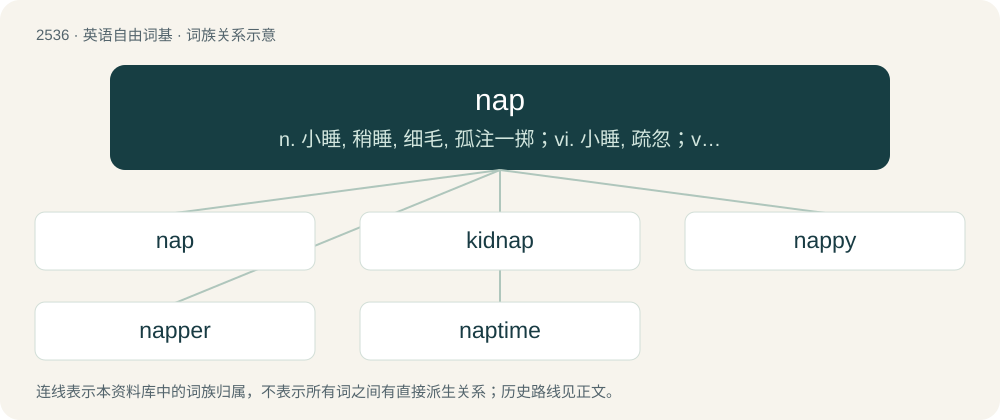

# 2641 · nap — n. 小睡, 稍睡, 细毛, 孤注一掷；vi. 小睡, 疏忽；vt. 使拉毛, 打盹度过, 预测...为获胜马

[总目录](../00_总目录_按常用程度.md)

**类型**：英语自由词基　｜　**来源语言**：见词源记录

## 核心含义与来源

- 核心含义：n. 小睡, 稍睡, 细毛, 孤注一掷；vi. 小睡, 疏忽；vt. 使拉毛, 打盹度过, 预测...为获胜马
- 英文含义：To have a nap; to sleep for a short period of time, especially during the day.
- 词形：nap

**多个词源／构词路径**：同一拼写可能有不同来源；以下按词性和含义分别列出。

**来源记录 1**（动词；To have a nap; to sleep for a short period of time, especially during the day.）

From Middle English nappen, from Old English hnappian (“to doze, slumber, sleep”), from Proto-West Germanic \*hnappōn (“to nap”). Cognate with Old High German hnaffezan, hnaffezzan (whence Middle High German nafzen (“to slumber”) whence German dialectal napfezen, nafzen (“to nod, slumber, nap”)).

**来源记录 2**（名词；A short period of sleep, especially one during the day.）

From Middle English nap, from the verb nappen.

**来源记录 3**（名词；A soft or fuzzy surface, generally on fabric or leather.）

From late Middle English noppe, nappe, from Middle Dutch and Middle Low German noppe, noppen (“to trim the nap”), ultimately from knappen (“to eat, crack”), of imitative origin. Related to the first element of knapsack.

**来源记录 4**（名词；A type of bet in British horse racing, based on the experts' best tips.）

From the name of the French emperor Napoleon I of France.

**来源记录 5**（动词；To cover (something) with a sauce. (usually in the passive)）

From French napper, from nappe (“nape”).

**来源记录 6**（名词；A cup, bowl.）

From Middle English nap (“a bowl”), from Old English hnæpp (“a cup, bowl”), from Proto-West Germanic \*hnapp, from Proto-Germanic \*hnappaz (“a cup, bowl”). Cognate with Dutch nap (“drinking cup”), Low German Napp (“bowl, cup”), German Napf (“bowl”), Icelandic hnappur (“button, key”). Doublet of hanap. See also nappy.

## 词族图

## 单词速览（常用到不常用）

| 单词 | 音标 | 释义 |
|---|---|---|
| [nap](#w-1) | 英 /næp/ | n. 小睡, 稍睡, 细毛, 孤注一掷；vi. 小睡, 疏忽；vt. 使拉毛, 打盹度过, 预测...为获胜马 |
| [kidnap](#w-2) | /ˈkɪdnæp/ | vt. 绑架, 诱拐, 拐骗；\[法\] 拐带, 诱拐, 绑架 |
| [nappy](#w-3) | /ˈnæpi/ | 【英文】Having a nap (of cloth etc.); downy; shaggy. |
| [napper](#w-4) | /ˈnæpə/ | n. 打盹的人, 拉毛工人 |
| [naptime](#w-5) |  | 【英文】The time when one takes a short sleep. |

## 逐词详解

### 1. nap

**词性**：动词　｜　**音标**：英 /næp/

**中文释义**：n. 小睡, 稍睡, 细毛, 孤注一掷；vi. 小睡, 疏忽；vt. 使拉毛, 打盹度过, 预测...为获胜马

**英文义项**：To have a nap; to sleep for a short period of time, especially during the day. / To be off one's guard.

**词源与演化**：

From Middle English nappen, from Old English hnappian (“to doze, slumber, sleep”), from Proto-West Germanic \*hnappōn (“to nap”). Cognate with Old High German hnaffezan, hnaffezzan (whence Middle High German nafzen (“to slumber”) whence German dialectal napfezen, nafzen (“to nod, slumber, nap”)).

**例句**：

> Feeling tired after his walk in the country, he took a nap.

### 2. kidnap

**词性**：动词　｜　**音标**：/ˈkɪdnæp/

**中文释义**：vt. 绑架, 诱拐, 拐骗；\[法\] 拐带, 诱拐, 绑架

**英文义项**：To seize or detain a person unlawfully and move or conceal them; sometimes for ransom.

**构词拆分**：kid + nap (“to nab; to grab”)

**词源与演化**：

From kid + nap (“to nab; to grab”). Originally Thieves' cant, referring to the practice of stealing children and shipping them to colonies or plantations as laborers. First attested c. 1680.

**例句**：

> You thought you were going to kidnap the kid, didn't you?

### 3. nappy

**词性**：形容词　｜　**音标**：/ˈnæpi/

**英文义项**：Having a nap (of cloth etc.); downy; shaggy. / Of hair: tightly curled or twisted; frizzy (often specifically in reference to Afro textured hair)

**构词拆分**：nap + -y

**词源与演化**：

From nap + -y.

### 4. napper

**词性**：名词　｜　**音标**：/ˈnæpə/

**中文释义**：n. 打盹的人, 拉毛工人

**英文义项**：A person who takes a nap. / The head.

**构词拆分**：nap + -er

**词源与演化**：

From nap + -er.

### 5. naptime

**词性**：名词

**英文义项**：The time when one takes a short sleep.

**构词拆分**：nap + time

**词源与演化**：

From nap + time.
