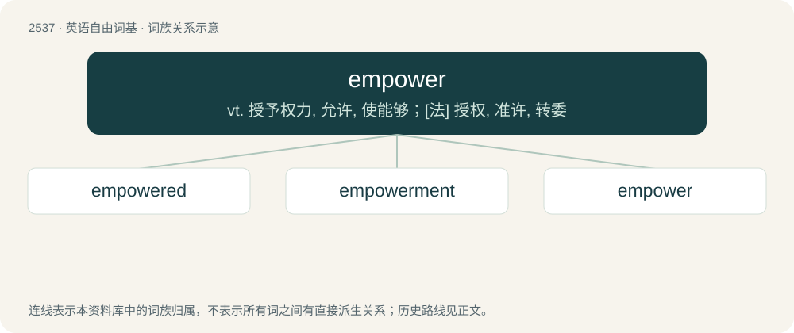

# 2642 · empower — vt. 授予权力, 允许, 使能够；\[法\] 授权, 准许, 转委

[总目录](../00_总目录_按常用程度.md)

**类型**：英语自由词基　｜　**来源语言**：见词源记录

## 核心含义与来源

- 核心含义：vt. 授予权力, 允许, 使能够；\[法\] 授权, 准许, 转委
- 英文含义：To give permission, power, or the legal right to do something.
- 词形：empower

**来源记录 1**（动词；To give permission, power, or the legal right to do something.）

From em- + power.

## 词族图

## 单词速览（常用到不常用）

| 单词 | 音标 | 释义 |
|---|---|---|
| [empowered](#w-1) | /emˈpaʊəd/ | v. 授权( empower的过去式和过去分词 ); 准许; 增加（某人的）自主权; 使控制局势 |
| [empowerment](#w-2) | /ɪmˈpaʊ.əɹ.mənt/ | n. 授权; 许可 |
| [empower](#w-3) | 英 /ɪmˈpaʊ.ə/；美 /ɪmˈpaʊ.əɹ/ | vt. 授予权力, 允许, 使能够；\[法\] 授权, 准许, 转委 |

## 逐词详解

### 1. empowered

**词性**：形容词　｜　**音标**：/emˈpaʊəd/

**中文释义**：v. 授权( empower的过去式和过去分词 ); 准许; 增加（某人的）自主权; 使控制局势

**英文义项**：Having been given powers. / Having been given the power to make choices relevant to one's situation.

**构词拆分**：empower + -ed

**词源与演化**：

From empower + -ed.

**例句**：

> When you know yourself you are empowered. When you accept yourself you are invincible.

### 2. empowerment

**词性**：名词　｜　**音标**：/ɪmˈpaʊ.əɹ.mənt/

**中文释义**：n. 授权; 许可

**英文义项**：The achievement of political, social or economic power by an individual or group. / The process of supporting another person or persons to discover and claim personal power.

**构词拆分**：empower + -ment

**词源与演化**：

From empower + -ment.

**例句**：

> Stereotypical beliefs about femininity hinder women's empowerment and limit their opportunities for growth.

### 3. empower

**词性**：动词　｜　**音标**：英 /ɪmˈpaʊ.ə/；美 /ɪmˈpaʊ.əɹ/

**中文释义**：vt. 授予权力, 允许, 使能够；\[法\] 授权, 准许, 转委

**英文义项**：To give permission, power, or the legal right to do something. / To give someone more confidence and/or strength to do something, often by enabling them to increase their control over their own life or situation.

**构词拆分**：en- + power

**词源与演化**：

From em- + power.

**例句**：

> John found that starting up his own business empowered him greatly in social situations.

该用例对应义项：To give someone more confidence and/or strength to do something, often by enabling them to increase their control over their own life or situation.
