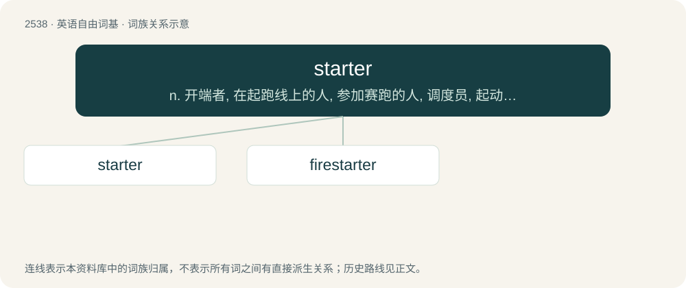

# 2643 · starter — n. 开端者, 在起跑线上的人, 参加赛跑的人, 调度员, 起动机, 酵母；\[计\] 启动程序, 启动器

[总目录](../00_总目录_按常用程度.md)

**类型**：英语自由词基　｜　**来源语言**：见词源记录

## 核心含义与来源

- 核心含义：n. 开端者, 在起跑线上的人, 参加赛跑的人, 调度员, 起动机, 酵母；\[计\] 启动程序, 启动器
- 英文含义：Someone who starts, or who starts something.
- 词形：starter

**来源记录 1**（名词；Someone who starts, or who starts something.）

From start + -er.

## 词族图

## 单词速览（常用到不常用）

| 单词 | 音标 | 释义 |
|---|---|---|
| [starter](#w-1) | 英 /ˈstɑː.tə(ɹ)/；美 /ˈstɑɹ.tɚ/ | n. 开端者, 在起跑线上的人, 参加赛跑的人, 调度员, 起动机, 酵母；\[计\] 启动程序, 启动器 |
| [firestarter](#w-2) |  | 打火石点火器具 |

## 逐词详解

### 1. starter

**词性**：名词　｜　**音标**：英 /ˈstɑː.tə(ɹ)/；美 /ˈstɑɹ.tɚ/

**中文释义**：n. 开端者, 在起跑线上的人, 参加赛跑的人, 调度员, 起动机, 酵母；\[计\] 启动程序, 启动器

**英文义项**：Someone who starts, or who starts something. / The person who starts a race by firing a gun or waving a flag.

**构词拆分**：From start + -er.

**词源与演化**：

From start + -er.

**例句**：

> It's small, but it's a good starter house.

该用例对应义项：Something with which to begin; a first property, etc.

### 2. firestarter

**词性**：名词

**中文释义**：打火石点火器具

**英文义项**：Someone who starts a fire or fires. / A tool used to start a fire; especially, a ferrocerium-and-steel set designed for camping, bushcraft, and so on.

**构词拆分**：fire + starter

**词源与演化**：

From fire + starter.

**例句**：

> Matthew used a firestarter to light the campfire quickly and easily.
