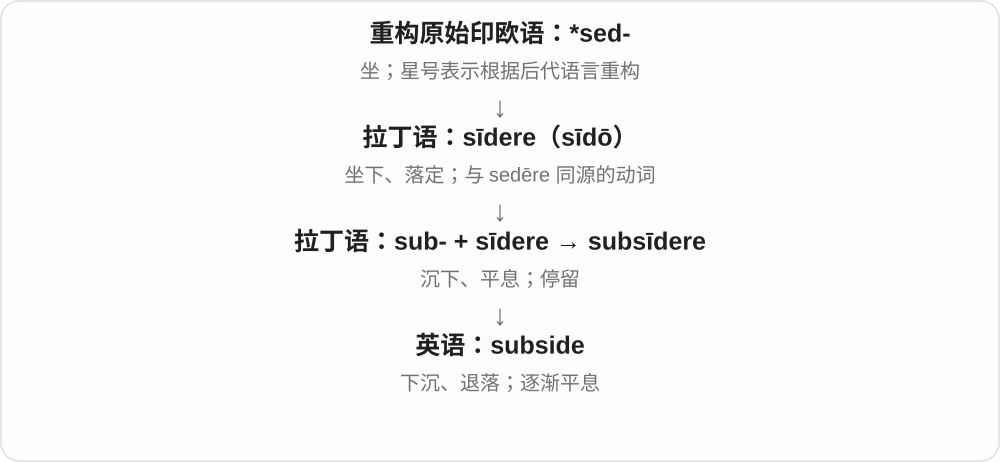
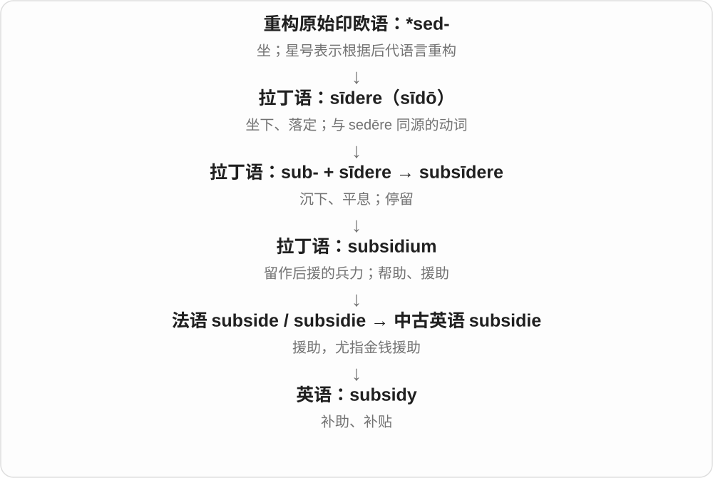
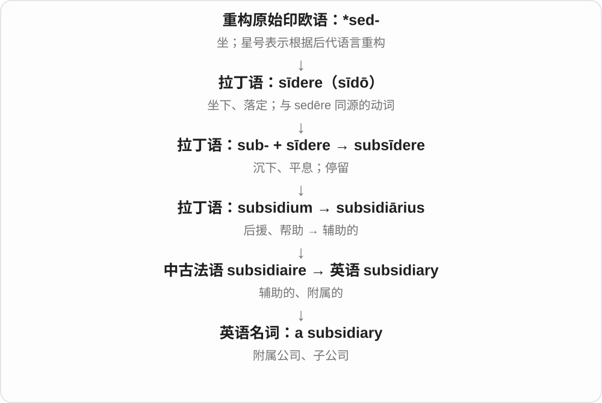
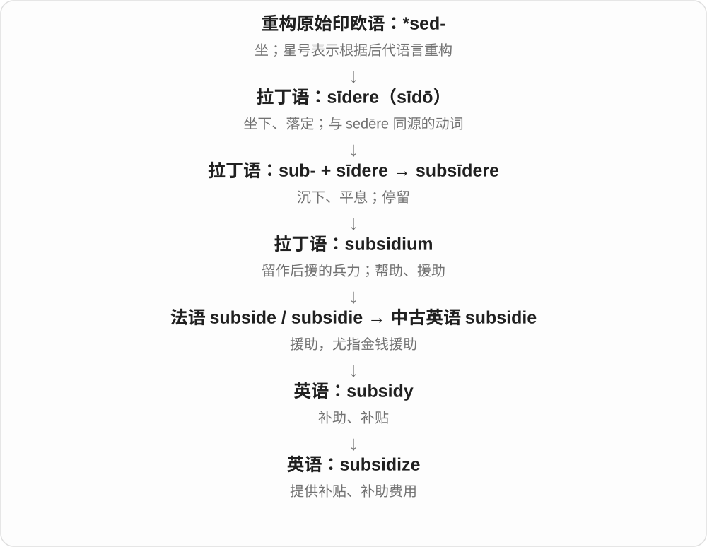

# 2644 · subsidy — 后援、援助；补贴

[逐词精讲目录](../00_逐词精讲目录.md) · [总目录](../00_总目录_按常用程度.md)

## 核心词根与来源

中古英语、法语相关形式追到拉丁 subsidium 后援、援助，与 sub-、sīdere 坐下、留驻等材料相连。旧的后援义逐渐有金钱支援的具体用法。

**SUBSIDY：从后面补一把力，现代常是补一部分钱**

前面在运转，后面留着能支援的力量；现代把钱补到交通、培训等活动里，就是 subsidy 的常用画面。

- **金钱支援**：subsidy · subsidize · subsidise
- **辅助、附属关系**：subsidiary
- **坐下、沉降的另一扩展**：subside

## 词形与演化规律

subsidy → subsidize／subsidise；subsidiary 借同一拉丁后援词族的形容词材料，说辅助、附属，作为名词又常指子公司。subside 是相关拉丁动词另一路意义延续。

## 单词速览（按词族由简到繁）

同一基础词的相关扩展放在一起，先读基础形式，再读扩展；各组之间优先读常用的。具体词源关系见各词讲解。

| 单词 | 音标 | 核心意思 |
|---|---|---|
| [subside](#w-4) | /səbˈsaɪd/ | 减弱、平息；退落；下沉 |
| [subsidy](#w-1) | /ˈsʌbsɪdi/ | 补贴；补助金 |
| [subsidiary](#w-3) | 英 /səbˈsɪdiəri/；美 /səbˈsɪdieri/ | 附属的；辅助的；子公司 |
| [subsidize](#w-2) | /ˈsʌbsɪdaɪz/ | 补贴；资助部分费用 |
| [subsidise](#w-5) | /ˈsʌbsɪdaɪz/ | 补助、补贴〔英式常用拼法〕 |

## 逐词讲解

### 1. subside — 减弱、平息；退落；下沉

**音标**：/səbˈsaɪd/

**先抓住这个画面**

subside 像高起来的水面慢慢降下去，喧闹或紧张也可以像水位一样逐渐退下。

**怎么拆**

直接联系拉丁 subsīdere，sub- 向下 + sīdere“落定、坐下”；sīdere 与 sedēre 同源。

**怎么变成今天的意思**

floodwater subsides 是洪水退去；anger subsides 是怒气平息；ground subsides 是地面下沉。通常是不及物动词。

**常见搭配与例句**

the noise subsided；floodwaters subside；gradually subside。

> The noise subsided after the doors closed.

门关上后，嘈杂声逐渐平息。

> We waited for the floodwater to subside.

我们等洪水退下去。

**别混淆**

stop 可以突然停下；subside 常有逐渐减弱、退落的过程感。

### 2. subsidy — 补贴；补助金

**音标**：/ˈsʌbsɪdi/

**先抓住这个画面**

subsidy 像在后面留下一支后援，前面的人撑不住时就补上一把力；现代最常补的是钱。

**怎么拆**

拉丁 subsidium“后备兵力、援助”来自 subsīdere“坐下留在后方”，经法语和中古英语进入英语。

**怎么变成今天的意思**

a transport subsidy 可以让运营方维持服务，也可让使用者少花钱。是谁给谁补助，要看具体句子，词本身不保证受助对象。

**常见搭配与例句**

a government subsidy；a housing subsidy；receive a subsidy。

> The village bus service depends on a public subsidy.

村里的公交服务依靠公共补贴维持。

> The programme offers a subsidy for home insulation.

这个项目为住宅保温改造提供补助。

**别混淆**

loan 是通常需要偿还的借款；subsidy 是补助、补贴，不能仅凭这个词推断所有附加条件。

### 3. subsidiary — 附属的；辅助的；子公司

**音标**：英 /səbˈsɪdiəri/；美 /səbˈsɪdieri/

**先抓住这个画面**

subsidiary 像主力旁边的后援，帮助主体系运作；在公司关系里，a subsidiary 就是受另一家公司控制的公司。

**怎么拆**

拉丁 subsidium“后援”→ subsidiārius“辅助的”，经法语 subsidiaire 等路线进入英语；公司名词从形容词用法发展。

**怎么变成今天的意思**

a subsidiary issue 是次要问题；a subsidiary company 是子公司。公司可以是独立法人，并不等于母公司的一个办公室。

**常见搭配与例句**

a wholly owned subsidiary；a subsidiary company；a subsidiary role。

> The group opened a subsidiary in another country.

该集团在另一个国家设立了子公司。

> Transport costs were a subsidiary issue in the discussion.

运输成本在讨论中是一个次要问题。

**别混淆**

subsidy 是补助金；subsidiary 是附属的或子公司，不能据字形断定它一定靠补贴生存。

### 4. subsidize — 补贴；资助部分费用

**音标**：/ˈsʌbsɪdaɪz/

**先抓住这个画面**

subsidize 像从旁边垫上一部分钱，让某项服务能继续运转，或让使用者付得起。

**怎么拆**

subsidy 去 y 加 -ize，英语中派生为动词；英式也拼 subsidise。

**怎么变成今天的意思**

可由政府、机构或其他收入来源提供补贴。某业务 subsidizes another 也可说用一项业务收入支持另一项。

**常见搭配与例句**

subsidize public transport；subsidize the cost；heavily subsidize。

> The council subsidizes bus fares for local students.

地方政府为当地学生补贴公交车费。

> Sales from the shop help subsidize the museum’s free events.

商店收入帮助补贴博物馆免费活动的开支。

**别混淆**

sponsor 往往强调赞助关系、宣传或支持身份；subsidize 更突出补贴成本。

### 5. subsidise — 补助、补贴〔英式常用拼法〕

**音标**：/ˈsʌbsɪdaɪz/

**先抓住这个画面**

一项服务或活动单靠自身收入撑不住，有人从旁补一部分钱，让它继续运转，就是 subsidise。

**怎么拆**

与 subsidize 是同一个动词的拼写变体，可按 subsidy 补助 + -ise／-ize 动词化理解，词尾 y 在构词中调整。补助名词更早追到拉丁 subsidium 后援、援助。

**怎么变成今天的意思**

**subsidy 的金钱援助义**  
帮助支付某项活动、服务的费用

↓

**动词 subsidize／subsidise**  
给予补贴；-ise 是英式常见拼写

subsidise public transport 补贴公共交通；subsidise the cost of training 补助培训费用。主语是提供补助的一方。

**常见搭配与例句**

a subsidised service；subsidise travel costs。

> The council subsidises the village bus service.

地方议会补贴村里的公交服务。

> The employer agreed to subsidise her training costs.

雇主同意补助她的培训费用。

**别混淆**

subsidise 与 subsidize 意思相同，选择主要跟拼写习惯有关。它常表示承担部分费用，但不能只凭动词算出具体比例。

## 这一组要分清什么

subsidiary 是附属、子公司的关系，不等于领取 subsidy 的公司。subside 平息、退落也不能按现代补贴动词来理解。

## 串起来练习

A public subsidy helps subsidise the evening bus service.

公共补贴帮助承担晚间公交服务的费用。
