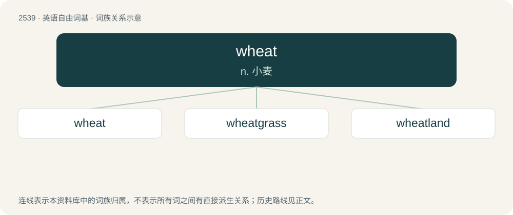

# 2644 · wheat — n. 小麦

[总目录](../00_总目录_按常用程度.md)

**类型**：英语自由词基　｜　**来源语言**：见词源记录

## 核心含义与来源

- 核心含义：n. 小麦
- 英文含义：Any of the several cereal grains, of the genus Triticum, that yields flour as used in bakery.
- 词形：wheat

**来源记录 1**（名词；Any of the several cereal grains, of the genus Triticum, that yields flour as used in bakery.）

From Middle English whete, from Old English hwǣte, from Proto-West Germanic \*hwaitī, from Proto-Germanic \*hwaitijaz (compare West Frisian weet, Dutch weit, Low German Weten, German Weizen, Danish hvede, Swedish vete, Norwegian Bokmål hvete, Norwegian Nynorsk kveite, Faroese and Icelandic hveiti), from \*hwītaz (“white”). More at white.

## 词族图

## 单词速览（常用到不常用）

| 单词 | 音标 | 释义 |
|---|---|---|
| [wheat](#w-1) | /ˈwiːt/ | n. 小麦 |
| [wheatgrass](#w-2) | /ˈhwiːtgræs/ | n. 麦草, 冰草 |
| [wheatland](#w-3) | /ˈhwiːtlænd/ | n. 小麦地, 适宜种小麦的地 |

## 逐词详解

### 1. wheat

**词性**：名词　｜　**音标**：/ˈwiːt/

**中文释义**：n. 小麦

**英文义项**：Any of the several cereal grains, of the genus Triticum, that yields flour as used in bakery. / A light brown color, like that of wheat.

**词源与演化**：

From Middle English whete, from Old English hwǣte, from Proto-West Germanic \*hwaitī, from Proto-Germanic \*hwaitijaz (compare West Frisian weet, Dutch weit, Low German Weten, German Weizen, Danish hvede, Swedish vete, Norwegian Bokmål hvete, Norwegian Nynorsk kveite, Faroese and Icelandic hveiti), from \*hwītaz (“white”). More at white.

**例句**：

> They debated the paint color options for the bathroom walls and settled on wheat.

该用例对应义项：A light brown color, like that of wheat.

### 2. wheatgrass

**词性**：名词　｜　**音标**：/ˈhwiːtgræs/

**中文释义**：n. 麦草, 冰草

**英文义项**：Young grass of the common wheat plant, Triticum aestivum, used freshly juiced or dried into powder for animal and human consumption. / A grass of the genus Agropyron, commonly known as crested-wheat grass.

**构词拆分**：wheat + grass

**词源与演化**：

From wheat + grass.

### 3. wheatland

**词性**：名词　｜　**音标**：/ˈhwiːtlænd/

**中文释义**：n. 小麦地, 适宜种小麦的地

**英文义项**：An area where wheat is produced.

**构词拆分**：wheat + land

**词源与演化**：

From wheat + land.
