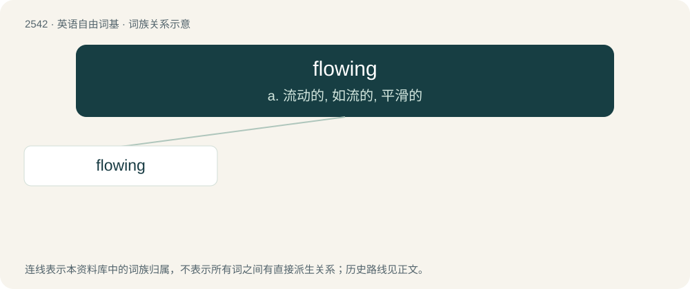

# 2647 · flowing — a. 流动的, 如流的, 平滑的

[总目录](../00_总目录_按常用程度.md)

**类型**：英语自由词基　｜　**来源语言**：见词源记录

## 核心含义与来源

- 核心含义：a. 流动的, 如流的, 平滑的
- 英文含义：The action of the verb to flow
- 词形：flowing

**来源记录 1**（名词；The action of the verb to flow）

From Middle English flowyng; equivalent to flow + -ing.

## 词族图

## 单词速览（常用到不常用）

| 单词 | 音标 | 释义 |
|---|---|---|
| [flowing](#w-1) | 英 /ˈfləʊ.ɪŋ/；美 /ˈfloʊ.ɪŋ/ | a. 流动的, 如流的, 平滑的 |

## 逐词详解

### 1. flowing

**词性**：名词　｜　**音标**：英 /ˈfləʊ.ɪŋ/；美 /ˈfloʊ.ɪŋ/

**中文释义**：a. 流动的, 如流的, 平滑的

**英文义项**：The action of the verb to flow

**构词拆分**：flow + -ing

**词源与演化**：

From Middle English flowyng; equivalent to flow + -ing.

**用法示例／搭配（非完整句）**：

> the flowing of the river

该用例对应义项：The action of the verb to flow
