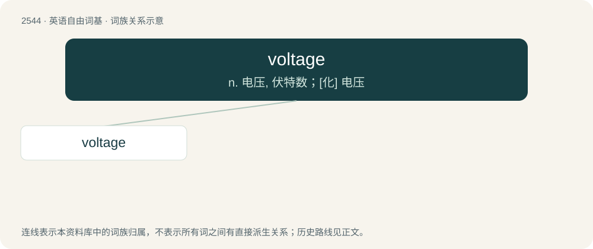

# 2649 · voltage — n. 电压, 伏特数；\[化\] 电压

[总目录](../00_总目录_按常用程度.md)

**类型**：英语自由词基　｜　**来源语言**：见词源记录

## 核心含义与来源

- 核心含义：n. 电压, 伏特数；\[化\] 电压
- 英文含义：The difference in electrostatic potential between two points in space, especially between live and neutral conductors or the earth.
- 词形：voltage

**来源记录 1**（名词；The difference in electrostatic potential between two points in space, especially between live and neutral conductors or the earth.）

From volt + -age, ultimately derived from the name of Alessandro Volta, inventor of the modern battery.

## 词族图

## 单词速览（常用到不常用）

| 单词 | 音标 | 释义 |
|---|---|---|
| [voltage](#w-1) | 英 /ˈvəʊltɪd͡ʒ/；美 /ˈvoʊltɪd͡ʒ/ | n. 电压, 伏特数；\[化\] 电压 |

## 逐词详解

### 1. voltage

**词性**：名词　｜　**音标**：英 /ˈvəʊltɪd͡ʒ/；美 /ˈvoʊltɪd͡ʒ/

**中文释义**：n. 电压, 伏特数；\[化\] 电压

**英文义项**：The difference in electrostatic potential between two points in space, especially between live and neutral conductors or the earth.

**构词拆分**：volt + -age

**词源与演化**：

From volt + -age, ultimately derived from the name of Alessandro Volta, inventor of the modern battery.

**例句**：

> The voltage between the wires is too low to produce a spark.

该用例对应义项：The difference in electrostatic potential between two points in space, especially between live and neutral conductors or the earth.
