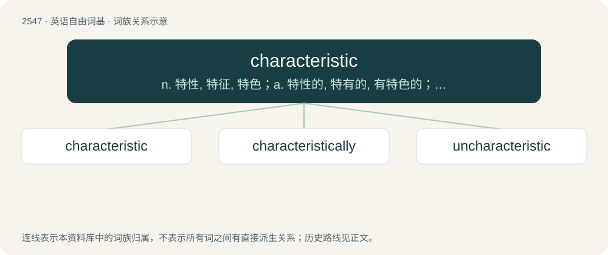

# 2652 · characteristic — n. 特性, 特征, 特色；a. 特性的, 特有的, 有特色的；\[计\] 阶; 指数

[总目录](../00_总目录_按常用程度.md)

**类型**：英语自由词基　｜　**来源语言**：见词源记录

## 核心含义与来源

- 核心含义：n. 特性, 特征, 特色；a. 特性的, 特有的, 有特色的；\[计\] 阶; 指数
- 英文含义：Indicating a distinguishing feature of a person or thing; typical.
- 词形：characteristic

**来源记录 1**（形容词；Indicating a distinguishing feature of a person or thing; typical.）

From Ancient Greek χαρακτηριστικός (kharaktēristikós), from χαρακτηρίζω (kharaktērízō, “to designate by a characteristic mark”), from χαρακτήρ (kharaktḗr, “a mark, character”). By surface analysis, character + -istic.

## 词族图

## 单词速览（常用到不常用）

| 单词 | 音标 | 释义 |
|---|---|---|
| [characteristic](#w-1) | 英 /ˌkæɹəktəˈɹɪstɪk/；美 /ˌkæɹ(ə)ktəˈɹɪstɪk/ | n. 特性, 特征, 特色；a. 特性的, 特有的, 有特色的；\[计\] 阶; 指数 |
| [characteristically](#w-2) | 美 /ˌkɛɹəktəˈɹɪstɪkli/ | adv. 表示特性地 |
| [uncharacteristic](#w-3) |  | a. 无典型特征的；不典型的 |

## 逐词详解

### 1. characteristic

**词性**：名词　｜　**音标**：英 /ˌkæɹəktəˈɹɪstɪk/；美 /ˌkæɹ(ə)ktəˈɹɪstɪk/

**中文释义**：n. 特性, 特征, 特色；a. 特性的, 特有的, 有特色的；\[计\] 阶; 指数

**英文义项**：A distinguishing feature of a person or thing, a part of mental or physical behavior. / The integer part of a logarithm.

**词源与演化**：

From Ancient Greek χαρακτηριστικός (kharaktēristikós), from χαρακτηρίζω (kharaktērízō, “to designate by a characteristic mark”), from χαρακτήρ (kharaktḗr, “a mark, character”). By surface analysis, character + -istic.

**例句**：

> The characteristic of a field, if non-zero, must be a prime number.

该用例对应义项：For a given field or ring, a natural number that is either the smallest positive number n such that n instances of the multiplicative identity (1) summed together yield the additive identity (0) or, if no such number exists, the number 0.

### 2. characteristically

**词性**：副词　｜　**音标**：美 /ˌkɛɹəktəˈɹɪstɪkli/

**中文释义**：adv. 表示特性地

**英文义项**：In a usual or expected way; in characteristic manner.

**构词拆分**：characteristic + -ally

**词源与演化**：

From characteristic + -ally.

**例句**：

> He arrived characteristically late.

该用例对应义项：in characteristic manner

### 3. uncharacteristic

**词性**：形容词

**中文释义**：a. 无典型特征的；不典型的

**英文义项**：Not characteristic. / Out of character; behavior that is unusual for a given person or thing.

**构词拆分**：un- + characteristic

**词源与演化**：

From un- + characteristic.

**例句**：

> A book uncharacteristic of its author.

该用例对应义项：distinctive and not typical
