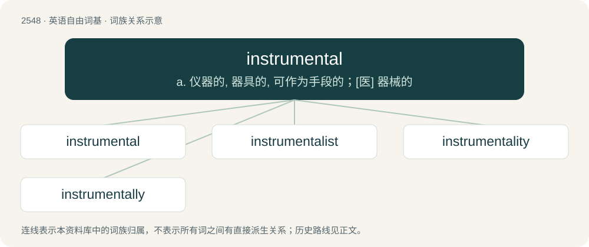

# 2653 · instrumental — a. 仪器的, 器具的, 可作为手段的；\[医\] 器械的

[总目录](../00_总目录_按常用程度.md)

**类型**：英语自由词基　｜　**来源语言**：见词源记录

## 核心含义与来源

- 核心含义：a. 仪器的, 器具的, 可作为手段的；\[医\] 器械的
- 英文含义：Essential or central; of great importance or relevance.
- 词形：instrumental

**来源记录 1**（形容词；Essential or central; of great importance or relevance.）

From Middle English instrumental, instrumentale, from Medieval Latin īnstrūmentālis, equivalent to instrument + -al.

## 词族图

## 单词速览（常用到不常用）

| 单词 | 音标 | 释义 |
|---|---|---|
| [instrumental](#w-1) | /ɪnstɹəˈmɛntəl/ | a. 仪器的, 器具的, 可作为手段的；\[医\] 器械的 |
| [instrumentalist](#w-2) | /.instruˈmentəlist. instrə-/ | n. 工具主义者；乐器演奏家 |
| [instrumentality](#w-3) | 英 /ˌɪnstɹʊmɛnˈtælɪti/ | n. 媒介, 手段, 机构；\[法\] 媒介, 工具, 手段 |
| [instrumentally](#w-4) |  | adv. 仪器地；有助益地；用乐器演奏地 |

## 逐词详解

### 1. instrumental

**词性**：形容词　｜　**音标**：/ɪnstɹəˈmɛntəl/

**中文释义**：a. 仪器的, 器具的, 可作为手段的；\[医\] 器械的

**英文义项**：Essential or central; of great importance or relevance. / Serving as an instrument, medium, means, or agency.

**构词拆分**：instrument + -al

**词源与演化**：

From Middle English instrumental, instrumentale, from Medieval Latin īnstrūmentālis, equivalent to instrument + -al.

**例句**：

> He was instrumental in conducting the business.

该用例对应义项：Essential or central; of great importance or relevance.

### 2. instrumentalist

**词性**：名词　｜　**音标**：/.instruˈmentəlist. instrə-/

**中文释义**：n. 工具主义者；乐器演奏家

**英文义项**：One who plays a musical instrument, as distinguished from a vocalist. / An adherent of instrumentalism.

**构词拆分**：instrumental + -ist

**词源与演化**：

From instrumental + -ist.

### 3. instrumentality

**词性**：名词　｜　**音标**：英 /ˌɪnstɹʊmɛnˈtælɪti/

**中文释义**：n. 媒介, 手段, 机构；\[法\] 媒介, 工具, 手段

**英文义项**：The condition or quality of being instrumental; being useful; serving a purpose. / Something that is instrumental; an instrument.

**构词拆分**：instrumental + -ity

**词源与演化**：

From instrumental + -ity.

### 4. instrumentally

**词性**：副词

**中文释义**：adv. 仪器地；有助益地；用乐器演奏地

**英文义项**：By means of an instrument or agency; as means to an end / With musical instruments

**构词拆分**：instrumental + -ly

**词源与演化**：

From instrumental + -ly.

**用法示例／搭配（非完整句）**：

> an instrumentally accompanied song

该用例对应义项：With musical instruments
