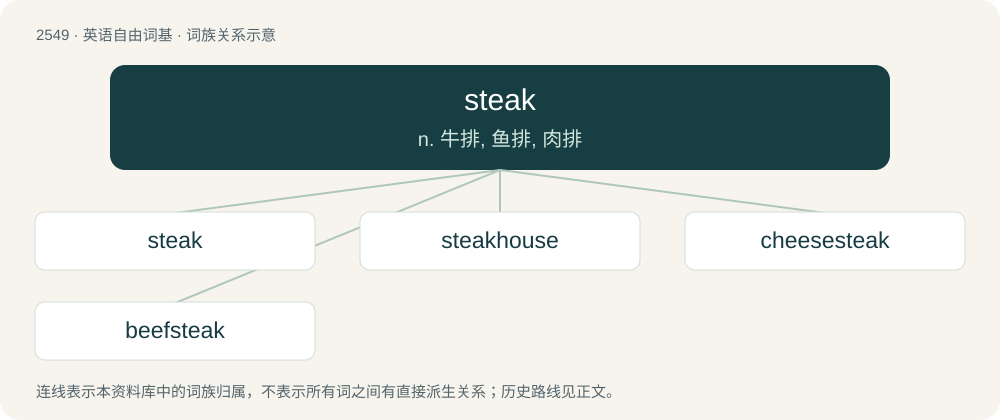

# 2654 · steak — n. 牛排, 鱼排, 肉排

[总目录](../00_总目录_按常用程度.md)

**类型**：英语自由词基　｜　**来源语言**：见词源记录

## 核心含义与来源

- 核心含义：n. 牛排, 鱼排, 肉排
- 英文含义：Beefsteak: a slice of beef, broiled or cut for broiling.
- 词形：steak

**来源记录 1**（名词；Beefsteak: a slice of beef, broiled or cut for broiling.）

From Middle English steike, from Old Norse steik (“roast; meat roasted on a stick”). The verb is either from the noun or from steikja (“to roast”). The modern pronunciation shows an irregular change of Early Modern English /ɛː/ to /eɪ/ in the standard language; contrast this with the development of other words such as speak and wreak.

## 词族图

## 单词速览（常用到不常用）

| 单词 | 音标 | 释义 |
|---|---|---|
| [steak](#w-1) | /steɪk/ | n. 牛排, 鱼排, 肉排 |
| [steakhouse](#w-2) | 美 /ˈsteɪk.haʊs/ | n. 牛排餐厅 |
| [cheesesteak](#w-3) |  | n. 费城牛肉芝士三明治 |
| [beefsteak](#w-4) | /ˈbiːfˌsteɪk/ | n. 牛排 |

## 逐词详解

### 1. steak

**词性**：名词　｜　**音标**：/steɪk/

**中文释义**：n. 牛排, 鱼排, 肉排

**英文义项**：Beefsteak: a slice of beef, broiled or cut for broiling. / A relatively large, thick slice or slab cut from another animal, a vegetable, etc.

**词源与演化**：

From Middle English steike, from Old Norse steik (“roast; meat roasted on a stick”). The verb is either from the noun or from steikja (“to roast”). The modern pronunciation shows an irregular change of Early Modern English /ɛː/ to /eɪ/ in the standard language; contrast this with the development of other words such as speak and wreak.

**用法示例／搭配（非完整句）**：

> venison steak, pork steak, salmon steak; cauliflower steak, eggplant steaks

该用例对应义项：A relatively large, thick slice or slab cut from another animal, a vegetable, etc.

### 2. steakhouse

**词性**：名词　｜　**音标**：美 /ˈsteɪk.haʊs/

**中文释义**：n. 牛排餐厅

**英文义项**：A restaurant that specializes in good cuts of meat, particularly steak.

**构词拆分**：steak + house

**词源与演化**：

From steak + house.

**例句**：

> Layla and Sami went to a Brazilian steakhouse.

### 3. cheesesteak

**词性**：名词

**中文释义**：n. 费城牛肉芝士三明治

**英文义项**：A Philadelphia snack food consisting of chopped steak and melted cheese in a bread roll.

**构词拆分**：cheese + steak

**词源与演化**：

From cheese + steak.

### 4. beefsteak

**词性**：名词　｜　**音标**：/ˈbiːfˌsteɪk/

**中文释义**：n. 牛排

**英文义项**：(A) steak cut from a cattle beast (e.g., cow, steer). / The herb prepared from the leaves of the beefsteak plant.

**构词拆分**：beef + steak

**词源与演化**：

From beef + steak. Doublet of bifshtek and bistek.

**例句**：

> I really enjoyed the beefsteak you served, not to mention the other dishes.
