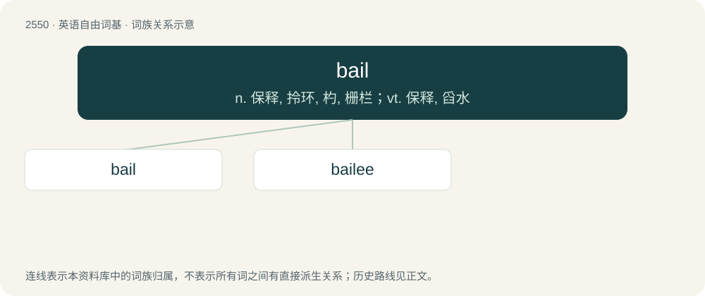

# 2656 · bail — n. 保释, 拎环, 杓, 栅栏；vt. 保释, 舀水

[总目录](../00_总目录_按常用程度.md)

**类型**：英语自由词基　｜　**来源语言**：见词源记录

## 核心含义与来源

- 核心含义：n. 保释, 拎环, 杓, 栅栏；vt. 保释, 舀水
- 英文含义：Security, usually a sum of money, exchanged for the release of an arrested person as a guarantee of that person's appearance for trial.
- 词形：bail

**多个词源／构词路径**：同一拼写可能有不同来源；以下按词性和含义分别列出。

**来源记录 1**（名词；Security, usually a sum of money, exchanged for the release of an arrested person as a guarantee of that person's appearance for trial.）

From Middle English baille, from the Old French verb bailler (“to deliver or hand over”) and noun bail (“lease”), from Latin bāiulāre (“carry or bear”), from baiulus (“porter; steward”) (English: bailiff).

**来源记录 2**（动词；To leave or exit abruptly.）

From a shortening of bail out, ultimately same as above.

**来源记录 3**（名词；A hoop, ring or handle (especially of a kettle or bucket).）

From Middle English beyle, from Old English bīeġels, from bīeġan + -els.

**来源记录 4**（动词；To confine.）

Borrowed from French baillier.

## 词族图

## 单词速览（常用到不常用）

| 单词 | 音标 | 释义 |
|---|---|---|
| [bail](#w-1) | 英 /beɪl/ | n. 保释, 拎环, 杓, 栅栏；vt. 保释, 舀水 |
| [bailee](#w-2) | /.beiˈliː/ | n. 受托者；\[经\] 受寄人, 受托人 |

## 逐词详解

### 1. bail

**词性**：名词　｜　**音标**：英 /beɪl/

**中文释义**：n. 保释, 拎环, 杓, 栅栏；vt. 保释, 舀水

**英文义项**：Security, usually a sum of money, exchanged for the release of an arrested person as a guarantee of that person's appearance for trial. / Release from imprisonment on payment of such money.

**词源与演化**：

From Middle English baille, from the Old French verb bailler (“to deliver or hand over”) and noun bail (“lease”), from Latin bāiulāre (“carry or bear”), from baiulus (“porter; steward”) (English: bailiff).

**例句**：

> He was granted bail for £20000.

该用例对应义项：Security, usually a sum of money, exchanged for the release of an arrested person as a guarantee of that person's appearance for trial.

### 2. bailee

**词性**：名词　｜　**音标**：/.beiˈliː/

**中文释义**：n. 受托者；\[经\] 受寄人, 受托人

**英文义项**：One who holds bailed property; one who takes possession of the property of another (called a bailor) in order to keep that property safe for the other. / A person who is granted bail.

**构词拆分**：From bail + -ee.

**词源与演化**：

From bail + -ee.
