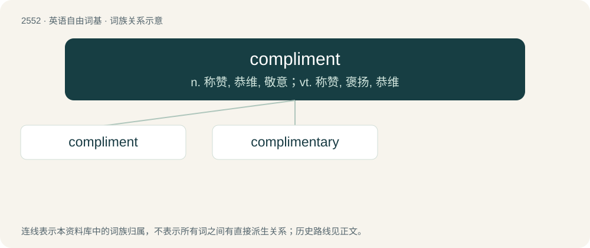

# 2657 · compliment — n. 称赞, 恭维, 敬意；vt. 称赞, 褒扬, 恭维

[总目录](../00_总目录_按常用程度.md)

**类型**：英语自由词基　｜　**来源语言**：见词源记录

## 核心含义与来源

- 核心含义：n. 称赞, 恭维, 敬意；vt. 称赞, 褒扬, 恭维
- 英文含义：An expression of praise, congratulation, or respect.
- 词形：compliment

**多个词源／构词路径**：同一拼写可能有不同来源；以下按词性和含义分别列出。

**来源记录 1**（名词；An expression of praise, congratulation, or respect.）

Borrowed from French compliment, itself a borrowing of Italian complimento, which in turn is a borrowing from Spanish cumplimiento, from cumplir (“to comply, complete, do what is proper”) + -miento or Latin complēmentum. Doublet of complement. Displaced Old English ġeswǣsnes.

**来源记录 2**（动词；To pay a compliment (to someone); to express a favourable opinion (of someone).）

Borrowed from French complimenter, from compliment + -er (verb-forming suffix).

## 词族图

## 单词速览（常用到不常用）

| 单词 | 音标 | 释义 |
|---|---|---|
| [compliment](#w-1) | 英 /ˈkɒmplɪmənt/；美 /ˈkɑmpləmənt/ | n. 称赞, 恭维, 敬意；vt. 称赞, 褒扬, 恭维 |
| [complimentary](#w-2) | 英 /ˌkɒmplɪˈmɛnt(ə)ɹi/；美 /ˌkɑmplɪˈmɛnt(ə)ɹi/ | a. 问候的, 称赞的, 夸奖的 |

## 逐词详解

### 1. compliment

**词性**：名词　｜　**音标**：英 /ˈkɒmplɪmənt/；美 /ˈkɑmpləmənt/

**中文释义**：n. 称赞, 恭维, 敬意；vt. 称赞, 褒扬, 恭维

**英文义项**：An expression of praise, congratulation, or respect. / Complimentary language; courtesy, flattery.

**词源与演化**：

Borrowed from French compliment, itself a borrowing of Italian complimento, which in turn is a borrowing from Spanish cumplimiento, from cumplir (“to comply, complete, do what is proper”) + -miento or Latin complēmentum. Doublet of complement. Displaced Old English ġeswǣsnes.

**用法示例／搭配（非完整句）**：

> pay someone a compliment

该用例对应义项：An expression of praise, congratulation, or respect.

### 2. complimentary

**词性**：形容词　｜　**音标**：英 /ˌkɒmplɪˈmɛnt(ə)ɹi/；美 /ˌkɑmplɪˈmɛnt(ə)ɹi/

**中文释义**：a. 问候的, 称赞的, 夸奖的

**英文义项**：In the nature of a compliment. / Free; provided at no charge.

**构词拆分**：compliment (noun) + -ary

**词源与演化**：

From compliment (noun) + -ary. Piecewise doublet of complementary.

**用法示例／搭配（非完整句）**：

> a complimentary remark

该用例对应义项：In the nature of a compliment.
