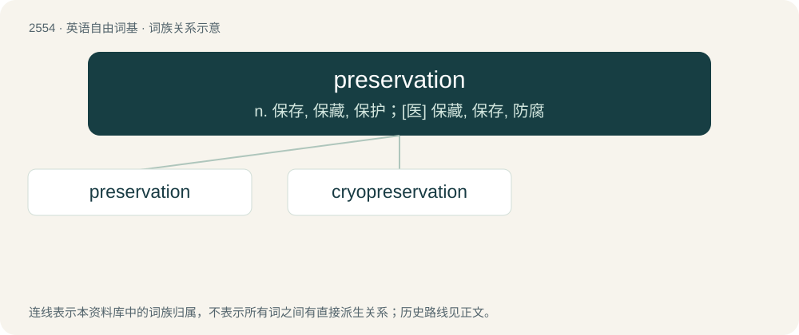

# 2658 · preservation — n. 保存, 保藏, 保护；\[医\] 保藏, 保存, 防腐

[总目录](../00_总目录_按常用程度.md)

**类型**：英语自由词基　｜　**来源语言**：见词源记录

## 核心含义与来源

- 核心含义：n. 保存, 保藏, 保护；\[医\] 保藏, 保存, 防腐
- 英文含义：The act of preserving; care to preserve; act of keeping from destruction, decay or any ill.
- 词形：preservation

**来源记录 1**（名词；The act of preserving; care to preserve; act of keeping from destruction, decay or any ill.）

From Old French preservacion, from Medieval Latin preservatio. Morphologically preserve + -ation.

## 词族图

## 单词速览（常用到不常用）

| 单词 | 音标 | 释义 |
|---|---|---|
| [preservation](#w-1) | 英 /ˌpɹɛz.əˈveɪ.ʃən/；美 /ˌpɹɛz.ɚˈveɪ.ʃən/ | n. 保存, 保藏, 保护；\[医\] 保藏, 保存, 防腐 |
| [cryopreservation](#w-2) | /,kraiə,prezəˈveiʃən/ | n. (医学、工业等领域的)低温贮藏 |

## 逐词详解

### 1. preservation

**词性**：名词　｜　**音标**：英 /ˌpɹɛz.əˈveɪ.ʃən/；美 /ˌpɹɛz.ɚˈveɪ.ʃən/

**中文释义**：n. 保存, 保藏, 保护；\[医\] 保藏, 保存, 防腐

**英文义项**：The act of preserving; care to preserve; act of keeping from destruction, decay or any ill. / The state of being preserved, how something has survived.

**构词拆分**：preserve + -ation

**词源与演化**：

From Old French preservacion, from Medieval Latin preservatio. Morphologically preserve + -ation.

**例句**：

> Sorting your packaging means actively participating in the preservation of the environment.

### 2. cryopreservation

**词性**：名词　｜　**音标**：/,kraiə,prezəˈveiʃən/

**中文释义**：n. (医学、工业等领域的)低温贮藏

**英文义项**：the preservation of biological tissue at cryogenic temperatures, typically at -80°C (dry ice temperature) or -196°C (the boiling point of liquid nitrogen).

**构词拆分**：cryo- + preservation

**词源与演化**：

From cryo- + preservation, from Ancient Greek κρύος (krúos, “icy cold, chill, frost”).
