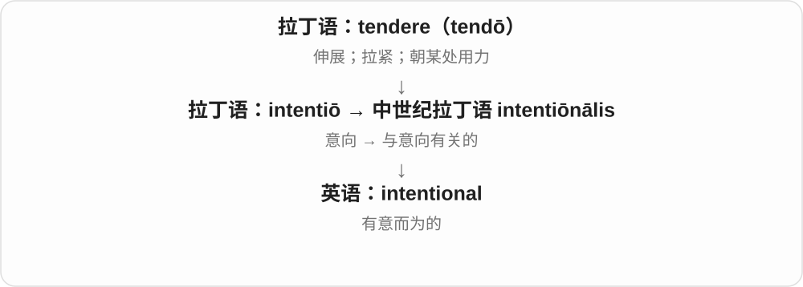
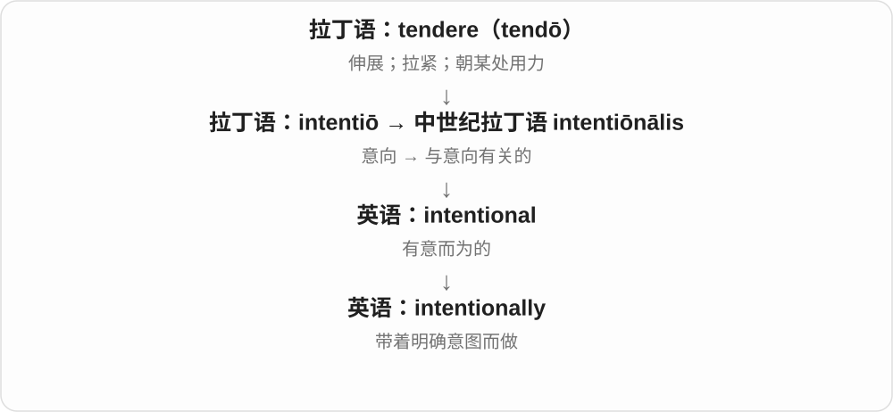

# 2659 · intentional — 有意安排与非有意，哲学意向性另看专门定义

[逐词精讲目录](../00_逐词精讲目录.md) · [总目录](../00_总目录_按常用程度.md)

## 核心词根与来源

日常关心故意还是无意，哲学则还用 intentionality 讨论念头关于什么。两者相关，但不能只用故意二字概括。

**INTENTIONAL：行动是否出于意图；intentionality 还可说心灵指向**

intentional → intentionally、intentionality；unintentional 是否定。

- **有意及其方式、性质**：intentional · intentionally · intentionality
- **无意状态**：unintentional

## 词形与演化规律

intention + -al 的现代对应，另接中世纪拉丁词史；-ly 方式，-ity 性质，un- 否定。

## 单词速览（按词族由简到繁）

同一基础词的相关扩展放在一起，先读基础形式，再读扩展；各组之间优先读常用的。具体词源关系见各词讲解。

| 单词 | 音标 | 核心意思 |
|---|---|---|
| [intentional](#w-2) | /ɪnˈtenʃənəl/ | 有意的；故意的 |
| [intentionally](#w-1) | /ɪnˈtenʃənəli/ | 有意地；故意地 |
| [intentionality](#w-4) | /ɪnˌtenʃəˈnæləti/ | 有意性、目的性；〔哲学〕意向性 |
| [unintentional](#w-3) | /ˌʌnɪnˈtenʃənəl/ | 无意的；非故意的 |

## 逐词讲解

### 1. intentional — 有意的；故意的

**音标**：/ɪnˈtenʃənəl/

**先抓住这个画面**

intentional 表示这件事是心里先有方向、然后照着做的，而不是碰巧发生。

**怎么拆**

与 intention + -al 对应；历史联系中世纪拉丁 intentiōnālis。

**怎么变成今天的意思**

并不总带恶意：intentional design 是有目的的设计；intentional damage 才按语境说故意破坏。

**常见搭配与例句**

an intentional act；intentional design；intentional damage。

> The unusual spacing is intentional.

这种不寻常的间距是特意设计的。

> The investigation found no evidence of intentional damage.

调查没有发现故意破坏的证据。

**别混淆**

intentional 是有意；intensional 是逻辑学中的内涵，两者同音而不同义。

### 2. intentionally — 有意地；故意地

**音标**：/ɪnˈtenʃənəli/

**先抓住这个画面**

intentionally 像在行动旁加一句：“我是有意这样安排的。”

**怎么拆**

intentional + -ly。

**怎么变成今天的意思**

可以解释设计选择，也可以说明行为不是失误。它本身不说明这个目的好还是坏。

**常见搭配与例句**

intentionally left blank；intentionally vague；act intentionally。

> This page has been intentionally left blank.

这一页是特意留白的。

> She intentionally chose a simple example.

她特意选了一个简单的例子。

**别混淆**

intently 是专注地；intentionally 是有意地，认真看不等于故意安排。

### 3. intentionality — 有意性、目的性；〔哲学〕意向性

**音标**：/ɪnˌtenʃəˈnæləti/

**先抓住这个画面**

设计每个细节都经过安排，可以说有 intentionality。哲学里则问念头在想什么：想起巴黎、害怕失败，都有指向的对象。

**怎么拆**

intentional + -ity，-al + -ity 形成 -ality 名词结尾。哲学用法还承中世纪拉丁 intentio 一族的概念历史，联系心灵朝某对象指去。

**怎么变成今天的意思**

**intentional 有意的 + -ity**  
形成有意、有目的的性质名词

↓

**哲学 intentionality 的专门用法**  
心灵状态指向、关于某种对象的特征

intentionality in design 设计的有意安排，the intentionality of thought 思想的意向性；专门语境先确定讨论的是目的还是关于某物。

**常见搭配与例句**

intentionality in design；the intentionality of thought。

> There is a sense of intentionality in every detail of the design.

设计的每个细节都让人感到经过有意安排。

> In philosophy, intentionality concerns how thoughts are about things.

在哲学中，意向性讨论思想如何指向、关于某些事物。

**别混淆**

哲学 intentionality 不等于每件事都故意为之；它常说心理状态能关于、表征某物，和日常 intention 计划、意图分清。

### 4. unintentional — 无意的；非故意的

**音标**：/ˌʌnɪnˈtenʃənəl/

**先抓住这个画面**

unintentional 像手滑碰倒杯子：事情发生了，但不是原本想做的。

**怎么拆**

un-（不）+ intentional。

**怎么变成今天的意思**

可评价失误、后果或冒犯；不故意并不等于没有造成影响。

**常见搭配与例句**

an unintentional error；unintentional harm；an unintentional consequence。

> The omission was unintentional.

这处遗漏并非有意为之。

> Even unintentional remarks can hurt someone.

即使是无心的话，也可能伤到别人。

**别混淆**

accidental 常突出偶发事件；unintentional 明确谈人的意图是否存在。

## 这一组要分清什么

哲学意向性不都等于行动目的；intentional 与 unintentional 要看是否出于意图。

## 串起来练习

The change was intentional, and she explained why she had made it intentionally.

这个改动是有意的，她也解释了为何特意这样改。
