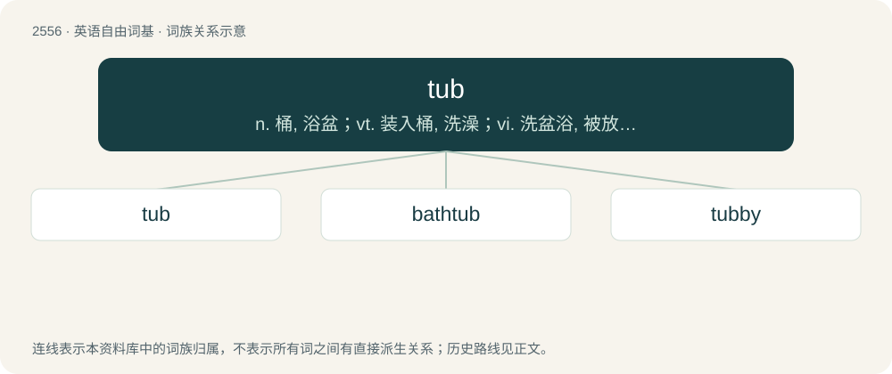

# 2660 · tub — n. 桶, 浴盆；vt. 装入桶, 洗澡；vi. 洗盆浴, 被放在桶里洗

[总目录](../00_总目录_按常用程度.md)

**类型**：英语自由词基　｜　**来源语言**：见词源记录

## 核心含义与来源

- 核心含义：n. 桶, 浴盆；vt. 装入桶, 洗澡；vi. 洗盆浴, 被放在桶里洗
- 英文含义：A flat-bottomed vessel, of width similar to or greater than its height, used for storing or packing things, or for washing things in.
- 词形：tub

**来源记录 1**（名词；A flat-bottomed vessel, of width similar to or greater than its height, used for storing or packing things, or for washing things in.）

From Middle English tubbe, tobbe, from Middle Dutch tubbe or Middle Low German tubbe, tobbe, further etymology unknown. Considered to be unrelated to tube.

## 词族图

## 单词速览（常用到不常用）

| 单词 | 音标 | 释义 |
|---|---|---|
| [tub](#w-1) | /tʌb/ | n. 桶, 浴盆；vt. 装入桶, 洗澡；vi. 洗盆浴, 被放在桶里洗 |
| [bathtub](#w-2) | 英 /ˈbɑːθtʌb/；美 /ˈbæθtʌb/ | n. 浴缸 |
| [tubby](#w-3) | /ˈtʌbi/ | a. 桶状的, 肥胖的, 发钝音的 |

## 逐词详解

### 1. tub

**词性**：名词　｜　**音标**：/tʌb/

**中文释义**：n. 桶, 浴盆；vt. 装入桶, 洗澡；vi. 洗盆浴, 被放在桶里洗

**英文义项**：A flat-bottomed vessel, of width similar to or greater than its height, used for storing or packing things, or for washing things in. / The contents or capacity of such a vessel.

**词源与演化**：

From Middle English tubbe, tobbe, from Middle Dutch tubbe or Middle Low German tubbe, tobbe, further etymology unknown. Considered to be unrelated to tube.

**例句**：

> He bought a tub of lard to roast the potatoes in.

该用例对应义项：A flat-bottomed vessel, of width similar to or greater than its height, used for storing or packing things, or for washing things in.

### 2. bathtub

**词性**：名词　｜　**音标**：英 /ˈbɑːθtʌb/；美 /ˈbæθtʌb/

**中文释义**：n. 浴缸

**英文义项**：A large container for holding water in which a person may bathe (take a bath).

**构词拆分**：bath + tub

**词源与演化**：

From bath + tub.

**例句**：

> I had a long, leisurely soak in the bathtub.

该用例对应义项：A large container for holding water in which a person may bathe (take a bath).

### 3. tubby

**词性**：形容词　｜　**音标**：/ˈtʌbi/

**中文释义**：a. 桶状的, 肥胖的, 发钝音的

**英文义项**：stout, rotund / Resembling a tub

**构词拆分**：tub + -y

**词源与演化**：

From tub + -y. False cognate with chubby, even though they are often interchangeable.

**用法示例／搭配（非完整句）**：

> a tubby violin

该用例对应义项：sounding dull and without resonance or freedom of sound.
