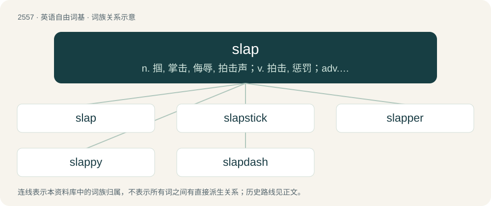

# 2661 · slap — n. 掴, 掌击, 侮辱, 拍击声；v. 拍击, 惩罚；adv. 正面地, 直接地, 突然地

[总目录](../00_总目录_按常用程度.md)

**类型**：英语自由词基　｜　**来源语言**：见词源记录

## 核心含义与来源

- 核心含义：n. 掴, 掌击, 侮辱, 拍击声；v. 拍击, 惩罚；adv. 正面地, 直接地, 突然地
- 英文含义：A blow, especially one given with the open hand, or with something broad and flat.
- 词形：slap

**来源记录 1**（名词；A blow, especially one given with the open hand, or with something broad and flat.）

From Middle English slappen, of uncertain origin, possibly imitative. Compare Low German Slappe (“slap”), whence also German Schlappe (“defeat”). Compare also Italian sleppa (“slap”).

## 词族图

## 单词速览（常用到不常用）

| 单词 | 音标 | 释义 |
|---|---|---|
| [slap](#w-1) | /slæp/ | n. 掴, 掌击, 侮辱, 拍击声；v. 拍击, 惩罚；adv. 正面地, 直接地, 突然地 |
| [slapstick](#w-2) | /ˈslæpstik/ | n. 闹剧, 趣剧 |
| [slapper](#w-3) | 英 /ˈslæpə/；美 /ˈslæpɚ/ | n. 飞片；粘舌 |
| [slappy](#w-4) | /ˈslæpi/ | 【英文】Resembling a slap, especially of sound. |
| [slapdash](#w-5) | /ˈslæpdæʃ/ | n. 草率；a. 猛烈的, 粗心的 |

## 逐词详解

### 1. slap

**词性**：名词　｜　**音标**：/slæp/

**中文释义**：n. 掴, 掌击, 侮辱, 拍击声；v. 拍击, 惩罚；adv. 正面地, 直接地, 突然地

**英文义项**：A blow, especially one given with the open hand, or with something broad and flat. / A sharp percussive sound like that produced by such a blow.

**词源与演化**：

From Middle English slappen, of uncertain origin, possibly imitative. Compare Low German Slappe (“slap”), whence also German Schlappe (“defeat”). Compare also Italian sleppa (“slap”).

**例句**：

> He gave me a friendly slap on the back as a sign of camaraderie.

该用例对应义项：A blow, especially one given with the open hand, or with something broad and flat.

### 2. slapstick

**词性**：名词　｜　**音标**：/ˈslæpstik/

**中文释义**：n. 闹剧, 趣剧

**英文义项**：A style of humor focusing on physical comedy, such as slipping on a banana peel, and with foolish characters who get into humiliating situations. / A pair of sticks attached at one end and used to create a slapping sound effect, used especially in slapstick comedy; a type of clapper.

**构词拆分**：slap + stick

**词源与演化**：

From slap + stick, calque of Italian batacchio. The pair of sticks was used by the comic character Harlequin in the commedia dell'arte.

**例句**：

> Shimura attracted fans of all generations with his slapstick comedy and funny faces.

### 3. slapper

**词性**：名词　｜　**音标**：英 /ˈslæpə/；美 /ˈslæpɚ/

**中文释义**：n. 飞片；粘舌

**英文义项**：One who, or that which, slaps. / A prostitute.

**构词拆分**：slap + -er

**词源与演化**：

From slap + -er. For senses 2 and 3, the OED tentatively quotes the Bloomsbury Dictionary of Contemporary Slang: "This working class term from East London and Essex is probably a corruption of shlepper or schlepper, a word of Yiddish origin, one of whose meanings is a slovenly or immoral woman."

**例句**：

> Someone slapped me on the back and I turned to see who the slapper was.

该用例对应义项：a hitter who slaps (usually another person) with an open hand

### 4. slappy

**词性**：形容词　｜　**音标**：/ˈslæpi/

**英文义项**：Resembling a slap, especially of sound.

**构词拆分**：slap + -y

**词源与演化**：

From slap + -y.

### 5. slapdash

**词性**：动词　｜　**音标**：/ˈslæpdæʃ/

**中文释义**：n. 草率；a. 猛烈的, 粗心的

**英文义项**：To apply, or apply something to, in a hasty, careless, or rough manner; to roughcast.

**构词拆分**：slap + dash

**词源与演化**：

From slap + dash. First attested in the late 17th century, meaning "careless".

**用法示例／搭配（非完整句）**：

> to slapdash mortar or paint on a wall

该用例对应义项：To apply, or apply something to, in a hasty, careless, or rough manner; to roughcast.
