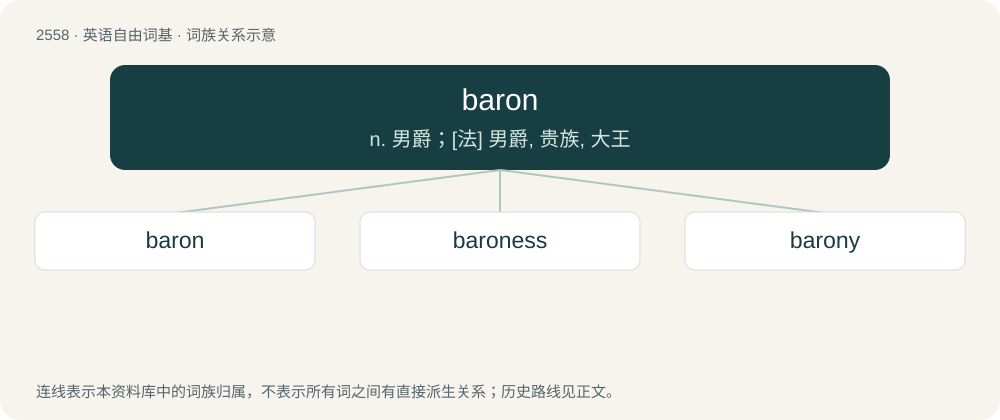

# 2662 · baron — n. 男爵；\[法\] 男爵, 贵族, 大王

[总目录](../00_总目录_按常用程度.md)

**类型**：英语自由词基　｜　**来源语言**：见词源记录

## 核心含义与来源

- 核心含义：n. 男爵；\[法\] 男爵, 贵族, 大王
- 英文含义：The male ruler of a barony.
- 词形：baron

**来源记录 1**（名词；The male ruler of a barony.）

From Middle English baroun, from Old French baron, from Latin barōnem, from Proto-West Germanic \*barō, ultimately from Proto-Indo-European \*bʰer- (“to bear”). Cognate with Old High German \*baro (“human being, man, freeman”), Old English bora (“a man who bears responsibility, one who is in charge, a ruler”), and perhaps to Old English beorn (“man, warrior”). Used in early Germanic law in the sense of "man, human being". A Celtic origin has also been suggested; see the quote under sense 3 of Latin barō. However, the OED takes the hypothetical Proto-Celtic \*bar- (“hero”) to be a figment.

## 词族图

## 单词速览（常用到不常用）

| 单词 | 音标 | 释义 |
|---|---|---|
| [baron](#w-1) | 英 /ˈbæɹən/；/ˈbæɹən/ | n. 男爵；\[法\] 男爵, 贵族, 大王 |
| [baroness](#w-2) | 英 /ˌbæ.ɹəˈnɛs/ | n. 男爵夫人, 女性男爵 |
| [barony](#w-3) | 英 /ˈbæ.ɹə.ni/ | n. 男爵领地, 男爵爵位 |

## 逐词详解

### 1. baron

**词性**：名词　｜　**音标**：英 /ˈbæɹən/；/ˈbæɹən/

**中文释义**：n. 男爵；\[法\] 男爵, 贵族, 大王

**英文义项**：The male ruler of a barony. / A male member of the lowest rank of English nobility (the equivalent rank in Scotland is lord).

**词源与演化**：

From Middle English baroun, from Old French baron, from Latin barōnem, from Proto-West Germanic \*barō, ultimately from Proto-Indo-European \*bʰer- (“to bear”). Cognate with Old High German \*baro (“human being, man, freeman”), Old English bora (“a man who bears responsibility, one who is in charge, a ruler”), and perhaps to Old English beorn (“man, warrior”). Used in early Germanic law in the sense of "man, human being". A Celtic origin has also been suggested; see the quote under sense 3 of Latin barō. However, the OED takes the hypothetical Proto-Celtic \*bar- (“hero”) to be a figment.

**用法示例／搭配（非完整句）**：

> railroad baron

该用例对应义项：A person of great power in society, especially in business and politics.

### 2. baroness

**词性**：名词　｜　**音标**：英 /ˌbæ.ɹəˈnɛs/

**中文释义**：n. 男爵夫人, 女性男爵

**英文义项**：The wife of a baron. / A woman holding a baronial title in her own right; a female ruler of a barony.

**构词拆分**：baron + -ess

**词源与演化**：

From Middle English baronesse; equivalent to baron + -ess.

**例句**：

> You've still got time, dear baroness.

### 3. barony

**词性**：名词　｜　**音标**：英 /ˈbæ.ɹə.ni/

**中文释义**：n. 男爵领地, 男爵爵位

**英文义项**：Any large manor or estate, regardless of its owner's rank. / Baronship, the rank or position of a baron.

**构词拆分**：baron + -y

**词源与演化**：

From Middle English baronie, baronye, from Old French baronie, equivalent to baron + -y.
