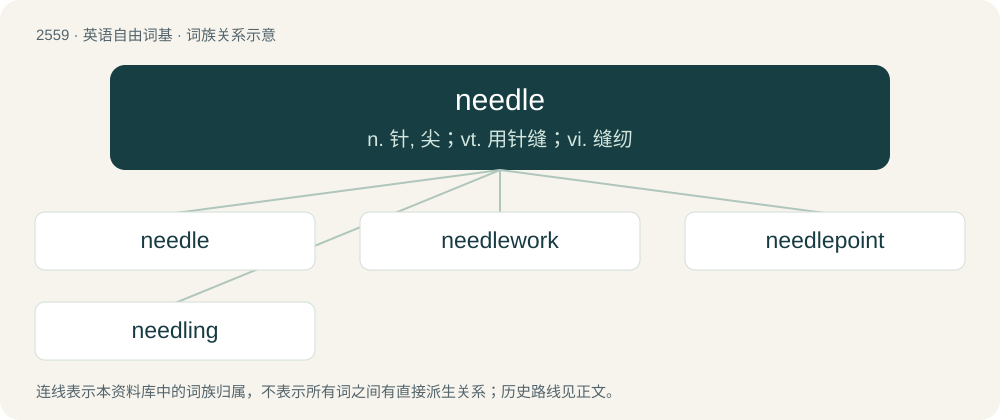

# 2665 · needle — n. 针, 尖；vt. 用针缝；vi. 缝纫

[总目录](../00_总目录_按常用程度.md)

**类型**：英语自由词基　｜　**来源语言**：见词源记录

## 核心含义与来源

- 核心含义：n. 针, 尖；vt. 用针缝；vi. 缝纫
- 英文含义：A long, thin, sharp implement usually for piercing as in sewing, embroidery, acupuncture, tattooing, body piercing, medical injections, sutures, etc; or a blunt but otherwise similar implement used for forming loops or knots in crafts such as darning, knitting, tatting, etc.
- 词形：needle

**来源记录 1**（名词；A long, thin, sharp implement usually for piercing as in sewing, embroidery, acupuncture, tattooing, body piercing, medical injections, sutures, etc; or a blunt but otherwise similar implement used for forming loops or knots in crafts such as darning, knitting, tatting, etc.）

From Middle English nedle, from Old English nǣdl, from Proto-West Germanic \*nāþlu, from Proto-Germanic \*nēþlō, from pre-Germanic \*neh₁-tleh₂, from Proto-Indo-European \*(s)neh₁- (“to spin, twist”). Cognates Cognate with Saterland Frisian Näddele (“sewing needle”), Dutch naald (“needle”), German Nadel (“needle, pin, crochet hook”), nähen (“sew”), Luxembourgish Nol (“needle”), Vilamovian nöłd (“needle”), Yiddish נאָדל (nodl, “needle, pin”), Danish, Norwegian Bokmål, Norwegian Nynorsk, Swedish nål (“needle”), Elfdalian ną̊l (“needle”), Faroese, Icelandic nál (“needle”), Gothic 𐌽𐌴𐌸𐌻𐌰 (nēþla, “sewing needle”), Finnish neula (“needle”). Further related with Welsh nyddu, Latin nēre, Sanskrit स्नायति (snāyati, “wraps up, winds”). Related to snood.

## 词族图

## 单词速览（常用到不常用）

| 单词 | 音标 | 释义 |
|---|---|---|
| [needle](#w-1) | /ˈniː.dəl/ | n. 针, 尖；vt. 用针缝；vi. 缝纫 |
| [needlework](#w-2) | 英 /ˈniː.dəl.wɜːk/；美 /ˈniː.dəl.wɚk/ | n. 刺绣, 缝纫 |
| [needlepoint](#w-3) | /ˈniːdl̩ˌpɔɪnt/ | n. 针尖, 针绣花边 |
| [needling](#w-4) | /ˈnid(ə)lɪŋ/ | 【英文】The act of one who needles or annoys. |

## 逐词详解

### 1. needle

**词性**：名词　｜　**音标**：/ˈniː.dəl/

**中文释义**：n. 针, 尖；vt. 用针缝；vi. 缝纫

**英文义项**：A long, thin, sharp implement usually for piercing as in sewing, embroidery, acupuncture, tattooing, body piercing, medical injections, sutures, etc; or a blunt but otherwise similar implement used for forming loops or knots in crafts such as darning, knitting, tatting, etc. / Any slender, pointed object resembling a needle, such as a pointed crystal, a sharp pinnacle of rock, an obelisk, etc.

**词源与演化**：

From Middle English nedle, from Old English nǣdl, from Proto-West Germanic \*nāþlu, from Proto-Germanic \*nēþlō, from pre-Germanic \*neh₁-tleh₂, from Proto-Indo-European \*(s)neh₁- (“to spin, twist”). Cognates Cognate with Saterland Frisian Näddele (“sewing needle”), Dutch naald (“needle”), German Nadel (“needle, pin, crochet hook”), nähen (“sew”), Luxembourgish Nol (“needle”), Vilamovian nöłd (“needle”), Yiddish נאָדל (nodl, “needle, pin”), Danish, Norwegian Bokmål, Norwegian Nynorsk, Swedish nål (“needle”), Elfdalian ną̊l (“needle”), Faroese, Icelandic nál (“needle”), Gothic 𐌽𐌴𐌸𐌻𐌰 (nēþla, “sewing needle”), Finnish neula (“needle”). Further related with Welsh nyddu, Latin nēre, Sanskrit स्नायति (snāyati, “wraps up, winds”). Related to snood.

**例句**：

> Ziggy bought some diamond needles for his hi-fi phonograph.

该用例对应义项：A sensor for playing phonograph records, a phonograph stylus.

### 2. needlework

**词性**：名词　｜　**音标**：英 /ˈniː.dəl.wɜːk/；美 /ˈniː.dəl.wɚk/

**中文释义**：n. 刺绣, 缝纫

**英文义项**：The art or process of working with a needle especially in embroidery or needlepoint. / The product of such art or process.

**构词拆分**：needle + -work

**词源与演化**：

From needle + -work.

**例句**：

> Victorian ladies were expected to excel at needlework, and everybody read a lot.

### 3. needlepoint

**词性**：名词　｜　**音标**：/ˈniːdl̩ˌpɔɪnt/

**中文释义**：n. 针尖, 针绣花边

**英文义项**：A craft involving pulling yarn, thread, or floss through a canvas mesh to produce a decorative design. / An object made using that craft.

**构词拆分**：needle + point

**词源与演化**：

From needle + point.

### 4. needling

**词性**：名词　｜　**音标**：/ˈnid(ə)lɪŋ/

**英文义项**：The act of one who needles or annoys.

**构词拆分**：needle + -ing

**词源与演化**：

From needle + -ing.
