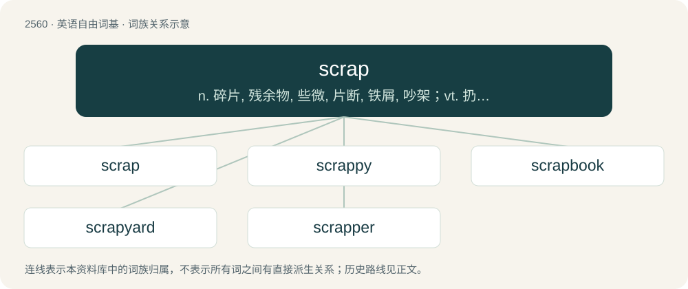

# 2666 · scrap — n. 碎片, 残余物, 些微, 片断, 铁屑, 吵架；vt. 扔弃, 敲碎, 拆毁；vi. 互相殴打

[总目录](../00_总目录_按常用程度.md)

**类型**：英语自由词基　｜　**来源语言**：见词源记录

## 核心含义与来源

- 核心含义：n. 碎片, 残余物, 些微, 片断, 铁屑, 吵架；vt. 扔弃, 敲碎, 拆毁；vi. 互相殴打
- 英文含义：A (small) piece; a fragment; a detached, incomplete portion.
- 词形：scrap

**多个词源／构词路径**：同一拼写可能有不同来源；以下按词性和含义分别列出。

**来源记录 1**（名词；A (small) piece; a fragment; a detached, incomplete portion.）

From Middle English scrappe, from Old Norse skrap, from skrapa (“to scrape, scratch”), from Proto-Germanic \*skrapōną, \*skrepaną (“to scrape, scratch”), from Proto-Indo-European \*skreb-, \*skrep- (“to engrave”). Cf. Swedish skräp (“garbage”).

**来源记录 2**（名词；A fight, tussle, skirmish.）

Perhaps from the obsolete colloquial meaning "sinister plot, scheme, villainy", or a dialectal variant of scrape.

## 词族图

## 单词速览（常用到不常用）

| 单词 | 音标 | 释义 |
|---|---|---|
| [scrap](#w-1) | /ˈskɹæp/ | n. 碎片, 残余物, 些微, 片断, 铁屑, 吵架；vt. 扔弃, 敲碎, 拆毁；vi. 互相殴打 |
| [scrappy](#w-2) | /ˈskɹæpi/ | a. 杂凑的, 不连贯的, 爱打架的, 坚决的 |
| [scrapbook](#w-3) | 美 /ˈskɹæpˌbʊk/ | n. 剪贴簿 |
| [scrapyard](#w-4) | /ˈskræpjɑːd/ | n. 废品堆放场 |
| [scrapper](#w-5) | /ˈskræpə/ | n. 好打架的人, 拳击手 |

## 逐词详解

### 1. scrap

**词性**：名词　｜　**音标**：/ˈskɹæp/

**中文释义**：n. 碎片, 残余物, 些微, 片断, 铁屑, 吵架；vt. 扔弃, 敲碎, 拆毁；vi. 互相殴打

**英文义项**：A (small) piece; a fragment; a detached, incomplete portion. / The smallest amount.

**词源与演化**：

From Middle English scrappe, from Old Norse skrap, from skrapa (“to scrape, scratch”), from Proto-Germanic \*skrapōną, \*skrepaną (“to scrape, scratch”), from Proto-Indo-European \*skreb-, \*skrep- (“to engrave”). Cf. Swedish skräp (“garbage”).

**例句**：

> Give the scraps to the animals: any meat to the dogs, and the rest to the hogs.

该用例对应义项：Leftover food.

### 2. scrappy

**词性**：形容词　｜　**音标**：/ˈskɹæpi/

**中文释义**：a. 杂凑的, 不连贯的, 爱打架的, 坚决的

**英文义项**：Consisting of scraps; fragmentary; lacking unity or consistency. / Having an aggressive spirit; inclined to fight or strive.

**构词拆分**：scrap + -y

**词源与演化**：

From scrap + -y.

**例句**：

> He's a scrappy dog and will charge at you if you taunt him.

该用例对应义项：Having an aggressive spirit; inclined to fight or strive.

### 3. scrapbook

**词性**：名词　｜　**音标**：美 /ˈskɹæpˌbʊk/

**中文释义**：n. 剪贴簿

**英文义项**：A book, similar to a notebook or journal, in which personal or family memorabilia and photos are collected and arranged.

**构词拆分**：scrap + book

**词源与演化**：

From scrap + book.

**例句**：

> I love the scrapbook Tom made for me.

### 4. scrapyard

**词性**：名词　｜　**音标**：/ˈskræpjɑːd/

**中文释义**：n. 废品堆放场

**英文义项**：A junkyard; a place where scrap is stored, discarded or resold.

**构词拆分**：scrap + yard

**词源与演化**：

From scrap + yard.

**例句**：

> There's a lot of interesting stuff you can find if you scavenge in the scrapyard.

### 5. scrapper

**词性**：名词　｜　**音标**：/ˈskræpə/

**中文释义**：n. 好打架的人, 拳击手

**英文义项**：A person who disposes of scraps, such as one who collects scrap metal to sell to a scrap dealer. / A person who fights doggedly, who exhibits indomitable will.

**构词拆分**：From scrap + -er.

**词源与演化**：

From scrap + -er.

**例句**：

> After the uncle died they sold off most of his rustbuckets to a scrapper and kept one to fix up.

该用例对应义项：A person who disposes of scraps, such as one who collects scrap metal to sell to a scrap dealer.
