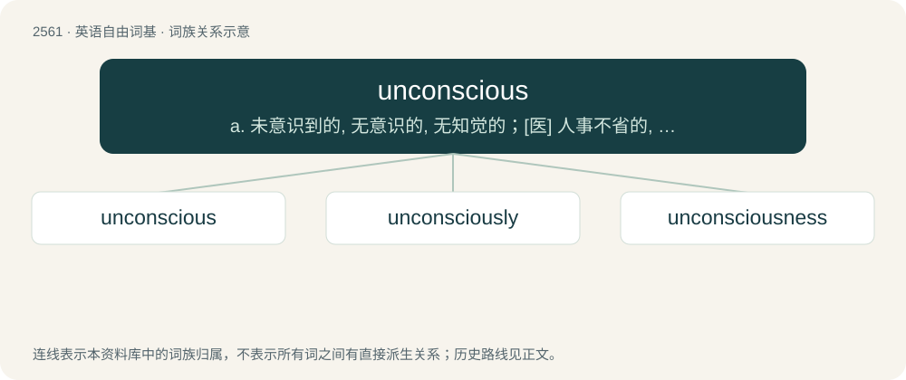

# 2667 · unconscious — a. 未意识到的, 无意识的, 无知觉的；\[医\] 人事不省的, 神志丧失的; 无意识的

[总目录](../00_总目录_按常用程度.md)

**类型**：英语自由词基　｜　**来源语言**：见词源记录

## 核心含义与来源

- 核心含义：a. 未意识到的, 无意识的, 无知觉的；\[医\] 人事不省的, 神志丧失的; 无意识的
- 英文含义：Not awake; having no awareness (usually as the result of a head injury).
- 词形：unconscious

**来源记录 1**（形容词；Not awake; having no awareness (usually as the result of a head injury).）

From un- + conscious.

## 词族图

## 单词速览（常用到不常用）

| 单词 | 音标 | 释义 |
|---|---|---|
| [unconscious](#w-1) | 英 /ˌʌnˈkɒnʃəs/；美 /ˌʌnˈkɑnʃəs/ | a. 未意识到的, 无意识的, 无知觉的；\[医\] 人事不省的, 神志丧失的; 无意识的 |
| [unconsciously](#w-2) | 英 /ˌʌnˈkɒnʃəsli/；美 /ˌʌnˈkɑnʃəsli/ | adv. 无意识地, 无意中, 不知不觉地 |
| [unconsciousness](#w-3) | /.ʌnˈkɒnʃəsnis/ | n. 无意识, 意识不清, 人事不省；\[医\] 人事不省, 神志丧失; 无意识 |

## 逐词详解

### 1. unconscious

**词性**：形容词　｜　**音标**：英 /ˌʌnˈkɒnʃəs/；美 /ˌʌnˈkɑnʃəs/

**中文释义**：a. 未意识到的, 无意识的, 无知觉的；\[医\] 人事不省的, 神志丧失的; 无意识的

**英文义项**：Not awake; having no awareness (usually as the result of a head injury). / Without directed thought or awareness.

**构词拆分**：un- + conscious

**词源与演化**：

From un- + conscious.

**例句**：

> After the anesthetist administered the general anesthetic the patient was unconscious.

该用例对应义项：Not awake; having no awareness (usually as the result of a head injury).

### 2. unconsciously

**词性**：副词　｜　**音标**：英 /ˌʌnˈkɒnʃəsli/；美 /ˌʌnˈkɑnʃəsli/

**中文释义**：adv. 无意识地, 无意中, 不知不觉地

**英文义项**：In an unconscious manner; unknowingly

**构词拆分**：un- + consciously；unconscious + -ly

**词源与演化**：

From un- + consciously, and more rarely, from unconscious + -ly.

**例句**：

> I end up unconsciously trying to get fit as summer draws near.

### 3. unconsciousness

**词性**：名词　｜　**音标**：/.ʌnˈkɒnʃəsnis/

**中文释义**：n. 无意识, 意识不清, 人事不省；\[医\] 人事不省, 神志丧失; 无意识

**英文义项**：The state of lacking consciousness, of being unconscious / ignorance or innocence; the state of being uninformed or unaware

**构词拆分**：unconscious + -ness；un- + consciousness

**词源与演化**：

From unconscious + -ness or un- + consciousness.

**例句**：

> I was roused from unconsciousness by the alarm clock.

该用例对应义项：The state of lacking consciousness, of being unconscious
