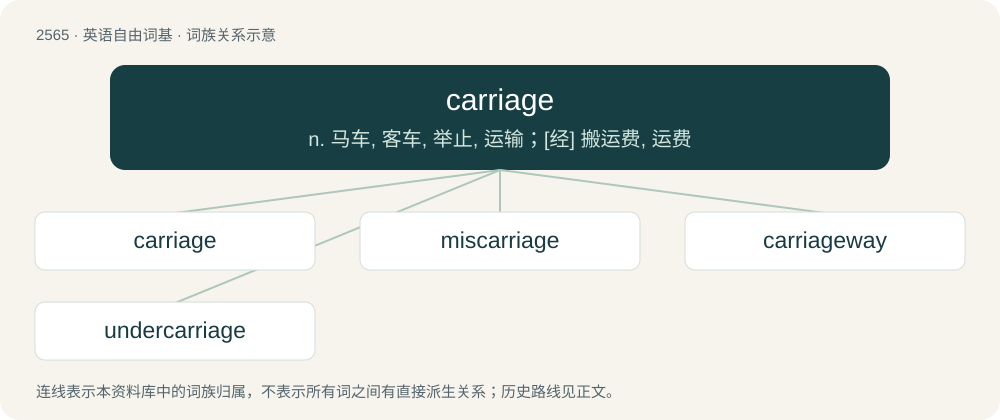

# 2670 · carriage — n. 马车, 客车, 举止, 运输；\[经\] 搬运费, 运费

[总目录](../00_总目录_按常用程度.md)

**类型**：英语自由词基　｜　**来源语言**：见词源记录

## 核心含义与来源

- 核心含义：n. 马车, 客车, 举止, 运输；\[经\] 搬运费, 运费
- 英文含义：The act of conveying; carrying.
- 词形：carriage

**来源记录 1**（名词；The act of conveying; carrying.）

From Middle English cariage, from Old Northern French cariage, from carier (“to carry”).

## 词族图

## 单词速览（常用到不常用）

| 单词 | 音标 | 释义 |
|---|---|---|
| [carriage](#w-1) | 英 /ˈkæɹɪd͡ʒ/；美 /ˈkæɹɪd͡ʒ/ | n. 马车, 客车, 举止, 运输；\[经\] 搬运费, 运费 |
| [miscarriage](#w-2) | 英 /ˈmɪskaɹɪd͡ʒ/；美 /ˈmɪs.kæɹ.əd͡ʒ/ | n. 失败, 误送, 流产；\[医\] 流产 |
| [carriageway](#w-3) | /ˈkæridʒwei/ | n. 车行道；\[法\] 车道, 马路 |
| [undercarriage](#w-4) | 英 /ˈʌndəˌkæɹɪd͡ʒ/；美 /ˈʌndɚˌkɛɹɪd͡ʒ/ | n. 底盘, 起落架 |

## 逐词详解

### 1. carriage

**词性**：名词　｜　**音标**：英 /ˈkæɹɪd͡ʒ/；美 /ˈkæɹɪd͡ʒ/

**中文释义**：n. 马车, 客车, 举止, 运输；\[经\] 搬运费, 运费

**英文义项**：The act of conveying; carrying. / A means of conveyance.

**词源与演化**：

From Middle English cariage, from Old Northern French cariage, from carier (“to carry”).

**例句**：

> The runner has a very low arm carriage.

该用例对应义项：The manner or posture in which one holds or positions a body part, such as one's arm or head.

### 2. miscarriage

**词性**：名词　｜　**音标**：英 /ˈmɪskaɹɪd͡ʒ/；美 /ˈmɪs.kæɹ.əd͡ʒ/

**中文释义**：n. 失败, 误送, 流产；\[医\] 流产

**英文义项**：A failure; a mistake or error. / The spontaneous natural termination of a pregnancy, especially before it is viable; the fatal expulsion of a foetus from the womb before term.

**构词拆分**：mis- + carriage

**词源与演化**：

From mis- + carriage.

**例句**：

> My friend had a miscarriage and I don't know how to comfort her.

### 3. carriageway

**词性**：名词　｜　**音标**：/ˈkæridʒwei/

**中文释义**：n. 车行道；\[法\] 车道, 马路

**英文义项**：The part of a road that carries traffic. / One side of a dual carriageway that carries traffic in a single direction.

**构词拆分**：carriage + way

**词源与演化**：

From carriage + way.

**例句**：

> The car came off the carriageway, due to icy conditions on the road.

### 4. undercarriage

**词性**：名词　｜　**音标**：英 /ˈʌndəˌkæɹɪd͡ʒ/；美 /ˈʌndɚˌkɛɹɪd͡ʒ/

**中文释义**：n. 底盘, 起落架

**英文义项**：The supporting structural framework of a land vehicle (such as a car, truck, van, wagon, etc). / The landing gear of an aircraft.

**构词拆分**：under- + carriage

**词源与演化**：

From under- + carriage.
