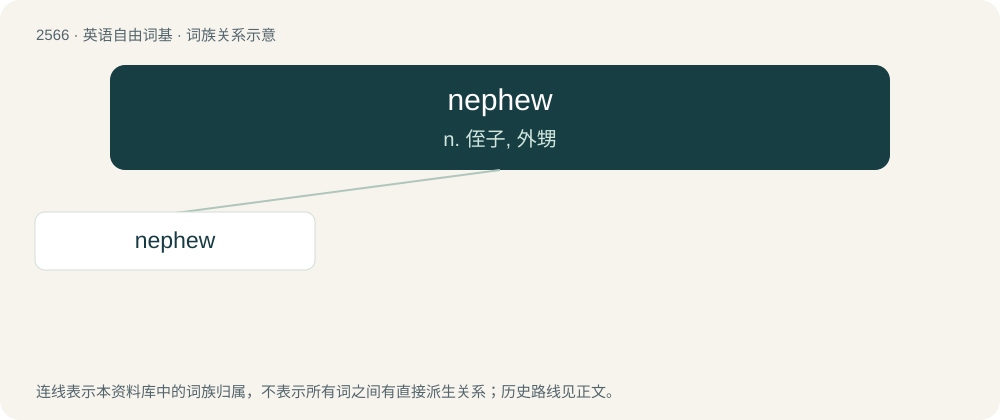

# 2671 · nephew — n. 侄子, 外甥

[总目录](../00_总目录_按常用程度.md)

**类型**：英语自由词基　｜　**来源语言**：见词源记录

## 核心含义与来源

- 核心含义：n. 侄子, 外甥
- 英文含义：A son of one's sibling, brother-in-law, or sister-in-law; either a son of one's brother (fraternal nephew) or a son of one's sister (sororal nephew).
- 词形：nephew

**来源记录 1**（名词；A son of one's sibling, brother-in-law, or sister-in-law; either a son of one's brother (fraternal nephew) or a son of one's sister (sororal nephew).）

From Middle English nevew, neveu (“nephew, grandson”), from Old French neveu, from Latin nepos, nepōtem, from Proto-Italic \*nepōts (“nephew, grandson”), whence also French neveu, Italian nipote. Displaced or absorbed the inherited English neve (“nephew, grandson, male cousin”), from Middle English neve, from Old English nefa, from Proto-West Germanic \*nefō, from Proto-Germanic \*nefô (“nephew, grandson”), whence Dutch neef, German Neffe. All ultimately from Proto-Indo-European \*népōts (“grandchild, sister's son”). Cognate with Serbo-Croatian nećak, Irish nia, Persian نوه (nave). Doublet of neve. Spelt with -ph- by readaptation to Latin nepos since the 15th century, which later triggered the spelling pronunciation with /f/.

## 词族图

## 单词速览（常用到不常用）

| 单词 | 音标 | 释义 |
|---|---|---|
| [nephew](#w-1) | 英 /ˈnɛv.ju/；/ˈnɛf.ju/ | n. 侄子, 外甥 |

## 逐词详解

### 1. nephew

**词性**：名词　｜　**音标**：英 /ˈnɛv.ju/；/ˈnɛf.ju/

**中文释义**：n. 侄子, 外甥

**英文义项**：A son of one's sibling, brother-in-law, or sister-in-law; either a son of one's brother (fraternal nephew) or a son of one's sister (sororal nephew). / A son of one's cousin or cousin-in-law

**词源与演化**：

From Middle English nevew, neveu (“nephew, grandson”), from Old French neveu, from Latin nepos, nepōtem, from Proto-Italic \*nepōts (“nephew, grandson”), whence also French neveu, Italian nipote. Displaced or absorbed the inherited English neve (“nephew, grandson, male cousin”), from Middle English neve, from Old English nefa, from Proto-West Germanic \*nefō, from Proto-Germanic \*nefô (“nephew, grandson”), whence Dutch neef, German Neffe. All ultimately from Proto-Indo-European \*népōts (“grandchild, sister's son”). Cognate with Serbo-Croatian nećak, Irish nia, Persian نوه (nave). Doublet of neve. Spelt with -ph- by readaptation to Latin nepos since the 15th century, which later triggered the spelling pronunciation with /f/.

**例句**：

> Since my nephew was still young, he was let off the hook.
