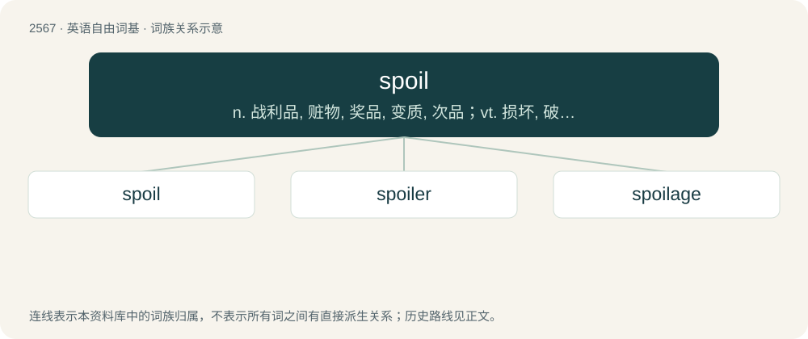

# 2672 · spoil — n. 战利品, 赃物, 奖品, 变质, 次品；vt. 损坏, 破坏, 溺爱；vi. 腐坏, 掠夺

[总目录](../00_总目录_按常用程度.md)

**类型**：英语自由词基　｜　**来源语言**：见词源记录

## 核心含义与来源

- 核心含义：n. 战利品, 赃物, 奖品, 变质, 次品；vt. 损坏, 破坏, 溺爱；vi. 腐坏, 掠夺
- 英文含义：To ruin; to damage in such a way as to make undesirable or unusable.
- 词形：spoil

**来源记录 1**（动词；To ruin; to damage in such a way as to make undesirable or unusable.）

From Middle English spoilen, spuylen, borrowed from Old French espoillier, espollier, espuler, from Latin spoliō, spoliāre (“pillage, ruin, spoil”).

## 词族图

## 单词速览（常用到不常用）

| 单词 | 音标 | 释义 |
|---|---|---|
| [spoil](#w-1) | /spɔɪl/ | n. 战利品, 赃物, 奖品, 变质, 次品；vt. 损坏, 破坏, 溺爱；vi. 腐坏, 掠夺 |
| [spoiler](#w-2) | 英 /ˈspɔɪ.lə/；美 /ˈspɔɪ.lɚ/ | n. 掠夺者, 搞坏事情的人, 宠坏别人的人 |
| [spoilage](#w-3) | /ˈspɒilidʒ/ | n. 变质, 糟蹋, 损耗, 损坏；\[经\] (原料,材料,产品)损坏 |

## 逐词详解

### 1. spoil

**词性**：动词　｜　**音标**：/spɔɪl/

**中文释义**：n. 战利品, 赃物, 奖品, 变质, 次品；vt. 损坏, 破坏, 溺爱；vi. 腐坏, 掠夺

**英文义项**：To ruin; to damage in such a way as to make undesirable or unusable. / To ruin the character of, by overindulgence; to coddle or pamper to excess.

**词源与演化**：

From Middle English spoilen, spuylen, borrowed from Old French espoillier, espollier, espuler, from Latin spoliō, spoliāre (“pillage, ruin, spoil”).

**例句**：

> Make sure you put the milk back in the fridge; otherwise it will spoil.

该用例对应义项：To go bad; to become sour or rancid; to decay.

### 2. spoiler

**词性**：名词　｜　**音标**：英 /ˈspɔɪ.lə/；美 /ˈspɔɪ.lɚ/

**中文释义**：n. 掠夺者, 搞坏事情的人, 宠坏别人的人

**英文义项**：One who spoils; a plunderer; a pillager; a robber; a despoiler. / One who corrupts, mars, or renders useless.

**构词拆分**：spoil + -er

**词源与演化**：

From spoil + -er.

**例句**：

> Good netiquette dictates that one warn of spoilers before discussing them, so that readers who wish to do so may experience the surprises for themselves.

该用例对应义项：A document, review or comment that discloses the ending or some key surprise or twist in a story, or the internal rules controlling the behaviour of a video game, etc.

### 3. spoilage

**词性**：名词　｜　**音标**：/ˈspɒilidʒ/

**中文释义**：n. 变质, 糟蹋, 损耗, 损坏；\[经\] (原料,材料,产品)损坏

**英文义项**：The part of something that has spoiled. / The process of spoiling.

**构词拆分**：spoil + -age

**词源与演化**：

From spoil + -age.

**例句**：

> To prevent spoilage, store in a cool, dry place.

该用例对应义项：The process of spoiling.
