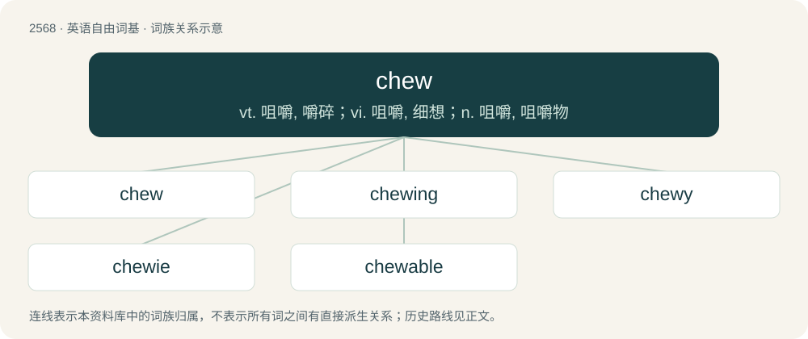

# 2673 · chew — vt. 咀嚼, 嚼碎；vi. 咀嚼, 细想；n. 咀嚼, 咀嚼物

[总目录](../00_总目录_按常用程度.md)

**类型**：英语自由词基　｜　**来源语言**：见词源记录

## 核心含义与来源

- 核心含义：vt. 咀嚼, 嚼碎；vi. 咀嚼, 细想；n. 咀嚼, 咀嚼物
- 英文含义：To crush with the teeth by repeated closing and opening of the jaws; done to food to soften it and break it down by the action of saliva before it is swallowed.
- 词形：chew

**多个词源／构词路径**：同一拼写可能有不同来源；以下按词性和含义分别列出。

**来源记录 1**（动词；To crush with the teeth by repeated closing and opening of the jaws; done to food to soften it and break it down by the action of saliva before it is swallowed.）

From Middle English chewen, from Old English ċēowan, from Proto-West Germanic \*keuwan, from Proto-Germanic \*kewwaną, from Proto-Indo-European \*ǵyewh₁-. Cognate with West Frisian kôgje, Low German käwwen, Dutch kauwen, German kauen; also Latin gingīva (“gums”), Tocharian B śuwaṃ (“to eat”), Polish żuć (“to chew”), Persian جویدن (javidan), Pashto ژُوَل (žovạl, “to bite, gnaw”).

**来源记录 2**（名词；The act of chewing; mastication with the mouth.）

From Middle English chew, cheu, icheu, from Old English \*ċēaw, \*ġeċēaw (“chewing”), from Proto-West Germanic \*kauw, \*gakauw (“chewing”), from Proto-Germanic \*kewwaną (“to chew”). Cognate with obsolete Dutch kauw (“chewing”), Dutch gekauw (“chewing”), West Frisian gekau (“chewing”).

## 词族图

## 单词速览（常用到不常用）

| 单词 | 音标 | 释义 |
|---|---|---|
| [chew](#w-1) | 英 /tʃuː/；美 /t͡ʃ(j)u/ | vt. 咀嚼, 嚼碎；vi. 咀嚼, 细想；n. 咀嚼, 咀嚼物 |
| [chewing](#w-2) |  | \[医\] \[咀\]嚼 |
| [chewy](#w-3) | /ˈt͡ʃuː.i/ | a. 需要多嚼的, 难嚼的 |
| [chewie](#w-4) | /ˈt͡ʃuː.i/ | n. &lt;澳口&gt;胶姆糖,口香糖,橡皮糖 |
| [chewable](#w-5) |  | a. chew的变形 |

## 逐词详解

### 1. chew

**词性**：动词　｜　**音标**：英 /tʃuː/；美 /t͡ʃ(j)u/

**中文释义**：vt. 咀嚼, 嚼碎；vi. 咀嚼, 细想；n. 咀嚼, 咀嚼物

**英文义项**：To crush with the teeth by repeated closing and opening of the jaws; done to food to soften it and break it down by the action of saliva before it is swallowed. / To grind, tear, or otherwise degrade or demolish something with teeth or as with teeth.

**词源与演化**：

From Middle English chewen, from Old English ċēowan, from Proto-West Germanic \*keuwan, from Proto-Germanic \*kewwaną, from Proto-Indo-European \*ǵyewh₁-. Cognate with West Frisian kôgje, Low German käwwen, Dutch kauwen, German kauen; also Latin gingīva (“gums”), Tocharian B śuwaṃ (“to eat”), Polish żuć (“to chew”), Persian جویدن (javidan), Pashto ژُوَل (žovạl, “to bite, gnaw”).

**例句**：

> He keeps his feed in steel drums to prevent the mice from chewing holes in the feed-sacks.

该用例对应义项：To grind, tear, or otherwise degrade or demolish something with teeth or as with teeth.

### 2. chewing

**词性**：名词

**中文释义**：\[医\] \[咀\]嚼

**英文义项**：The act by which something is chewed on; mastication. / The consumption of (the juice from) the khat plant.

**构词拆分**：chew + -ing

**词源与演化**：

From Middle English chewyng, chewynge, from Old English ċīwung, ċȳwung, ċēowung (“chewing”), equivalent to chew + -ing.

**例句**：

> Tom got some chewing gum stuck on the bottom of his shoe.

### 3. chewy

**词性**：形容词　｜　**音标**：/ˈt͡ʃuː.i/

**中文释义**：a. 需要多嚼的, 难嚼的

**英文义项**：Having a pliable or springy texture when chewed. / Prone to chewing.

**构词拆分**：From chew + -y.

**词源与演化**：

From chew + -y.

**例句**：

> I must have spent an hour gnawing on the chewy taffy.

该用例对应义项：Having a pliable or springy texture when chewed.

### 4. chewie

**词性**：名词　｜　**音标**：/ˈt͡ʃuː.i/

**中文释义**：n. &lt;澳口&gt;胶姆糖,口香糖,橡皮糖

**英文义项**：Chewing gum. / A chewable treat or toy intended for a pet.

**构词拆分**：From chew + -ie.

**词源与演化**：

From chew + -ie.

### 5. chewable

**词性**：形容词

**中文释义**：a. chew的变形

**英文义项**：Capable of being chewed. / Chewy.

**构词拆分**：chew + -able

**词源与演化**：

From chew + -able.
