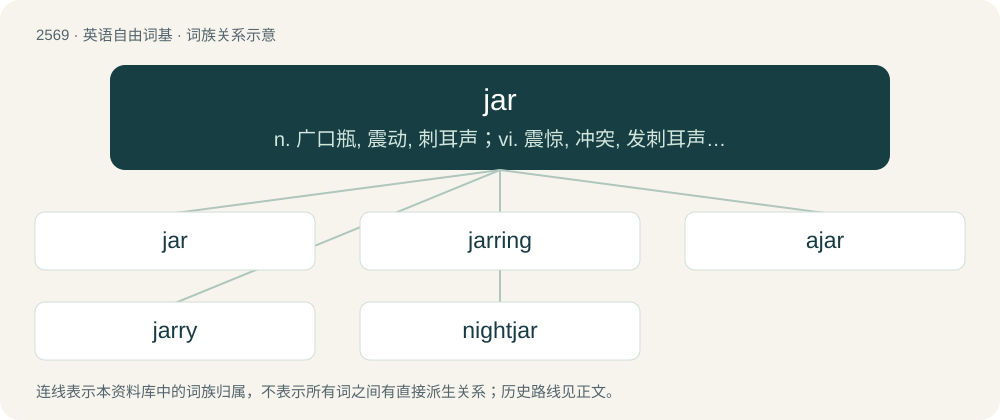

# 2674 · jar — n. 广口瓶, 震动, 刺耳声；vi. 震惊, 冲突, 发刺耳声, 不一致；vt. 震动, 刺激

[总目录](../00_总目录_按常用程度.md)

**类型**：英语自由词基　｜　**来源语言**：见词源记录

## 核心含义与来源

- 核心含义：n. 广口瓶, 震动, 刺耳声；vi. 震惊, 冲突, 发刺耳声, 不一致；vt. 震动, 刺激
- 英文含义：An earthenware container, either with two or no handles, for holding oil, water, wine, etc., or used for burial.
- 词形：jar

**多个词源／构词路径**：同一拼写可能有不同来源；以下按词性和含义分别列出。

**来源记录 1**（名词；An earthenware container, either with two or no handles, for holding oil, water, wine, etc., or used for burial.）

Inherited from Middle English jarre (“jar”), from Medieval Latin jarra, or from Middle French jarre (“liquid measure”) (from Old French jare; modern French jarre (“earthenware jar”)), or from Spanish jarra, jarro (“jug, pitcher; mug, stein”), all from Arabic جَرَّة (jarra, “earthen receptacle”). The word is cognate with Italian giara (“jar; crock”), Occitan jarro, Portuguese jarra, jarro (“jug; ewer, pitcher”). The verb is derived from the noun.

**来源记录 2**（名词；A clashing or discordant set of sounds, particularly with a quivering or vibrating quality.）

From earlier jar, jur, jarre, jurre, of uncertain origin. Possibly from earlier \*char, \*chur, \*charre, \*churre (now spelt chirr, churr (“to make a sound”); compare also nightjar and its variant nightchurr), from Middle English \*chirren, \*cherren, \*churren (“to sound, cry, murmur, complain”), from Old English ċeorian (“to murmur, gripe, complain with just cause”), from Proto-West Germanic \*karēn (“to complain”). For the change of ch to j, compare also charm, jarm (“chirping”); achar, ajar (“slightly turned or open”), chaw, jaw, etc. The noun is derived from the verb.

## 词族图

## 单词速览（常用到不常用）

| 单词 | 音标 | 释义 |
|---|---|---|
| [jar](#w-1) | 英 /d͡ʒɑː/；美 /d͡ʒɑɹ/ | n. 广口瓶, 震动, 刺耳声；vi. 震惊, 冲突, 发刺耳声, 不一致；vt. 震动, 刺激 |
| [jarring](#w-2) | /ˈdʒɑːriŋ/ | a. 辗轧的, 刺耳的, 不和谐的；n. 辗轧声, 震动, 冲突 |
| [ajar](#w-3) | 英 /əˈd͡ʒɑː/；美 /əˈd͡ʒɑɹ/ | 【英文】To show variance or contradiction with something; to be or cause to be askew. |
| [jarry](#w-4) | /dʒærɪ/ | \[人名\] 贾里 |
| [nightjar](#w-5) | 英 /ˈnaɪtd͡ʒɑː/；美 /ˈnaɪtd͡ʒɑɹ/ | n. \[鸟\]欧夜鹰, 蚊母鹰 |

## 逐词详解

### 1. jar

**词性**：名词　｜　**音标**：英 /d͡ʒɑː/；美 /d͡ʒɑɹ/

**中文释义**：n. 广口瓶, 震动, 刺耳声；vi. 震惊, 冲突, 发刺耳声, 不一致；vt. 震动, 刺激

**英文义项**：An earthenware container, either with two or no handles, for holding oil, water, wine, etc., or used for burial. / A small, approximately cylindrical container, normally made of clay or glass, for holding fruit, preserves, etc., or for ornamental purposes.

**词源与演化**：

Inherited from Middle English jarre (“jar”), from Medieval Latin jarra, or from Middle French jarre (“liquid measure”) (from Old French jare; modern French jarre (“earthenware jar”)), or from Spanish jarra, jarro (“jug, pitcher; mug, stein”), all from Arabic جَرَّة (jarra, “earthen receptacle”). The word is cognate with Italian giara (“jar; crock”), Occitan jarro, Portuguese jarra, jarro (“jug; ewer, pitcher”). The verb is derived from the noun.

**例句**：

> She refilled the jar with peanuts today evening.

该用例对应义项：An earthenware container, either with two or no handles, for holding oil, water, wine, etc., or used for burial.

### 2. jarring

**词性**：形容词　｜　**音标**：/ˈdʒɑːriŋ/

**中文释义**：a. 辗轧的, 刺耳的, 不和谐的；n. 辗轧声, 震动, 冲突

**英文义项**：That jars (clashes or disagrees); incongruous, conflictful.

**构词拆分**：jar + -ing

**词源与演化**：

From jar (“to clash, conflict, disturb”) + -ing.

**例句**：

> It's very jarring to hear uncensored songs with explicit lyrics playing in stores.

### 3. ajar

**词性**：动词　｜　**音标**：英 /əˈd͡ʒɑː/；美 /əˈd͡ʒɑɹ/

**英文义项**：To show variance or contradiction with something; to be or cause to be askew.

**构词拆分**：From a- (“in, at”) + jar (“discord, disagreement”).

**词源与演化**：

From a- (“in, at”) + jar (“discord, disagreement”).

### 4. jarry

**词性**：形容词　｜　**音标**：/dʒærɪ/

**中文释义**：\[人名\] 贾里

**英文义项**：Jarring, reverberating.

**构词拆分**：jar (“to vibrate, be discordant, disturb, clash”) + -y

**词源与演化**：

From jar (“to vibrate, be discordant, disturb, clash”) + -y.

### 5. nightjar

**词性**：名词　｜　**音标**：英 /ˈnaɪtd͡ʒɑː/；美 /ˈnaɪtd͡ʒɑɹ/

**中文释义**：n. \[鸟\]欧夜鹰, 蚊母鹰

**英文义项**：Any of various medium-sized nocturnal birds, of the family Caprimulgidae from the order Caprimulgiformes, that feed predominantly on moths and other large flying insects.

**构词拆分**：night + jar (“a discordant sound”)

**词源与演化**：

From night + jar (“a discordant sound”), due to the bird's harsh call.
