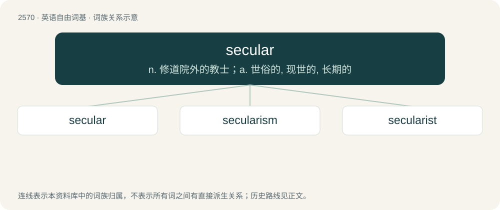

# 2675 · secular — n. 修道院外的教士；a. 世俗的, 现世的, 长期的

[总目录](../00_总目录_按常用程度.md)

**类型**：英语自由词基　｜　**来源语言**：见词源记录

## 核心含义与来源

- 核心含义：n. 修道院外的教士；a. 世俗的, 现世的, 长期的
- 英文含义：Not specifically religious; lay or civil, as opposed to clerical.
- 词形：secular

**来源记录 1**（形容词；Not specifically religious; lay or civil, as opposed to clerical.）

From Middle English seculer, from Old French seculer, from Latin saeculāris (“of the age”), from saeculum.

## 词族图

## 单词速览（常用到不常用）

| 单词 | 音标 | 释义 |
|---|---|---|
| [secular](#w-1) | 英 /ˈsɛkjʊlə/；美 /ˈsɛkjələɹ/ | n. 修道院外的教士；a. 世俗的, 现世的, 长期的 |
| [secularism](#w-2) | 英 /ˈsɛkjʊləɹɪzəm/；美 /ˈsɛkjələɹɪzəm/ | n. 现世主义, 宗教与教育分离论 |
| [secularist](#w-3) | /ˈsekjulərist/ | n. 现世主义者, 宗教与教育分离论者 |

## 逐词详解

### 1. secular

**词性**：形容词　｜　**音标**：英 /ˈsɛkjʊlə/；美 /ˈsɛkjələɹ/

**中文释义**：n. 修道院外的教士；a. 世俗的, 现世的, 长期的

**英文义项**：Not specifically religious; lay or civil, as opposed to clerical. / Temporal; worldly, or otherwise not based on something timeless.

**词源与演化**：

From Middle English seculer, from Old French seculer, from Latin saeculāris (“of the age”), from saeculum.

**例句**：

> The long-term growth in population and income accounts for most secular trends in economic phenomena.

该用例对应义项：Continuing over a long period of time.

### 2. secularism

**词性**：名词　｜　**音标**：英 /ˈsɛkjʊləɹɪzəm/；美 /ˈsɛkjələɹɪzəm/

**中文释义**：n. 现世主义, 宗教与教育分离论

**英文义项**：Neutrality towards all religions. / The political belief in the separation of church and state, i.e. the position that religious belief should not influence public and governmental decisions.

**构词拆分**：secular + -ism

**词源与演化**：

From secular + -ism.

**用法示例／搭配（非完整句）**：

> state secularism

该用例对应义项：Neutrality towards all religions.

### 3. secularist

**词性**：名词　｜　**音标**：/ˈsekjulərist/

**中文释义**：n. 现世主义者, 宗教与教育分离论者

**英文义项**：A person who believes in or supports secularism.

**构词拆分**：secular + -ist

**词源与演化**：

From secular + -ist.
