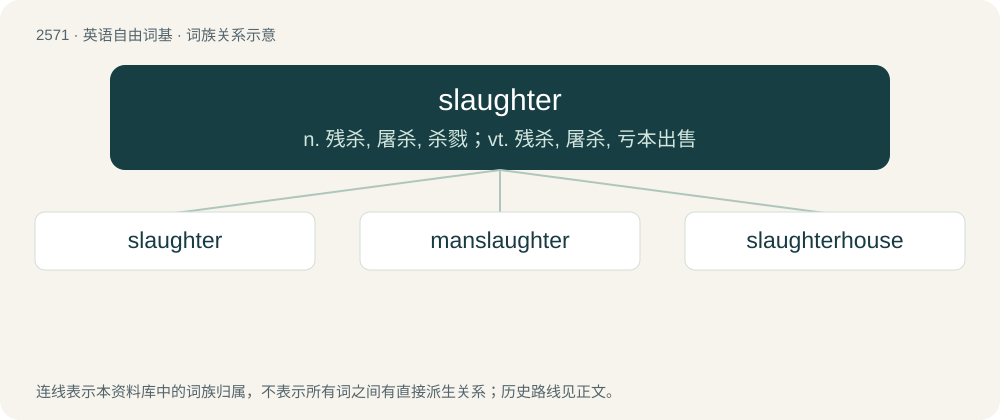

# 2676 · slaughter — n. 残杀, 屠杀, 杀戮；vt. 残杀, 屠杀, 亏本出售

[总目录](../00_总目录_按常用程度.md)

**类型**：英语自由词基　｜　**来源语言**：见词源记录

## 核心含义与来源

- 核心含义：n. 残杀, 屠杀, 杀戮；vt. 残杀, 屠杀, 亏本出售
- 英文含义：The killing of animals, generally for food.
- 词形：slaughter

**来源记录 1**（名词；The killing of animals, generally for food.）

From Middle English slaughter, from Old Norse \*slahtr, later sláttr, from Proto-Germanic \*slahtrą, from Proto-Germanic \*slahaną. Equivalent to slay + -ter (as in laughter). Eventually derived from Proto-Indo-European \*slak- (“to hit, strike, throw”). Related with Dutch slachten, German schlachten, Finnish lahdata (all “to slaughter”).

## 词族图

## 单词速览（常用到不常用）

| 单词 | 音标 | 释义 |
|---|---|---|
| [slaughter](#w-1) | 英 /ˈslɔːtə/；/ˈslɔtɚ/ | n. 残杀, 屠杀, 杀戮；vt. 残杀, 屠杀, 亏本出售 |
| [manslaughter](#w-2) | 英 /ˈmænˌslɔːtə/；美 /ˈmænˌslɔtɚ/ | n. 杀人, 过失杀人罪 |
| [slaughterhouse](#w-3) | 英 /ˈsloː.tə(ɹ).haʊs/ | n. 屠杀场 |

## 逐词详解

### 1. slaughter

**词性**：名词　｜　**音标**：英 /ˈslɔːtə/；/ˈslɔtɚ/

**中文释义**：n. 残杀, 屠杀, 杀戮；vt. 残杀, 屠杀, 亏本出售

**英文义项**：The killing of animals, generally for food. / A massacre; the killing of a large number of people.

**构词拆分**：slay + -ter

**词源与演化**：

From Middle English slaughter, from Old Norse \*slahtr, later sláttr, from Proto-Germanic \*slahtrą, from Proto-Germanic \*slahaną. Equivalent to slay + -ter (as in laughter). Eventually derived from Proto-Indo-European \*slak- (“to hit, strike, throw”). Related with Dutch slachten, German schlachten, Finnish lahdata (all “to slaughter”).

**例句**：

> As long as there are slaughter houses there will always be battlefields.

### 2. manslaughter

**词性**：名词　｜　**音标**：英 /ˈmænˌslɔːtə/；美 /ˈmænˌslɔtɚ/

**中文释义**：n. 杀人, 过失杀人罪

**英文义项**：The unlawful killing of a human, either in negligence or incidentally to the commission of some unlawful act, but without specific malice, or upon a sudden excitement of anger; considered less culpable than murder, but more culpable than justifiable homicide.

**构词拆分**：man + slaughter

**词源与演化**：

From Middle English manslaȝter, manslauter, equivalent to man + slaughter, or taken as an adaptation of Old English mansliht (“murder; killing of a person”), from mann (“person”) + sliht (“killing”), see manslaught. Cognate with Scots manslauchter (“homicide”). Compare also Old Frisian monslaga (“murder”).

**例句**：

> Sami is not guilty of murder. He's instead guilty of manslaughter.

### 3. slaughterhouse

**词性**：名词　｜　**音标**：英 /ˈsloː.tə(ɹ).haʊs/

**中文释义**：n. 屠杀场

**英文义项**：A place where animals are slaughtered. / The scene of a massacre.

**构词拆分**：slaughter + house

**词源与演化**：

From slaughter + house.

**例句**：

> Tom's mobile slaughterhouse was quickly shut down by the local authorities.
