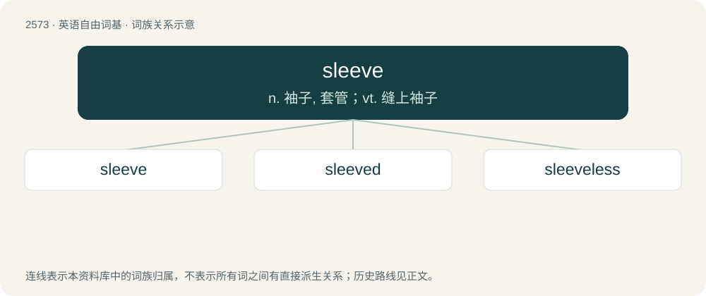

# 2679 · sleeve — n. 袖子, 套管；vt. 缝上袖子

[总目录](../00_总目录_按常用程度.md)

**类型**：英语自由词基　｜　**来源语言**：见词源记录

## 核心含义与来源

- 核心含义：n. 袖子, 套管；vt. 缝上袖子
- 英文含义：The part of a garment that covers the arm.
- 词形：sleeve

**来源记录 1**（名词；The part of a garment that covers the arm.）

From Middle English sleve, slefe, from Old English slīef and slīefe (“sleeve”). Cognate with Saterland Frisian Sleeuwe (“sleeve”), West Frisian slúf, Dutch sloof (“apron”), Low German sluve, dialectal German Schlaube. The Canadian sense of “measure smaller than a pint” is due to a former conflict between federal law and provincial law in British Columbia. According to federal law, a pint must be 20 imperial ounces (~568 ml), but according to provincial law at the time, the maximum individual serving size was 500 ml, so an individual portion could not be called a “pint” in British Columbia, and required a different term. The provincial law has been changed, allowing servings of up to 24 oz (~682 ml), but the term remains in use. The term sleeve itself for a cylindrical glass of beer is also found in the UK and Australia (as sleever), and may be due to stacked glasses resembling a sleeve.

## 词族图

## 单词速览（常用到不常用）

| 单词 | 音标 | 释义 |
|---|---|---|
| [sleeve](#w-1) | 英 /sliːv/；美 /sliv/ | n. 袖子, 套管；vt. 缝上袖子 |
| [sleeved](#w-2) |  | a. 装有袖子的 |
| [sleeveless](#w-3) | /ˈsliːvlɪs/ | a. 无袖的 |

## 逐词详解

### 1. sleeve

**词性**：名词　｜　**音标**：英 /sliːv/；美 /sliv/

**中文释义**：n. 袖子, 套管；vt. 缝上袖子

**英文义项**：The part of a garment that covers the arm. / A (usually tubular) covering or lining to protect a piece of machinery etc.

**词源与演化**：

From Middle English sleve, slefe, from Old English slīef and slīefe (“sleeve”). Cognate with Saterland Frisian Sleeuwe (“sleeve”), West Frisian slúf, Dutch sloof (“apron”), Low German sluve, dialectal German Schlaube. The Canadian sense of “measure smaller than a pint” is due to a former conflict between federal law and provincial law in British Columbia. According to federal law, a pint must be 20 imperial ounces (~568 ml), but according to provincial law at the time, the maximum individual serving size was 500 ml, so an individual portion could not be called a “pint” in British Columbia, and required a different term. The provincial law has been changed, allowing servings of up to 24 oz (~682 ml), but the term remains in use. The term sleeve itself for a cylindrical glass of beer is also found in the UK and Australia (as sleever), and may be due to stacked glasses resembling a sleeve.

**例句**：

> This bearing requires a sleeve so the shaft will fit snugly.

该用例对应义项：A (usually tubular) covering or lining to protect a piece of machinery etc.

### 2. sleeved

**词性**：形容词

**中文释义**：a. 装有袖子的

**英文义项**：Having sleeves. / Made with or having sleeves.

**构词拆分**：sleeve + -ed

**词源与演化**：

From Middle English \*sleved, \*isleved, from Old English ġeslīefed (“sleeved”), equivalent to sleeve + -ed.

### 3. sleeveless

**词性**：形容词　｜　**音标**：/ˈsliːvlɪs/

**中文释义**：a. 无袖的

**英文义项**：Of a garment, having no sleeves.

**构词拆分**：sleeve + -less

**词源与演化**：

From Middle English slevelees, sleveles, from Old English slīeflēas (“sleeveless”), equivalent to sleeve + -less.

**例句**：

> He's wearing a sleeveless shirt and a trucker hat.
