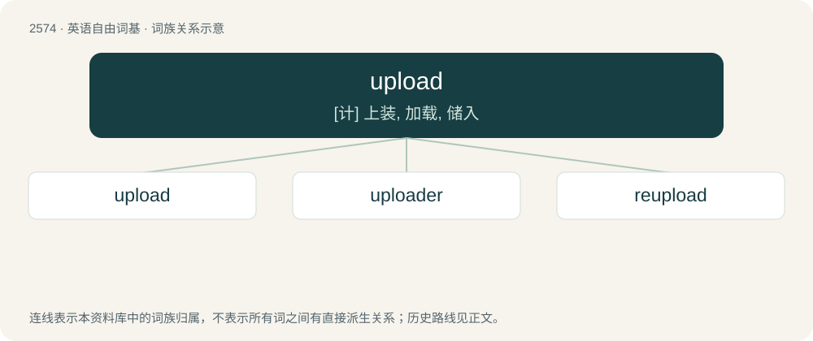

# 2680 · upload — \[计\] 上装, 加载, 储入

[总目录](../00_总目录_按常用程度.md)

**类型**：英语自由词基　｜　**来源语言**：见词源记录

## 核心含义与来源

- 核心含义：\[计\] 上装, 加载, 储入
- 英文含义：To transfer data to a computer on a network, especially to a server on the Internet.
- 词形：upload

**来源记录 1**（动词；To transfer data to a computer on a network, especially to a server on the Internet.）

From up- + load.

## 词族图

## 单词速览（常用到不常用）

| 单词 | 音标 | 释义 |
|---|---|---|
| [upload](#w-1) | 英 /ˌʌpˈləʊd/；美 /ˈʌpˌloʊd/ | \[计\] 上装, 加载, 储入 |
| [uploader](#w-2) |  | 主页更新软件; 支持ftp 方式上传。本软件是为了解决主页更新后的上传任务而开发的; 具有其他主页上传工具的功能; 而且还独创了本地站点镜像功能。可以解决主页更新后的比较与批量上传工作 |
| [reupload](#w-3) | /ɹiːˈʌpləʊd/ | 【英文】A second or subsequent upload. |

## 逐词详解

### 1. upload

**词性**：动词　｜　**音标**：英 /ˌʌpˈləʊd/；美 /ˈʌpˌloʊd/

**中文释义**：\[计\] 上装, 加载, 储入

**英文义项**：To transfer data to a computer on a network, especially to a server on the Internet. / To transfer jurisdiction and responsibility of a government asset or service to a higher level of government.

**构词拆分**：From up- + load.

**词源与演化**：

From up- + load.

**例句**：

> You will have to convert your photograph to a jpg format if you wish to upload it.

该用例对应义项：To transfer data to a computer on a network, especially to a server on the Internet.

### 2. uploader

**词性**：名词

**中文释义**：主页更新软件; 支持ftp 方式上传。本软件是为了解决主页更新后的上传任务而开发的; 具有其他主页上传工具的功能; 而且还独创了本地站点镜像功能。可以解决主页更新后的比较与批量上传工作

**英文义项**：Someone who uploads files. / A computer program that assists with the uploading of files.

**构词拆分**：upload + -er

**词源与演化**：

From upload + -er.

### 3. reupload

**词性**：名词　｜　**音标**：/ɹiːˈʌpləʊd/

**英文义项**：A second or subsequent upload.

**构词拆分**：re- + upload

**词源与演化**：

From re- + upload.

**例句**：

> Both of my reuploads failed.

该用例对应义项：A second or subsequent upload.
