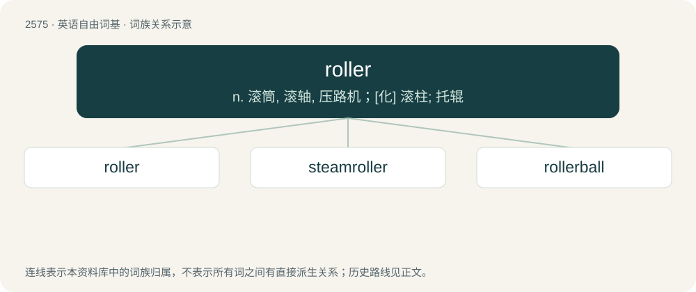

# 2681 · roller — n. 滚筒, 滚轴, 压路机；\[化\] 滚柱; 托辊

[总目录](../00_总目录_按常用程度.md)

**类型**：英语自由词基　｜　**来源语言**：见词源记录

## 核心含义与来源

- 核心含义：n. 滚筒, 滚轴, 压路机；\[化\] 滚柱; 托辊
- 英文含义：Any rotating cylindrical device that is part of a machine, especially one used to apply or reduce pressure.
- 词形：roller

**来源记录 1**（名词；Any rotating cylindrical device that is part of a machine, especially one used to apply or reduce pressure.）

\* From Middle English rollere, equivalent to roll + -er. \* (credits in TV or film): These were originally printed on a physical cylinder that was rotated in front of the camera.

## 词族图

## 单词速览（常用到不常用）

| 单词 | 音标 | 释义 |
|---|---|---|
| [roller](#w-1) | 英 /ˈɹəʊlə/；美 /ˈɹoʊlɚ/ | n. 滚筒, 滚轴, 压路机；\[化\] 滚柱; 托辊 |
| [steamroller](#w-2) | 美 /ˈstimˌroʊlɚ/ | vt.vi. 压垮, 压服；n. 蒸汽压路机, 高压力量, 高压手段 |
| [rollerball](#w-3) |  | 宝珠笔；签字笔 |

## 逐词详解

### 1. roller

**词性**：名词　｜　**音标**：英 /ˈɹəʊlə/；美 /ˈɹoʊlɚ/

**中文释义**：n. 滚筒, 滚轴, 压路机；\[化\] 滚柱; 托辊

**英文义项**：Any rotating cylindrical device that is part of a machine, especially one used to apply or reduce pressure. / A cylindrical (or approximately cylindrical) item used under a heavy object to facilitate moving it; usually several are needed.

**构词拆分**：roll + -er

**词源与演化**：

\* From Middle English rollere, equivalent to roll + -er. \* (credits in TV or film): These were originally printed on a physical cylinder that was rotated in front of the camera.

**例句**：

> He threw a beautiful roller that cut the corner perfectly and stopped just outside the circle.

该用例对应义项：A throw which involves the player throwing the disc in a way that makes it roll, by that being able to travel further than if thrown in the air. Only used on holes with open areas with short or no grass.

### 2. steamroller

**词性**：名词　｜　**音标**：美 /ˈstimˌroʊlɚ/

**中文释义**：vt.vi. 压垮, 压服；n. 蒸汽压路机, 高压力量, 高压手段

**英文义项**：Any heavy road roller. / Any seemingly irresistible force.

**构词拆分**：steam + roller

**词源与演化**：

From steam + roller.

**例句**：

> Horses used to pull road-rollers, but the steamroller arrived with the invention of the steam engine.

### 3. rollerball

**词性**：名词

**中文释义**：宝珠笔；签字笔

**英文义项**：A kind of ballpoint pen with a spherical nib that uses water-based liquid or gelled ink. / A trackball.

**构词拆分**：roller + ball

**词源与演化**：

From roller + ball.

**例句**：

> I prefer a felt-tip pen over a rollerball one.
