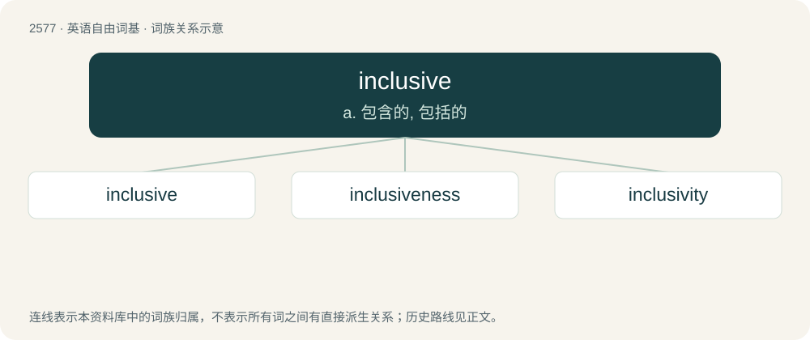

# 2683 · inclusive — a. 包含的, 包括的

[总目录](../00_总目录_按常用程度.md)

**类型**：英语自由词基　｜　**来源语言**：见词源记录

## 核心含义与来源

- 核心含义：a. 包含的, 包括的
- 英文含义：Including (almost) everything within its scope.
- 词形：inclusive

**来源记录 1**（形容词；Including (almost) everything within its scope.）

Derived from Middle French inclusif, from Medieval Latin inclūsīvus, from Latin inclūsus + -īvus.

## 词族图

## 单词速览（常用到不常用）

| 单词 | 音标 | 释义 |
|---|---|---|
| [inclusive](#w-1) | /ɪnˈkluːsɪv/ | a. 包含的, 包括的 |
| [inclusiveness](#w-2) |  | n. 包容性 |
| [inclusivity](#w-3) | /ˌɪŋkluːˈsɪvɪti/ | n. 包容性 |

## 逐词详解

### 1. inclusive

**词性**：形容词　｜　**音标**：/ɪnˈkluːsɪv/

**中文释义**：a. 包含的, 包括的

**英文义项**：Including (almost) everything within its scope. / Including the extremes as well as the area between.

**词源与演化**：

Derived from Middle French inclusif, from Medieval Latin inclūsīvus, from Latin inclūsus + -īvus.

**例句**：

> The pronoun in "If you want, we could go back to my place for coffee" is an inclusive "we".

该用例对应义项：Of, or relating to the first-person plural pronoun when including the person being addressed.

### 2. inclusiveness

**词性**：名词

**中文释义**：n. 包容性

**英文义项**：The property of being inclusive; inclusivity

**构词拆分**：inclusive + -ness

**词源与演化**：

From inclusive + -ness.

**例句**：

> Another student comments that Martin Luther King's message of inclusiveness made him feel better about his Hispanic heritage.

### 3. inclusivity

**词性**：名词　｜　**音标**：/ˌɪŋkluːˈsɪvɪti/

**中文释义**：n. 包容性

**英文义项**：The quality of being inclusive; inclusiveness.

**构词拆分**：inclusive + -ity

**词源与演化**：

From inclusive + -ity, modeled after exclusivity, 1920s, but in more common usage only since the late 1980s.

**例句**：

> Instead of being an advocate for inclusivity, the English teacher reinforced linguistic barriers.
