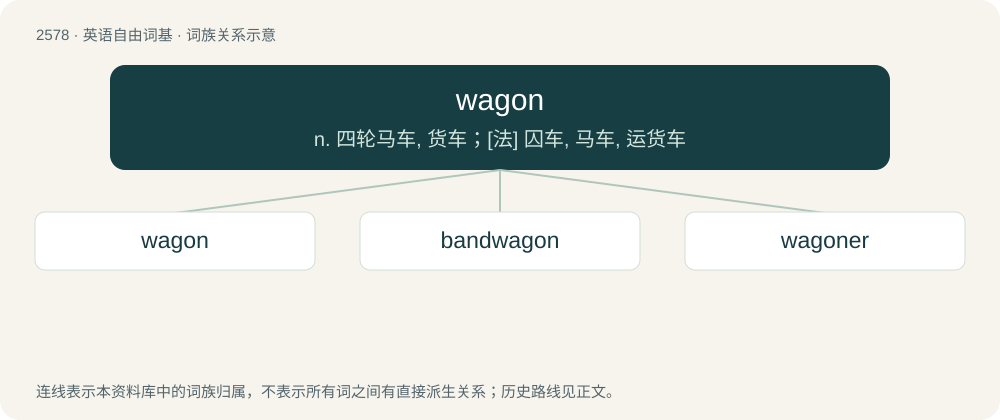

# 2684 · wagon — n. 四轮马车, 货车；\[法\] 囚车, 马车, 运货车

[总目录](../00_总目录_按常用程度.md)

**类型**：英语自由词基　｜　**来源语言**：见词源记录

## 核心含义与来源

- 核心含义：n. 四轮马车, 货车；\[法\] 囚车, 马车, 运货车
- 英文含义：A heavier four-wheeled (normally horse-drawn) vehicle designed to carry goods (or sometimes people).
- 词形：wagon

**来源记录 1**（名词；A heavier four-wheeled (normally horse-drawn) vehicle designed to carry goods (or sometimes people).）

Borrowed from Middle Dutch wagen, from Old Dutch \*wagan, from Proto-West Germanic \*wagn, from Proto-Germanic \*wagnaz (“wagon”), from Proto-Indo-European \*weǵʰ- (“to transport”). Generally displaced native cognate wain, from Old English wæġn, of which it is a doublet. Related also to way, weigh. Sense 8 (“woman of loose morals; obnoxious woman”) is probably a derogatory and jocular reference to a woman being “ridden”, that is, mounted for the purpose of sexual intercourse. The verb is derived from the noun.

## 词族图

## 单词速览（常用到不常用）

| 单词 | 音标 | 释义 |
|---|---|---|
| [wagon](#w-1) | 英 /ˈwæɡən/；/ˈwæːɡən/ | n. 四轮马车, 货车；\[法\] 囚车, 马车, 运货车 |
| [bandwagon](#w-2) | 英 /ˈbændˌwæɡ.ən/；/ˈbeə̯ndˌweɪ̯ɡ.ən/ | n. 乐队彩车, 流行 |
| [wagoner](#w-3) | /ˈwægənə/ | n. 运货马车车夫, 御夫(星)座, 北斗七星 |

## 逐词详解

### 1. wagon

**词性**：名词　｜　**音标**：英 /ˈwæɡən/；/ˈwæːɡən/

**中文释义**：n. 四轮马车, 货车；\[法\] 囚车, 马车, 运货车

**英文义项**：A heavier four-wheeled (normally horse-drawn) vehicle designed to carry goods (or sometimes people). / A shopping cart.

**词源与演化**：

Borrowed from Middle Dutch wagen, from Old Dutch \*wagan, from Proto-West Germanic \*wagn, from Proto-Germanic \*wagnaz (“wagon”), from Proto-Indo-European \*weǵʰ- (“to transport”). Generally displaced native cognate wain, from Old English wæġn, of which it is a doublet. Related also to way, weigh. Sense 8 (“woman of loose morals; obnoxious woman”) is probably a derogatory and jocular reference to a woman being “ridden”, that is, mounted for the purpose of sexual intercourse. The verb is derived from the noun.

**例句**：

> In the wagon were a few tools and some extra guns.

### 2. bandwagon

**词性**：名词　｜　**音标**：英 /ˈbændˌwæɡ.ən/；/ˈbeə̯ndˌweɪ̯ɡ.ən/

**中文释义**：n. 乐队彩车, 流行

**英文义项**：A large wagon used to carry a band of musicians in a parade. / A current movement that attracts wide support.

**构词拆分**：band + wagon

**词源与演化**：

From band + wagon.

**例句**：

> The gaudy bandwagon led the circus parade.

该用例对应义项：a large ornate wagon for carrying a musical band

### 3. wagoner

**词性**：名词　｜　**音标**：/ˈwægənə/

**中文释义**：n. 运货马车车夫, 御夫(星)座, 北斗七星

**英文义项**：Someone who drives a wagon. / One who transports the mined material away from the face in wagons.

**构词拆分**：From wagon + -er.

**词源与演化**：

From wagon + -er.
