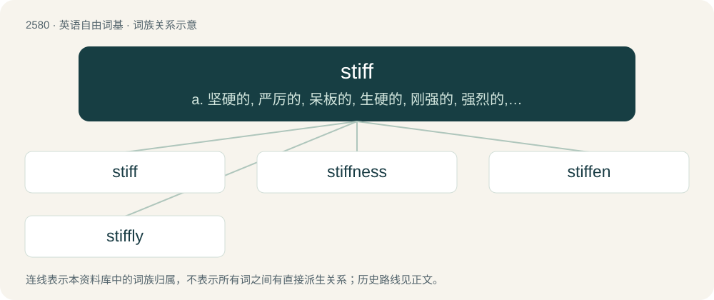

# 2685 · stiff — a. 坚硬的, 严厉的, 呆板的, 生硬的, 刚强的, 强烈的, 粘的, 稠的, 艰难的；n. 死尸, 醉鬼, 钞票；vt. 不肯付...小费

[总目录](../00_总目录_按常用程度.md)

**类型**：英语自由词基　｜　**来源语言**：见词源记录

## 核心含义与来源

- 核心含义：a. 坚硬的, 严厉的, 呆板的, 生硬的, 刚强的, 强烈的, 粘的, 稠的, 艰难的；n. 死尸, 醉鬼, 钞票；vt. 不肯付...小费
- 英文含义：Rigid; hard to bend; inflexible.
- 词形：stiff

**来源记录 1**（形容词；Rigid; hard to bend; inflexible.）

From Middle English stiff, stiffe, stif, from Old English stīf, from Proto-West Germanic \*stīf, from Proto-Germanic \*stīfaz, from Proto-Indo-European \*steypós. See also West Frisian stiif, Dutch stijf, Norwegian Bokmål stiv, German steif; also Latin stīpes, stīpō, from which English stevedore. The expected Modern English form would be /staɪf/; /stɪf/ is probably originally from compounds such as stiffly, where the vowel was shortened before a consonant cluster.

## 词族图

## 单词速览（常用到不常用）

| 单词 | 音标 | 释义 |
|---|---|---|
| [stiff](#w-1) | /stɪf/ | a. 坚硬的, 严厉的, 呆板的, 生硬的, 刚强的, 强烈的, 粘的, 稠的, 艰难的；n. 死尸, 醉鬼, 钞票；vt. 不肯付...小费 |
| [stiffness](#w-2) | /ˈstifnis/ | n. 坚硬, 呆板, 刻板；\[医\] 强直, 僵硬 |
| [stiffen](#w-3) | /ˈstɪfən/ | vt. 使变硬, 使僵硬, 使顽强, 使严厉；vi. 变粘, 变硬, 变强烈 |
| [stiffly](#w-4) | /ˈstɪfli/ | adv. 呆板地, 顽固地, 僵硬地 |

## 逐词详解

### 1. stiff

**词性**：形容词　｜　**音标**：/stɪf/

**中文释义**：a. 坚硬的, 严厉的, 呆板的, 生硬的, 刚强的, 强烈的, 粘的, 稠的, 艰难的；n. 死尸, 醉鬼, 钞票；vt. 不肯付...小费

**英文义项**：Rigid; hard to bend; inflexible. / Inflexible; rigid.

**词源与演化**：

From Middle English stiff, stiffe, stif, from Old English stīf, from Proto-West Germanic \*stīf, from Proto-Germanic \*stīfaz, from Proto-Indo-European \*steypós. See also West Frisian stiif, Dutch stijf, Norwegian Bokmål stiv, German steif; also Latin stīpes, stīpō, from which English stevedore. The expected Modern English form would be /staɪf/; /stɪf/ is probably originally from compounds such as stiffly, where the vowel was shortened before a consonant cluster.

**例句**：

> Adding too much peanut butter to your Peanut Sauce recipe may cause your sauce to turn out too stiff.

该用例对应义项：Having a dense consistency; thick; (by extension) Difficult to stir.

### 2. stiffness

**词性**：名词　｜　**音标**：/ˈstifnis/

**中文释义**：n. 坚硬, 呆板, 刻板；\[医\] 强直, 僵硬

**英文义项**：Rigidity or a measure of rigidity. / Inflexibility or a measure of inflexibility.

**构词拆分**：stiff + -ness

**词源与演化**：

From Middle English stiffenes, styffenesse, styfnesse; equivalent to stiff + -ness. Perhaps merging with Middle English stithnesse, stithnysse, from Old English stīþness (“stiffness”).

**例句**：

> His stiffness hampered the conversation.

该用例对应义项：Inelegance; a lack of relaxedness.

### 3. stiffen

**词性**：动词　｜　**音标**：/ˈstɪfən/

**中文释义**：vt. 使变硬, 使僵硬, 使顽强, 使严厉；vi. 变粘, 变硬, 变强烈

**英文义项**：To make stiff. / To become stiff.

**构词拆分**：stiff + -en

**词源与演化**：

From Middle English stifnen, equivalent to stiff + -en.

**例句**：

> Stiffen the cream by adding gelatine.

该用例对应义项：make stiff or stiffer

### 4. stiffly

**词性**：副词　｜　**音标**：/ˈstɪfli/

**中文释义**：adv. 呆板地, 顽固地, 僵硬地

**英文义项**：With stiffness; lacking a smooth flow of movement, or lacking movement altogether. / In a stiff manner.

**构词拆分**：stiff + -ly

**词源与演化**：

From Middle English stifly, styfly; equivalent to stiff + -ly.

**例句**：

> His hands lay stiffly.

该用例对应义项：in a stiff manner
