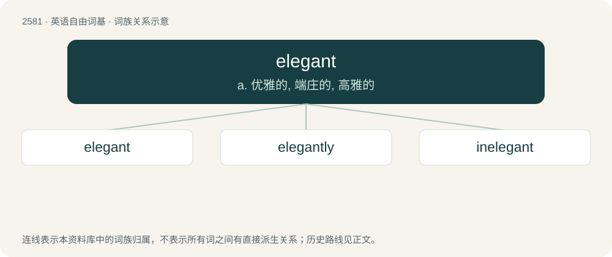

# 2686 · elegant — a. 优雅的, 端庄的, 高雅的

[总目录](../00_总目录_按常用程度.md)

**类型**：英语自由词基　｜　**来源语言**：见词源记录

## 核心含义与来源

- 核心含义：a. 优雅的, 端庄的, 高雅的
- 英文含义：Characterised by or exhibiting elegance; having grace, refinement, or tasteful simplicity.
- 词形：elegant

**来源记录 1**（形容词；Characterised by or exhibiting elegance; having grace, refinement, or tasteful simplicity.）

From Late Middle English elegaunt, from Middle French elegant, ultimately from Latin ēlegāns, collateral form of present participle of ēligere, from ex- (“out of, from”) + legō (“choose, select, appoint”).

## 词族图

## 单词速览（常用到不常用）

| 单词 | 音标 | 释义 |
|---|---|---|
| [elegant](#w-1) | 英 /ˈɛləɡənt/ | a. 优雅的, 端庄的, 高雅的 |
| [elegantly](#w-2) |  | adv. 优美地 |
| [inelegant](#w-3) | /ɪnˈɛlɪɡənt/ | n. 不优美, 不雅, 粗野 |

## 逐词详解

### 1. elegant

**词性**：形容词　｜　**音标**：英 /ˈɛləɡənt/

**中文释义**：a. 优雅的, 端庄的, 高雅的

**英文义项**：Characterised by or exhibiting elegance; having grace, refinement, or tasteful simplicity. / Characterised by minimalism and intuitiveness while preserving exactness and precision.

**词源与演化**：

From Late Middle English elegaunt, from Middle French elegant, ultimately from Latin ēlegāns, collateral form of present participle of ēligere, from ex- (“out of, from”) + legō (“choose, select, appoint”).

**用法示例／搭配（非完整句）**：

> an elegant solution

该用例对应义项：Characterised by minimalism and intuitiveness while preserving exactness and precision.

### 2. elegantly

**词性**：副词

**中文释义**：adv. 优美地

**英文义项**：Gracefully, smoothly, and swiftly; with supreme style.

**构词拆分**：elegant + -ly

**词源与演化**：

From elegant + -ly.

**例句**：

> The members of these groups do not express themselves as accurately or as elegantly as their critics do.

该用例对应义项：in a gracefully elegant manner

### 3. inelegant

**词性**：形容词　｜　**音标**：/ɪnˈɛlɪɡənt/

**中文释义**：n. 不优美, 不雅, 粗野

**英文义项**：Not elegant; not exhibiting neatness, refinement, or precision.

**构词拆分**：in- + elegant

**词源与演化**：

From Middle French inélégant, from Latin inēlegāns; equivalent to in- + elegant.

**例句**：

> Was my sentence incorrect? Or inelegant? Or both? Or neither one nor the other?
