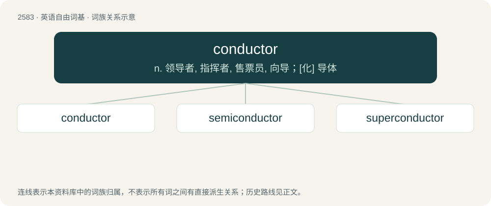

# 2687 · conductor — n. 领导者, 指挥者, 售票员, 向导；\[化\] 导体

[总目录](../00_总目录_按常用程度.md)

**类型**：英语自由词基　｜　**来源语言**：见词源记录

## 核心含义与来源

- 核心含义：n. 领导者, 指挥者, 售票员, 向导；\[化\] 导体
- 英文含义：One who conducts or leads; a guide; a director.
- 词形：conductor

**来源记录 1**（名词；One who conducts or leads; a guide; a director.）

Borrowed from Middle French conductour, from Old French conduitor, from Latin conductor.

## 词族图

## 单词速览（常用到不常用）

| 单词 | 音标 | 释义 |
|---|---|---|
| [conductor](#w-1) | /kənˈdʌktɚ/ | n. 领导者, 指挥者, 售票员, 向导；\[化\] 导体 |
| [semiconductor](#w-2) | 英 /ˌsɛmikənˈdʌktə/；美 /ˌsɛmikənˈdʌktɚ/ | n. 半导体；\[化\] 半导体 |
| [superconductor](#w-3) | /,sjuːpəkənˈdʌktə/ | n. 超导体, 超导电体；\[计\] 超导体 |

## 逐词详解

### 1. conductor

**词性**：名词　｜　**音标**：/kənˈdʌktɚ/

**中文释义**：n. 领导者, 指挥者, 售票员, 向导；\[化\] 导体

**英文义项**：One who conducts or leads; a guide; a director. / A person who conducts an orchestra, choir or other music ensemble; a professional whose occupation is conducting.

**词源与演化**：

Borrowed from Middle French conductour, from Old French conduitor, from Latin conductor.

**用法示例／搭配（非完整句）**：

> train conductor

该用例对应义项：A person who takes tickets on public transportation and also helps passengers.

### 2. semiconductor

**词性**：名词　｜　**音标**：英 /ˌsɛmikənˈdʌktə/；美 /ˌsɛmikənˈdʌktɚ/

**中文释义**：n. 半导体；\[化\] 半导体

**英文义项**：A substance with electrical properties intermediate between a good conductor and a good insulator.

**构词拆分**：semi- + conductor

**词源与演化**：

From semi- + conductor.

**例句**：

> Integrated circuits are made from semiconductors, especially silicon.

该用例对应义项：A substance with electrical properties intermediate between a good conductor and a good insulator.

### 3. superconductor

**词性**：名词　｜　**音标**：/,sjuːpəkənˈdʌktə/

**中文释义**：n. 超导体, 超导电体；\[计\] 超导体

**英文义项**：A substance that has no resistance to conducting an electric current

**构词拆分**：super- + conductor

**词源与演化**：

From super- + conductor, calque of Dutch suprageleider (modern spelling supergeleider).
