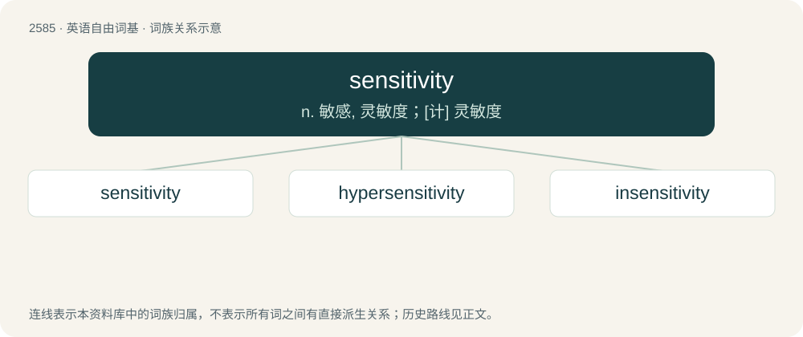

# 2688 · sensitivity — n. 敏感, 灵敏度；\[计\] 灵敏度

[总目录](../00_总目录_按常用程度.md)

**类型**：英语自由词基　｜　**来源语言**：见词源记录

## 核心含义与来源

- 核心含义：n. 敏感, 灵敏度；\[计\] 灵敏度
- 英文含义：The quality or state of being sensitive; sensitiveness.
- 词形：sensitivity

**来源记录 1**（名词；The quality or state of being sensitive; sensitiveness.）

From sensitive + -ity.

## 词族图

## 单词速览（常用到不常用）

| 单词 | 音标 | 释义 |
|---|---|---|
| [sensitivity](#w-1) | 英 /ˌsɛn.sɪˈtɪv.ɪ.ti/；美 /ˌsɛn.səˈtɪv.ə.ti/ | n. 敏感, 灵敏度；\[计\] 灵敏度 |
| [hypersensitivity](#w-2) | /,haipəsensiˈtiviti/ | n. 过敏症, 高灵敏度；\[医\] 过敏\[性\] |
| [insensitivity](#w-3) |  | n. 感觉迟钝；不灵敏性；昏迷 |

## 逐词详解

### 1. sensitivity

**词性**：名词　｜　**音标**：英 /ˌsɛn.sɪˈtɪv.ɪ.ti/；美 /ˌsɛn.səˈtɪv.ə.ti/

**中文释义**：n. 敏感, 灵敏度；\[计\] 灵敏度

**英文义项**：The quality or state of being sensitive; sensitiveness. / The ability of an organism or organ to respond to external stimuli.

**构词拆分**：sensitive + -ity

**词源与演化**：

From sensitive + -ity.

**例句**：

> Since he played with high sensitivity, he only needed to move the mouse a tiny distance to rotate a full 360 degrees.

该用例对应义项：The rate at which the player's facing direction or position changes relative to input device movement.

### 2. hypersensitivity

**词性**：名词　｜　**音标**：/,haipəsensiˈtiviti/

**中文释义**：n. 过敏症, 高灵敏度；\[医\] 过敏\[性\]

**英文义项**：Any heightened immune response to an antigen; an allergy; hypersensation. / The state of being easily offended or hurt.

**构词拆分**：hyper- + sensitivity

**词源与演化**：

From hyper- + sensitivity.

### 3. insensitivity

**词性**：名词

**中文释义**：n. 感觉迟钝；不灵敏性；昏迷

**英文义项**：The condition of being insensitive

**构词拆分**：in- + sensitivity

**词源与演化**：

From in- + sensitivity.

**例句**：

> The English teacher's mocking behavior showcased his own ignorance and insensitivity.
