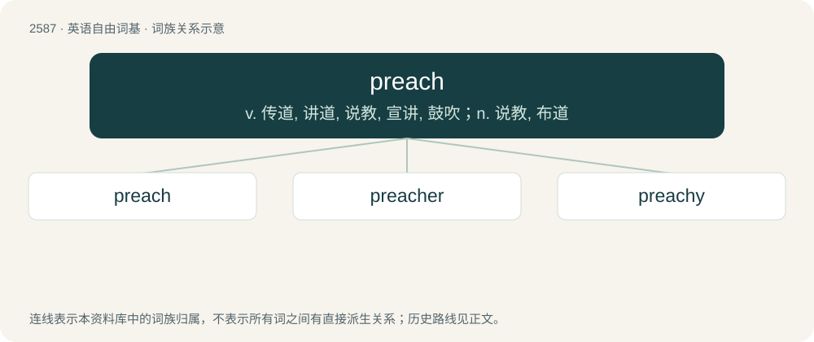

# 2689 · preach — v. 传道, 讲道, 说教, 宣讲, 鼓吹；n. 说教, 布道

[总目录](../00_总目录_按常用程度.md)

**类型**：英语自由词基　｜　**来源语言**：见词源记录

## 核心含义与来源

- 核心含义：v. 传道, 讲道, 说教, 宣讲, 鼓吹；n. 说教, 布道
- 英文含义：To give a sermon.
- 词形：preach

**来源记录 1**（动词；To give a sermon.）

From Middle English prechen, from Old French prëechier, precchier (Modern French prêcher), from Latin praedicō (“to proclaim, announce”, literally “to fore-assign, pre-dedicate”). Doublet of predicate. The Latin word is also the source of Old English predician (“to preach”), Saterland Frisian preetje (“to preach”), West Frisian preekje (“to preach”), Dutch preken (“to preach”), German Low German preken (“to preach”), German predigen (“to preach”), Danish prædike (“to preach”), Swedish predika (“to preach”), Icelandic prédika (“to preach”), Norwegian Nynorsk preika (“to preach”).

## 词族图

## 单词速览（常用到不常用）

| 单词 | 音标 | 释义 |
|---|---|---|
| [preach](#w-1) | 英 /pɹiːt͡ʃ/；美 /pɹit͡ʃ/ | v. 传道, 讲道, 说教, 宣讲, 鼓吹；n. 说教, 布道 |
| [preacher](#w-2) | 英 /ˈpɹiːt͡ʃəː/；美 /ˈpɹit͡ʃɚ/ | n. 传道士, 讲道者, 牧师 |
| [preachy](#w-3) | 美 /ˈpɹit͡ʃi/ | a. 爱讲道的, 爱教训人的 |

## 逐词详解

### 1. preach

**词性**：动词　｜　**音标**：英 /pɹiːt͡ʃ/；美 /pɹit͡ʃ/

**中文释义**：v. 传道, 讲道, 说教, 宣讲, 鼓吹；n. 说教, 布道

**英文义项**：To give a sermon. / To proclaim by public discourse; to utter in a sermon or a formal religious harangue.

**词源与演化**：

From Middle English prechen, from Old French prëechier, precchier (Modern French prêcher), from Latin praedicō (“to proclaim, announce”, literally “to fore-assign, pre-dedicate”). Doublet of predicate. The Latin word is also the source of Old English predician (“to preach”), Saterland Frisian preetje (“to preach”), West Frisian preekje (“to preach”), Dutch preken (“to preach”), German Low German preken (“to preach”), German predigen (“to preach”), Danish prædike (“to preach”), Swedish predika (“to preach”), Icelandic prédika (“to preach”), Norwegian Nynorsk preika (“to preach”).

**例句**：

> Our pastor can preach very well.

该用例对应义项：To give a sermon.

### 2. preacher

**词性**：名词　｜　**音标**：英 /ˈpɹiːt͡ʃəː/；美 /ˈpɹit͡ʃɚ/

**中文释义**：n. 传道士, 讲道者, 牧师

**英文义项**：Someone who preaches a worldview, philosophy, or religion, especially someone who preaches the gospel and especially a clergyman or clergywoman. In a religious context, usually used only to refer to Protestant Christian clergy.

**构词拆分**：preach + -er

**词源与演化**：

From Middle English precher, prechere; partly equivalent to preach + -er, and partly continuing Middle English prechour, prechiour, from Old French preecheor (French prêcheur), from Latin praedicator (“public praiser, proclaimer”). See preach. Displaced native Old English bydel.

**例句**：

> Vanity of vanities, saith the Preacher, vanity of vanities; all is vanity.

### 3. preachy

**词性**：形容词　｜　**音标**：美 /ˈpɹit͡ʃi/

**中文释义**：a. 爱讲道的, 爱教训人的

**英文义项**：Tending toward excessive moralization.

**构词拆分**：preach + -y

**词源与演化**：

From preach + -y.

**例句**：

> My old fussbudget aunt had a very preachy manner and would prattle on about the dangers of alcohol and other vices.

该用例对应义项：Tending toward excessive moralization.
