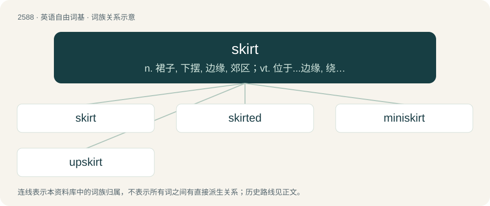

# 2690 · skirt — n. 裙子, 下摆, 边缘, 郊区；vt. 位于...边缘, 绕过, 回避；vi. 位于边缘

[总目录](../00_总目录_按常用程度.md)

**类型**：英语自由词基　｜　**来源语言**：见词源记录

## 核心含义与来源

- 核心含义：n. 裙子, 下摆, 边缘, 郊区；vt. 位于...边缘, 绕过, 回避；vi. 位于边缘
- 英文含义：A separate article of clothing, usually worn by women and girls, that hangs from the waist and covers the lower torso and part of the legs.
- 词形：skirt

**来源记录 1**（名词；A separate article of clothing, usually worn by women and girls, that hangs from the waist and covers the lower torso and part of the legs.）

From Middle English scyrt, skirt, skyrte, skyrthe, skyrtte, from Old Norse skyrta, from Proto-Germanic \*skurtijǭ (“apron; skirt”), from \*skurtaz (“short; deficient”), from \*skertaną (“to cut off”), from Proto-Indo-European \*(s)ker- (“to cut off; to divide”). Doublet of shirt. Cognates Cognate with Yola shoorth, skoorth (“shirt”), North Frisian Sjürt (“shirt”), Saterland Frisian Schoarte (“apron”), Dutch schort (“apron”), German Schürze (“apron”), Danish, Norwegian Bokmål, and Norwegian Nynorsk skjorte (“shirt”), Faroese skjúrta (“shirt”), Icelandic skyrta (“shirt”), Swedish skjorta (“shirt”), Irish sciorta (“skirt; strip”), Welsh sgert (“skirt”).

## 词族图

## 单词速览（常用到不常用）

| 单词 | 音标 | 释义 |
|---|---|---|
| [skirt](#w-1) | 英 /skɜːt/；美 /skɚt/ | n. 裙子, 下摆, 边缘, 郊区；vt. 位于...边缘, 绕过, 回避；vi. 位于边缘 |
| [skirted](#w-2) | /ˈskəːtid/ | a. 有缘的（带裙的） |
| [miniskirt](#w-3) | 英 /ˈmɪnɪskəːt/ | n. 超短裙 |
| [upskirt](#w-4) | 英 /ˈʌpskəːt/ | 【英文】An image of this kind. |

## 逐词详解

### 1. skirt

**词性**：动词　｜　**音标**：英 /skɜːt/；美 /skɚt/

**中文释义**：n. 裙子, 下摆, 边缘, 郊区；vt. 位于...边缘, 绕过, 回避；vi. 位于边缘

**英文义项**：To be on or form the border of. / To move around or along the border of; to avoid the center of.

**词源与演化**：

From Middle English scyrt, skirt, skyrte, skyrthe, skyrtte, from Old Norse skyrta, from Proto-Germanic \*skurtijǭ (“apron; skirt”), from \*skurtaz (“short; deficient”), from \*skertaną (“to cut off”), from Proto-Indo-European \*(s)ker- (“to cut off; to divide”). Doublet of shirt. Cognates Cognate with Yola shoorth, skoorth (“shirt”), North Frisian Sjürt (“shirt”), Saterland Frisian Schoarte (“apron”), Dutch schort (“apron”), German Schürze (“apron”), Danish, Norwegian Bokmål, and Norwegian Nynorsk skjorte (“shirt”), Faroese skjúrta (“shirt”), Icelandic skyrta (“shirt”), Swedish skjorta (“shirt”), Irish sciorta (“skirt; strip”), Welsh sgert (“skirt”).

**例句**：

> He skirted the issue of which parties to attend by staying at home instead.

该用例对应义项：To avoid or ignore (something); to manage to avoid (something or a problem); to skate by (something).

### 2. skirted

**词性**：形容词　｜　**音标**：/ˈskəːtid/

**中文释义**：a. 有缘的（带裙的）

**英文义项**：Wearing a skirt. / Having a skirt.

**构词拆分**：skirt + -ed

**词源与演化**：

From skirt + -ed.

**用法示例／搭配（非完整句）**：

> a skirted topic of conversation

该用例对应义项：Passed around; evaded.

### 3. miniskirt

**词性**：名词　｜　**音标**：英 /ˈmɪnɪskəːt/

**中文释义**：n. 超短裙

**英文义项**：A short skirt with its hemline well above the knees, generally at mid-thigh level.

**构词拆分**：mini- + skirt

**词源与演化**：

From mini- + skirt.

**例句**：

> I think that Tom's grandmother is too old to wear a miniskirt.

### 4. upskirt

**词性**：名词　｜　**音标**：英 /ˈʌpskəːt/

**英文义项**：An image of this kind. / The area inside a skirt, as viewed from below and while being worn.

**构词拆分**：up + skirt

**词源与演化**：

From up + skirt. First attested in 1997. As a verb, in 2008.

**例句**：

> Her upskirt is very frilly.

该用例对应义项：The area inside a skirt, as viewed from below and while being worn.
