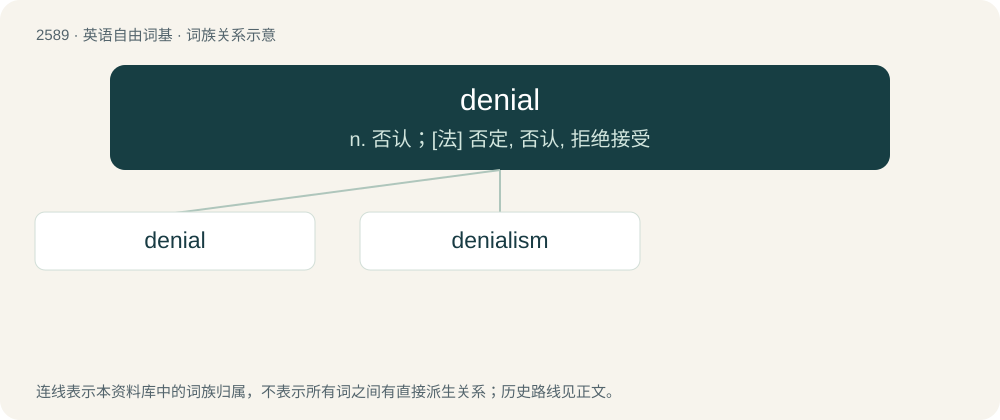

# 2691 · denial — n. 否认；\[法\] 否定, 否认, 拒绝接受

[总目录](../00_总目录_按常用程度.md)

**类型**：英语自由词基　｜　**来源语言**：见词源记录

## 核心含义与来源

- 核心含义：n. 否认；\[法\] 否定, 否认, 拒绝接受
- 英文含义：An assertion of untruth.
- 词形：denial

**来源记录 1**（名词；An assertion of untruth.）

From deny + -al.

## 词族图

## 单词速览（常用到不常用）

| 单词 | 音标 | 释义 |
|---|---|---|
| [denial](#w-1) | 英 /dɪˈnaɪ.əl/ | n. 否认；\[法\] 否定, 否认, 拒绝接受 |
| [denialism](#w-2) | 英 /dɪˈnaɪ(j)əlɪzəm/ | 【英文】The practice of rejecting propositions which are strongly supported by scientific or historical evidence, and often of seeking to influence policy processes and outcomes accordingly. |

## 逐词详解

### 1. denial

**词性**：名词　｜　**音标**：英 /dɪˈnaɪ.əl/

**中文释义**：n. 否认；\[法\] 否定, 否认, 拒绝接受

**英文义项**：An assertion of untruth. / The negation in logic.

**构词拆分**：deny + -al

**词源与演化**：

From deny + -al.

**例句**：

> The denial of medical treatment to those who cannot afford to pay is scandalous.

该用例对应义项：A refusal or failure to provide or grant something that is requested or desired.

### 2. denialism

**词性**：名词　｜　**音标**：英 /dɪˈnaɪ(j)əlɪzəm/

**英文义项**：The practice of rejecting propositions which are strongly supported by scientific or historical evidence, and often of seeking to influence policy processes and outcomes accordingly.

**构词拆分**：denial + -ism

**词源与演化**：

From denial + -ism.

**用法示例／搭配（非完整句）**：

> climate denialism; vaccine denialism; Holocaust denialism

该用例对应义项：The practice of rejecting propositions which are strongly supported by scientific or historical evidence, and often of seeking to influence policy processes and outcomes accordingly.
