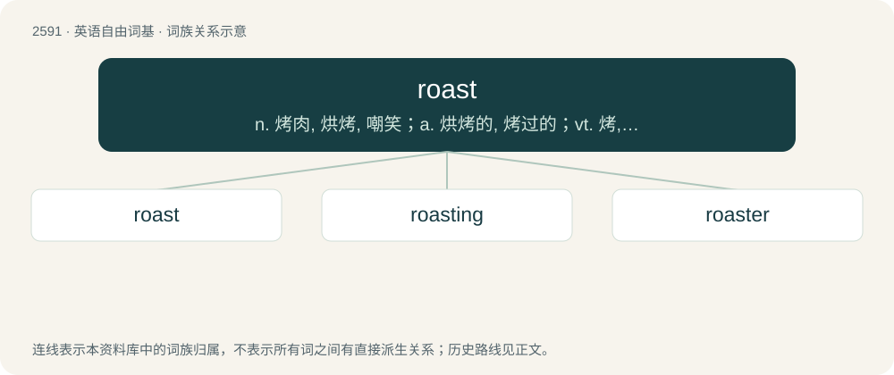

# 2692 · roast — n. 烤肉, 烘烤, 嘲笑；a. 烘烤的, 烤过的；vt. 烤, 炙, 烘焙, 嘲笑

[总目录](../00_总目录_按常用程度.md)

**类型**：英语自由词基　｜　**来源语言**：见词源记录

## 核心含义与来源

- 核心含义：n. 烤肉, 烘烤, 嘲笑；a. 烘烤的, 烤过的；vt. 烤, 炙, 烘焙, 嘲笑
- 英文含义：To cook food by heating in an oven or over a fire without covering, resulting in a crisp, possibly even slightly charred appearance.
- 词形：roast

**来源记录 1**（动词；To cook food by heating in an oven or over a fire without covering, resulting in a crisp, possibly even slightly charred appearance.）

From Middle English rosten, a borrowing from Old French rostir (“to roast, to torture with fire”), from Frankish \*rōstijan (“to roast, broil”), from Proto-Germanic \*raustijaną (“to roast”), from Proto-Indo-European \*Hrews- (“to crackle; roast”). Cognate with Saterland Frisian rosterje (“to roast”), Dutch roosten, roosteren (“to roast”), German rösten (“to roast”). Displaced native Middle English breden, bræden (“to roast”), from Old English brǣdan, related to German braten (“to roast, grill”). The noun is from Middle English roste, from Old French rost, roste, from the verb.

## 词族图

## 单词速览（常用到不常用）

| 单词 | 音标 | 释义 |
|---|---|---|
| [roast](#w-1) | 英 /ɹəʊst/；美 /ɹoʊst/ | n. 烤肉, 烘烤, 嘲笑；a. 烘烤的, 烤过的；vt. 烤, 炙, 烘焙, 嘲笑 |
| [roasting](#w-2) | 英 /ˈɹəʊstɪŋ/；美 /ˈɹoʊstɪŋ/ | a. 非常热的；adv. 非常热地 |
| [roaster](#w-3) | /ˈrəustə/ | n. 炙烤的人, 烘烤器, 焙烧炉；\[化\] 焙烧炉; 煅烧炉 |

## 逐词详解

### 1. roast

**词性**：动词　｜　**音标**：英 /ɹəʊst/；美 /ɹoʊst/

**中文释义**：n. 烤肉, 烘烤, 嘲笑；a. 烘烤的, 烤过的；vt. 烤, 炙, 烘焙, 嘲笑

**英文义项**：To cook food by heating in an oven or over a fire without covering, resulting in a crisp, possibly even slightly charred appearance. / To cook by surrounding with hot embers, ashes, sand, etc.

**词源与演化**：

From Middle English rosten, a borrowing from Old French rostir (“to roast, to torture with fire”), from Frankish \*rōstijan (“to roast, broil”), from Proto-Germanic \*raustijaną (“to roast”), from Proto-Indo-European \*Hrews- (“to crackle; roast”). Cognate with Saterland Frisian rosterje (“to roast”), Dutch roosten, roosteren (“to roast”), German rösten (“to roast”). Displaced native Middle English breden, bræden (“to roast”), from Old English brǣdan, related to German braten (“to roast, grill”). The noun is from Middle English roste, from Old French rost, roste, from the verb.

**例句**：

> I'm late home for the fourth time this week; my mate will really roast me this time.

该用例对应义项：To admonish someone vigorously.

### 2. roasting

**词性**：形容词　｜　**音标**：英 /ˈɹəʊstɪŋ/；美 /ˈɹoʊstɪŋ/

**中文释义**：a. 非常热的；adv. 非常热地

**英文义项**：Very hot.

**构词拆分**：roast + -ing

**词源与演化**：

From Middle English rostynge; equivalent to roast + -ing.

**例句**：

> The day started out cool, but by noon it was roasting.

该用例对应义项：Very hot.

### 3. roaster

**词性**：名词　｜　**音标**：/ˈrəustə/

**中文释义**：n. 炙烤的人, 烘烤器, 焙烧炉；\[化\] 焙烧炉; 煅烧炉

**英文义项**：Someone who roasts coffee beans; a company or place of business that does so. / A machine for roasting things; especially, one that roasts coffee beans.

**构词拆分**：roast + -er (agent noun suffix)

**词源与演化**：

From Middle English roster, roostare, equivalent to roast + -er (agent noun suffix) or + -er (patient suffix). Same formation as roster, although the words have very different meanings.

**例句**：

> Having been dumped out of the mine cars, the ore then moves along a conveyor to the roaster.

该用例对应义项：A type of industrial furnace; especially, one that roasts ore.
